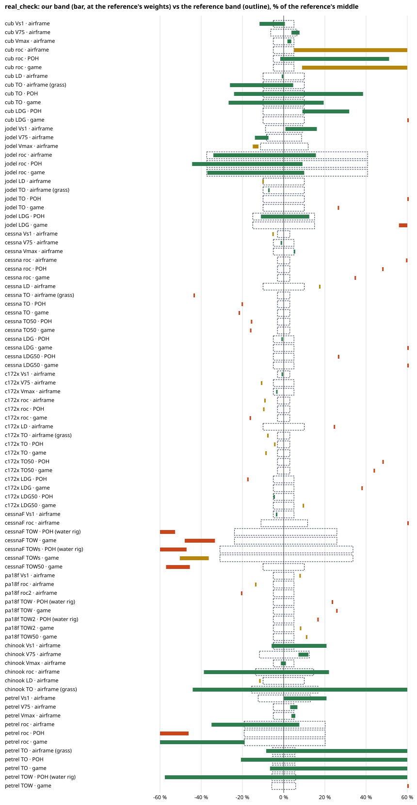

# REAL CHECK — the planes against their real figures, with bands (2026-11-07)

The user, 7 Nov: *"The testing of plane against real figures. I want to make it a lot more official with maybe a dedicated
tool ... We should not have a single number. We should have a range on our side, testing with the max load, the minimum
load ... We also have to make sure that our results are not biased by the pilot maybe not behaving optimally ... the tool
is not starting from a blank sheet."*

- The tool: `tools/real_check.js` (the runner) and `tools/real_refs.js` (the reference rows with their conditions, the
  plane list, the history).
- The evidence: `reports/evidence/REAL-CHECK-2026-11-07/` (one JSON per plane, the chart, the generated sections, the
  cards' re-run).
- Core and planes: unchanged. No physics, pilot or build file was edited. Every override is a pilot schedule on the
  process's own copy of `def.params`.

```
node tools/real_check.js cub              one plane, flown (runtimes in §1.1)
node tools/real_check.js cub --quick      the airframe band only, no flights (3-20 s a plane)
node tools/real_check.js --all --jobs=4   the master-branch set, one process per plane (62 min wall, 4 cores)
node tools/real_check.js --build=f.json --ref=c172r [--water]    any build against any reference row
```

## 1. How it works

**The reference is a band.** Every figure in `real_refs.js` carries the conditions it was stated at:
- the weight: `gross`, a number, `solo`, or `unknown`;
- the flaps, the surface, the altitude and temperature;
- the book's scatter (`tol`);
- the source.

A weight the source does not state becomes a range, from one light pilot with reserves up to gross. Brochure ranges stay
ranges ("1000–1400 fpm", the D.112's "800 fpm / 2 m/s").

**Our side is a band.** Every indicator is measured at three loads, put aboard through the game's own door: the frame's
seat billing (`freightStrapSeatBill`, `freightStrapBaggage`) into `sim.setFreight`, and the fuel through the burn's node
records. The three loads:

| case | load |
|---|---|
| MIN | one 70 kg pilot, ¼ fuel, no baggage |
| TYP | one 80 kg pilot, ½ fuel (the brochure's "solo, half fuel") |
| MTOW | every seat at the game's 80 kg, full fuel, baggage topped (or the fuel trimmed) to the **type's** gross |

`--cg` (on by default for the official Cessna) adds MTOW with the load forward and with it aft.

**The verdict** compares our values at the reference's weights (interpolated over the three loads) with the reference
band:
- **inside**: the two overlap;
- **near**: within 10 %;
- **outside**: further.

Outside the loads we flew, the band follows the MIN-to-MTOW secant for at most 15 % of the mass, never below zero, and
the verdict is marked **(extrap.)**. It also gives the weight at which ours equals theirs. That weight names the load that explains the figure; for example,
the Petrel's brochure climb is matched at 486 kg, which is solo with half fuel.

**The pilot is kept apart.** Each flown number has four readings:

| reading | what flies it |
|---|---|
| airframe | the analytic probes: power required against power available over the speed sweep, the excess-power climb, `genTORunAt`. No pilot. |
| POH | the game's own pilot (Expert, calm, deterministic) on a fixed handbook schedule: rotate, take-off and landing flap, Vy, the approach at 1.3 Vs0, braking. The speeds are ratios to the build's own stall at the load flown. |
| best | the schedule swept at one load (MTOW): rotate 1.0/1.1/1.2 Vs × take-off flap; climb at 0.85/1.0/1.15 × the probe's Vy; three braking and approach settings. The best result is kept. |
| game | the pilot as it ships. |

`game − best` is **the pilot's share**. `best − reference` (at the reference's weight) is the airframe's share.

**The test conditions:**
- Land runs are flown on a flat copy of the world: terrain 0, no trees or obstacles, the reference's surface (paved or
  grass), no wind, ISA. This keeps out the climb-out's "ground ahead → Vx" rule, which the 21 Sep runs carried.
- Water runs use GATE HYDROTRIM's rig (`hydro_trim_table.fly`: the floatplane supplement's technique, and the G3390 rig
  with no flap) and the game's pilot off the SEA lane.

### 1.1 Runtime (measured 7 Nov on the 4-core cloud box)

| run | wall |
|---|---|
| `--quick` (airframe, 3 to 5 loads) | 3-20 s a plane |
| Cub / Jodel / official Cessna (5 loads) / 172 corrected / Chinook | 22 / 53 / 44 / 33 / 15 min |
| float Cessna / PA-18 floats (water) | 17 / 12 min |
| the 7 master planes, `--jobs=4` | **62 min** |
| Petrel V4.1, land + water, alone on its branch | 116 min (the amphibian steps at ~0.8× real time) |

A full plane is 18-22 flights: 2 circuits × 3 loads, then 9 climb-outs and 3 circuits in the sweep. The water planes
add the rig twice and the game's pilot once per load.

## 2. The consolidated table: every plane ever compared to its real figures

"Then" is as printed in the source. "Now" is today's re-run of the same build, through the same door for the builds and
through `perf_study.js` (unchanged) for the cards. Units: kg, km/h, m/s, m. Flown numbers are the game's pilot.

### 2.1 The validated / official builds

| plane (build) | date | then (bench; flown) | now at the same weight (bench; flown) | source | still in the game |
|---|---|---|---|---|---|
| Piper Cub `cub_2026-09-20_corrected.json` | 09-20 / 09-21 | empty 352–354, Vs 62, V75 123–126, Vmax 142–145, ROC 2.4–2.5, L/D 9.4–9.6, TO 106–118; flown TO 144–145, climb 1.9–2.1, LDG 79 / 170 | empty 355, Vs 62, V75 124, Vmax 143, ROC 2.40, L/D 9.4, TO 118; flown TO 135, climb 2.49, LDG 160 | CUB-STUDY-2026-09-20, ACCURACY-SHEET-2026-09-21 | **yes, official**; re-run |
| Jodel D112 `jodel_2026-09-20_corrected.json` | 09-20 / 09-21 | empty 338–341, Vs 72, V75 134, Vmax 159–160, ROC 2.0, L/D 9.0, TO 183–197; flown TO 262–287, climb 1.4–1.6, LDG 87 / 243 | empty 344, Vs 73, V75 134, Vmax 159, ROC 2.00, L/D 9.0, TO 185; flown TO 252, climb 1.91, LDG 247 | JODEL-STUDY-2026-09-20, ACCURACY-SHEET | **yes, official**; re-run |
| Cessna 172 corrected `cessna172_2026-09-20_corrected.json` (IO-360 dials) | 09-20 / 09-21 | empty 641–664, Vs 93, V75 193–194, Vmax 220–221, ROC 3.3, L/D 11.1–11.2, TO 264–301, TO50 370–410; flown TO 308–428, climb 2.5, LDG 206–227 | empty 639, Vs 93, V75 194, Vmax 221, ROC 3.31, L/D 11.2, TO 265; flown TO 262, TO50 738, climb 3.05, LDG 231 | C172-STUDY-2026-09-20, ACCURACY-SHEET | yes, internal ("kept for the gates"); re-run as `c172x` |
| Metal Cessna B-CESS `cessna172_2026-09-20.json` (= the 20 Sep "as found") | 09-20 | on the io360 row: empty 632, Vs 89, V75 194, Vmax 219, ROC 4.0, TO 215; flown TO 266, climb 3.2, LDG 384. As saved (O-540): ROC 6.8, TO 150 (shakedown) | on its O-540 at 1111 kg: empty 710, Vs 89, V75 215, Vmax 241, ROC 5.83, TO 162; flown TO 225, climb 4.92, LDG 656 | C172-STUDY-2026-09-20 §1.1 | **yes, official**; re-run |
| Chinook `chinook_2026-09-21_corrected.json` | 09-21 | at 340 kg: empty 219, Vs 58, V75 125, Vmax 140, ROC 5.0, L/D 7.7, TO 52; flown TO 101, climb 2.5, LDG 74 | empty 235, Vs 57, V75 138, Vmax 154, ROC 5.9, L/D 8.8, TO 59 (at 329 kg); **not flyable** today (the pilot rejects the take-off: GATE ARCHETYPES' standing red) | CHINOOK-STUDY-2026-09-21, ACCURACY-SHEET | yes, official (out of the battery); airframe re-run |
| 172R on Wipline 2350, STC prop, 1157 kg | 10-20 | water, supplement technique: 30.7 s, 442 m (rig 38.8 s / 687 m) | not re-run (GATE HYDROTRIM's own build; not an official plane) | HANDOVER G3440-G3443 | yes (GATE HYDROTRIM) |
| PA-18 on floats `pa18_floats_2026-10-23.json` | 11-03 | the game's pilot at 753 kg: lift-off 22.6 s, 235 m (no reference was set then) | at 693 / 806 kg: 16.5 s / 187 m and 27.5 s / 297 m (interpolated at 753 kg ≈ 240 m) | evidence/FLOATS-CLASSIC/water_runs_node.txt | **yes, official**; re-run |
| Metal Cessna on floats `cessna172_floats_2026-11.json` | — | never compared before | §4 | — | **yes, official**; new |
| Super Petrel B54 (no wheels) | 11-06 | at 600 kg: empty 338, Vs 75, V75 162, Vmax 184, ROC 3.9, L/D 9.7; water 25.1 s | superseded by V4.1 | claude/hull-types PETREL-STUDY-2026-11-06 | on claude/hull-types |
| Super Petrel V2, solo half fuel (475 kg) | 11-06 | Vs 67, V75 166, Vmax 186, ROC 5.5, TO 74; flown TO 119, climb 4.1, LDG 290 | superseded by V4.1 | hull-types HANDOVER HULL-B76 | on claude/hull-types |
| Super Petrel V3 / V4 / **V4.1** at gross | 11-07 | empty 373/380/380, V75 161/164/164, Vmax 183/186/186, ROC 3.9/4.0/4.0, L/D 9.7/9.9/9.9; flown TO 180/183/182, climb 2.7/2.7/2.9, LDG 258/368/363; water 25.7/26.6/26.3 s | V4.1: §4 | hull-types HANDOVER HULL-B80 | on claude/hull-types (V4.1 final); re-run from a worktree |

### 2.2 The 12 recreation cards (PERF-STUDY-2026-09-15)

Each cell reads §2 (birth spec, 15 Sep morning) → §6 (joined, after chantiers G428-G431, 15 Sep evening) → today
(`node tools/perf_study.js`, the same instrument):

| card | empty | Vs1 | V75 | Vmax | ROC | L/D | TO roll |
|---|---|---|---|---|---|---|---|
| cub | 331 → 354 → 354 | 70 → 65 → 62 | 126 → 126 → 123 | 146 → 145 → 142 | 2.3 → 2.4 → 2.4 | 8.9 → 9.4 → 9.4 | 224 → 122 → 118 |
| pietenpol | 326 → 339 → 341 | 71 → 68 → 69 | 123 → 143 → 142 | 144 → 162 → 161 | 2.5 → 3.2 → 3.2 | 8.0 → 9.2 → 9.1 | 230 → 131 → 135 |
| tigermoth | 506 → 574 → 569 | 70 → 69 → 70 | — → 146 → 144 | 114 → 170 → 168 | 0.3 → 3.0 → 2.9 | 8.3 → 8.7 → 8.4 | 389 → 144 → 167 |
| stearman | 786 → 894 → 901 | 77 → 77 → 80 | 230 → 158 → 151 | 256 → 183 → 176 | 11.0 → 3.7 → 3.4 | 8.7 → 7.9 → 7.5 | 80 → 150 → 204 |
| d119 | 374 → 348 → (gone) | 84 → 84 → — | 154 → 182 → — | 177 → 203 → — | 3.3 → 4.4 → — | 9.3 → 11.4 → — | 248 → 154 → — |
| c172 | 412 → 640 → 641 | 94 → 95 → 93 | 181 → 203 → 195 | 207 → 230 → 222 | 4.0 → 4.0 → 3.3 | 9.3 → 11.0 → 11.2 | 247 → 222 → 265 |
| caravan | 558 → 1179 → 1137 | 94 → 143 → 143 | 282 → 282 → 283 | 304 → 308 → 309 | 17.2 → 5.6 → 5.7 | 11.3 → 12.3 → 12.3 | 90 → 470 → 433 |
| rv | 435 → 484 → 473 | 94 → 93 → 93 | 194 → 240 → 240 | 218 → 263 → 263 | 5.7 → 7.3 → 7.3 | 9.3 → 12.5 → 12.6 | 187 → 188 → 138 |
| savannah | 302 → 370 → 353 | 77 → 77 → 77 | 131 → 144 → 144 | 156 → 166 → 166 | 2.2 → 2.7 → 2.8 | 8.2 → 8.7 → 8.8 | 238 → 172 → 163 |
| mw5 | 283 → 213 → 208 | 61 → 55 → 55 | 110 → 100 → 101 | 128 → 116 → 116 | 3.0 → 3.2 → 3.2 | 7.0 → 6.7 → 6.6 | 87 → 67 → 53 |
| da62 | 652 → 973 → 965 | 98 → 129 → 129 | 233 → 237 → 238 | 256 → 264 → 265 | 9.8 → 4.2 → 4.3 | 10.9 → 12.1 → 12.2 | 139 → 425 → 404 |
| beaver | 660 → 1115 → 1114 | 77 → 115 → 115 | 246 → 238 → 238 | 271 → 267 → 266 | 11.8 → 5.2 → 5.2 | 11.3 → 11.0 → 11.0 | 87 → 444 → 400 |

The cards are not official planes, and real_check does not fly them. The card pass stays perf_study's (`node
tools/perf_study.js`, ~3 min); its full output today is in the evidence (`cards_now.md`).

**What changed since 15 Sep, and why.**
- **cub, c172 and jodel are no longer recreations.** Since G445.4 these cards ARE the user's corrected builds:
  - the `jodel` card became the D.112 (the D.119 row is gone);
  - the `c172` card's V75 203 → 195 and ROC 4.0 → 3.3 are the user's corrected airframe replacing the recreation; it now
    reads exactly the accuracy sheet's 172 (ROC 3.3, TO 264-265).
- **The empty weights moved by 1-5 %** on most cards: the G445.7-8 mass rules (the aft lattice by section, the tail at
  the J-3's weight, the engine installation) and G466's aluminium-tube row.
- **The analytic take-off roll moved on 8 of 12 cards** (Stearman +36 %, Tiger Moth +16 %, RV −27 %, MW5 −21 %, Caravan /
  Beaver / DA62 −5 to −10 %), with no matching move in Vs, ROC or V75. The Stearman's wing also went 28.8 → 27.9 m²
  (its REF_MATCH refit). The take-off change is **not traced in this session**. It is not a regression on any official
  plane: the Cub's, Jodel's and corrected 172's rolls are within 1 % of 21 Sep.

**What changed on the builds since 20-21 Sep.**
- The airframe readings are within 1-3 % of 21 Sep on the Cub, the Jodel and the corrected 172. Nothing moved the
  validated aeroplanes' Vs, V75, Vmax, ROC or analytic roll.
- The flown numbers moved, and for three reasons:
  - **The climb reads higher** (Cub 1.9 → 2.49, Jodel 1.4 → 1.91, 172 2.5 → 3.05). The 21 Sep figure was the mean over
    the whole CLIMB phase on the real world: the Vx leg the "ground ahead" rule flew at HOME, and the transitions. Today's
    figure is 60 → 250 m on flat ground, so it is a method change, not a model change.
  - **The take-off runs shortened** (Cub 145 → 135, 172 308-428 → 262): the pilot's take-off work since (PILOT-ONE,
    G3077's rotate pull, G3800's tailwheel laws).
  - **The landing rolls** (Cub 79 → 160, 172 206 → 231) depend on where the flare puts the wheels. The 21 Sep sheet
    printed both 79 and 170 for the same Cub on two days. It is the pilot's number, and §5 shows it is the pilot's gap.
- The official Cessna was never compared on its own engine before. The 20 Sep "as found" run swapped in the io360 row.

## 3. The band tables (the official planes)

Generated by the tool; the full sections (every load, every flight, every verdict) are in
`evidence/REAL-CHECK-2026-11-07/sections.md`. Here, the verdicts. The "equals at" column gives the weight at which ours
equals the reference's middle (— means the indicator barely moves with weight, or the curves never meet).

### 3.1 Piper Cub (official) vs J-3C-65 — 10 inside, 2 near, 1 outside

| indicator | reading | reference (band) | at kg | ours | verdict | equals at |
|---|---|---|---|---|---|---|
| empty | ledger | 345 (335–355) | — | 355 | inside | — |
| Vs1 | airframe | 61 (58–64) | 423–550 | 54–62 | inside | 544 kg (gross) |
| V75 | airframe | 117–121 | 423–550 | 124–128 | inside | — |
| Vmax | airframe | 140 | 423–550 | 143–145 | inside | — |
| ROC | airframe / POH / game | 2.29 (2.17–2.40) | 423–550 | 2.40–3.73 / 2.25–3.46 / 2.49–3.82 | near / inside / near | 561 / 547 / 570 kg (gross) |
| L/D | airframe | 9.5 | — | 9.4 | inside | — |
| TO roll | airframe / POH / game | 113 (101–124) | 423–550 | 83–118 / 85–156 / 83–135 | inside ×3 | 470–531 kg |
| LDG roll | POH / game | 88 (80–97) | 423–550 | 96–116 / 159–160 | inside / **outside** | — |

The J-3's sheet reads as a GROSS-weight sheet: Vs, ROC and the roll all meet ours at 530-570 kg. Only the landing roll is
out, and only for the game's pilot (§5).

### 3.2 Jodel D112 (official) vs D.112 — 7 inside, 3 near, 3 outside

| indicator | reading | reference | at kg | ours | verdict | equals at |
|---|---|---|---|---|---|---|
| empty | ledger | 320 (304–336) | — | 344 | near (+7.5 %) | — |
| Vs1 | airframe | 60–65 (club figure) | 398–530 | 63–73 | inside | 392 kg (under MIN) |
| V75 | airframe | 150–161 | 398–530 | 134–144 | inside (at the light end) | — |
| Vmax | airframe | 175–200 (the source line is ambiguous) | 398–530 | 159–164 | near (−6 to −9 % on 175) | — |
| ROC | airframe / POH / game | 2.0–4.06 ("800 fpm / 2 m/s") | 398–530 | 2.00–3.55 / 1.69–3.34 / 1.91–3.30 | inside ×3 | 420–438 kg (MIN) |
| L/D | airframe | 10 | — | 9.0 | near | — |
| TO roll | airframe (grass) / POH / game | 200 at gross | 530 | 185 / 440 / 252 | inside / **outside** / **outside** | 451–558 kg |
| LDG roll | POH / game | 150 | 398–530 | 133–169 / 234–247 | inside / **outside** | — |

The D.112's thin book reads as a light-load sheet. Its climb is met only at MIN (one light pilot, quarter fuel), its
stall below MIN. The airframe is 5-10 % slow (V75 inside only at the light end, Vmax 6-9 % under the lower figure) and 7 % heavy.

The flown take-off is 36 % over the airframe's even at the best technique (best 246 m at rotate 1.1 Vs, with 0.25 flap a
D.112 does not have; 258-283 m without). At rotate 1.2 Vs it runs 441 m: a taildragger held on the ground past the
three-point unstick. The airframe's 185 m is not reached by any schedule in the sweep. At MIN the pilot went around twice
and ran out the clock: the light Jodel floats past the aim (§6).

### 3.3 Metal Cessna B-CESS (official) vs 172R POH — 3 inside, 3 near, 11 outside (on another engine)

| indicator | reading | reference (POH, 1111 kg) | ours at 1111 kg | verdict | equals at |
|---|---|---|---|---|---|
| empty | ledger | 736 | 710 | near (−4 %) | — |
| Vs1 | airframe | 94 (51 KCAS) | 89 | near | 1232 kg |
| V75 / Vmax | airframe | 219 / 230 | 215 / 241 | inside / inside | — |
| ROC | airframe / POH / game | 3.66 | 5.83 / 5.41 / 4.92 | outside ×3 | 1273-1335 kg |
| TO roll | airframe / POH / game | 288 (flaps 10, paved) | 162 / 229 / 225 | outside ×3 | 1292-1344 kg |
| TO 50 ft | POH / game | 514 | 432 / 430 | outside | 1275 kg |
| LDG roll | POH / game | 168 (flaps 30, max braking) | 166 / 656 | **inside** / outside | 1108 kg |
| LDG 50 ft | POH / game | 395 | 499 / 1079 | outside / outside | — |

B-CESS flies an O-540 235 hp on an 18.4 m² wing; the 172R has an IO-360 160 hp on 16.2 m². Every power-bound row is
therefore out the "good" way (it climbs and leaves like a 172R 170-230 kg heavier), and is not a model finding.

The landing rows are the finding: CESSNA-TAIL, in §6. On the POH schedule (30° of flap, firm braking) the roll is inside
at MTOW with an aft CG (166 m). It is 379-406 m at light loads and 581 m at MTOW with the load forward, where the
elevator cannot hold the flap. The game's pilot lands it flapless at every load: 614-856 m.

### 3.4 Cessna 172 corrected (internal, IO-360 dials) vs 172R POH — 3 inside, 7 near, 7 outside: the like-for-like 172

| indicator | reading | reference (1111 kg) | ours | verdict |
|---|---|---|---|---|
| empty | ledger | 736 | 639 | **outside** (−13 %, the C172 study's known item) |
| Vs1 / V75 / Vmax | airframe | 94 / 219 / 230 | 93 / 194 / 221 | inside / near (−11 %) / inside |
| ROC | airframe / POH / game | 3.66 | 3.31 / 3.29 / 3.05 | near / near / outside (−17 %) |
| L/D | airframe | 9.0 | 11.2 | **outside** (+24 %) |
| TO roll | airframe / POH / game | 288 | 265 / 275 / 262 | near ×3 (−5 to −9 %) |
| TO 50 ft | POH / game | 514 | 760 / 738 | **outside** (+44-48 %) |
| LDG roll | POH / game | 168 | 138 / 231 | outside (−18 %) / outside (+37 %) |
| LDG 50 ft | POH / game | 395 | 375 / 431 | inside / near |

The roll is right, and the climb-out after the roll is not: 485 m from lift-off to 50 ft against the POH's 226 m. The
sweep's best is 657 m (§7, gap 3). This 172 lands with its full 40° slotted flap (its tail holds it: approach trim 0.09).

### 3.5 Metal Cessna on floats (official) vs 172 on Wipline 2350 — 1 inside, 2 near, 6 outside (on another engine)

- Vs1 is inside: 91 km/h at 1157 kg.
- The power-bound rows are out because of the engine, not the floats:
  - water run: 126-198 m on the supplement's technique, 179-282 m on the rig, 217-279 m for the game's pilot, against
    335-501 m;
  - time: 10-17 s against 20-35 s;
  - climb: 7.3-8.8 m/s against 3.4-3.8.
- The game's pilot lifts it off in 13.6-17.5 s. Ours equals theirs only at 1370-1600 kg, 200-450 kg over the float gross.
- With two aboard and a quarter of the fuel the build is still 83 kg over Wipaire's 1157 kg gross (empty 842 kg against a
  172 + 2350's ~886).

### 3.6 PA-18 on floats (official) vs Wipaire PA-18 on Wipline 2100 (160 hp) — 1 inside, 5 near, 4 outside

| indicator | reading | reference | ours | verdict | equals at |
|---|---|---|---|---|---|
| Vs1 | airframe | 69 (43 mph) at 806 kg | 74 | near | 695 kg |
| ROC at 806 / 907 kg | airframe | 4.70 / 3.84 | 4.05 / 3.04 (extrap.) | near / outside (−14 / −21 %) | 738 / 827 kg |
| water run at 806 kg | POH rig / no-flap rig / game | 237 | 292 / 260 / 297 | outside / near / outside | 744-780 kg |
| water run at 907 kg | POH rig / no-flap rig / game | 358 | 416 / 345 / 386 (extrap.) | outside / inside / near | 854-916 kg |
| 50 ft off water, 806 kg | game | 394 | 437 | near | 774 kg |

The engine is 150 hp against the reference's 160 (−6 % power). The references are amphibians, ~150 lb heavier than the
build's seaplane floats for the same gross: on a like-for-like float the reference would be better still. The model
reads 50-80 kg "heavy" on every water and climb row: a climb deficit of 14-21 %, the size of the ACCURACY SHEET's "climb
rows 10-20 % short on every matched engine" (the propeller's climb-speed efficiency).

On the PA-18 the no-flap rig beats the supplement's 20° of flap at gross (260 vs 292 m): the flapped hump costs more
than it saves.

### 3.7 Chinook (official, out of the battery) vs Chinook Plus 2 — airframe only: 5 inside, 2 near

Vs, V75, Vmax, ROC and the analytic roll are all inside, met at 327-349 kg: the one-up sheet, as the 21 Sep ruling read
it. The empty weight is 235 kg against the sheet's 380-460 lb (172-209 kg: near, +12 % on the heavier figure) and the L/D 8.8 against 10 (near). **Not flown**: the pilot
rejects the take-off on the flat world and at HOME alike (GATE ARCHETYPES' standing red, "Chinook-alike: rejected-
takeoff"). Since 21 Sep (flown TO 101, climb 2.5) the Chinook has stopped flying.

### 3.8 Super Petrel V4.1 (claude/hull-types) vs Super Petrel LS

Flown from a worktree of `claude/hull-types` at 60892db5, with that branch's core and rows. Build
`builds/candidates/superpetrel_V4_1.json` through that tree's load door: 99 hp 912 iS, S 14.5 m², empty 380 kg, two
side by side, 72 L. Result: 10 inside, 0 near, 3 outside. Several bands are flagged "extrap." because the brochure's
light case (320 kg empty) is 57 kg under our lightest load (the build is 60 kg heavy empty).

| indicator | reading | reference | at kg | ours | verdict | equals at |
|---|---|---|---|---|---|---|
| empty | ledger | 320 (304–336) | — | 380 | **outside** (+19 %) | — |
| Vs1 | airframe | 56–68 | 406–600 | 62–75 | inside (extrap.) | 410 kg |
| V75 / Vmax | airframe | 159 / 180 | 406–600 | 164–170 / 186–190 | inside / inside | — |
| ROC | airframe / POH / game | 1000–1400 fpm (5.1–7.1) | 406–600 | 3.96–6.56 / 2.07–3.28 / 2.42–4.94 | inside / **outside** / inside | 445 kg (airframe) |
| TO roll, land | airframe / POH / game | 79–80 | 406–600 | 73–128 / 63–187 / 74–192 | inside (extrap.) | 337–427 kg |
| water run | supplement rig / no-flap rig / game | 120–122 | 406–600 | 51–338 / 53–463 / 317 (MTOW only; MIN/TYP missing, see 2. below) | inside (extrap.) / inside (extrap.) / **outside** | 418 kg |

**The brochure is a solo sheet.** The stall, climb and runs all meet ours at 410-445 kg: one aboard, light fuel, on a
320 kg airframe. HULL-B76 found the same (475 kg).

At the weights we can fly:
- at TYP (486 kg): ROC 5.4, Vs 67, land roll 95-114 m, water 200-227 m;
- at MTOW (600 kg): ROC 4.0, Vs 75, land roll 128-192 m, water 317-463 m.

The cruise end (V75, Vmax) is inside at every load.

**Two Petrel findings for the hull-types branch:**
1. **Solo, the V4.1 sits at a 3-4 % static margin** (CG 31-32 % MAC), against 16 % at MTOW. The seats are ahead of the
   CG on a pusher, so taking the passenger out moves the CG aft.
2. **No water reading from the game's pilot at MIN or TYP.** In the harness it reached STOPPED in 160-180 s without a
   run. At MTOW it flies: 317 m, 25.1 s, matching HULL-B80's 26.3 s. At its as-baked load, without the harness's load
   door, it departs normally (lift-off 24.8 s). The two failing cases are the only water cases where the harness changed
   the fuel (setNodeMass on a hydro sim), so this may be the harness, not the pilot. **Owed**, not traced.

Then against now: HULL-B80's V4.1 at gross read empty 380, ROC 4.0, V75 164, Vmax 186; flown TO 182, climb 2.9, LDG 363;
water 26.3 s. Today: 380, 3.96, 164, 186; flown 192, 2.42, 457; water 25.1 s. The airframe is identical. The flown climb
and landing differ by method: flat world, the 60-250 m window, and a different landing-roll datum (touchdown to stop).

## 4. The chart

`evidence/REAL-CHECK-2026-11-07/real_check.svg`: one row per plane × indicator × reading.
- The outline is the reference band.
- The bar is our band at the reference's weights.
- Colour: green inside, amber near, red outside.
- Scale: % of the reference's middle, clipped at ±60 %.



## 5. Pilot against airframe

| plane (sweep load) | TO roll: game / best / airframe | TO 50 ft: game / best | climb m/s: game / best / airframe | LDG roll: game / best | pilot's share (game − best) |
|---|---|---|---|---|---|
| Cub (550) | 135 / 130 / 118 | 433 / 358 | 2.49 / 2.61 / 2.40 | 160 / 68 | TO +5 m, 50 ft +75 m, climb −0.12, **LDG +92 m** |
| Jodel (530) | 252 / 246 / 185 | 782 / 594 | 1.91 / 2.00 / 2.00 | 247 / 84 | TO +6, 50 ft +188, climb −0.09, **LDG +163** |
| B-CESS (1111) | 225 / 213 / 162 | 430 / 408 | 4.92 / 6.33 / 5.83 | 656 / 137 | TO +12, 50 ft +22, **climb −1.42**, **LDG +519** |
| 172 corrected (1111) | 262 / 275 / 265 | 738 / 657 | 3.05 / 3.46 / 3.31 | 231 / 117 | TO −12, 50 ft +81, climb −0.41, **LDG +114** |
| Petrel V4.1 (600) | 192 / 184 / 128 | 358 / 355 | 2.42 / 4.26 / 3.96 | 457 / 182 | TO +8, 50 ft +4, **climb −1.84**, **LDG +275** |

What the table says:

1. **The landing roll is the pilot's, on every plane.** With a handbook landing (the approach at 1.3 Vs0, braking from
   the touchdown at a 1/s ramp) the rolls are:

   | plane | handbook landing | reference | game's pilot |
   |---|---|---|---|
   | Cub | 68-96 m | 88 | 160 |
   | Jodel | 84-133 | 150 | 247 |
   | 172 corrected | 117-138 | 168 | 231 |
   | B-CESS at MTOW, aft CG | 137-166 | 168 | 656 |

   The cause is in `43_pilot.js`. A taildragger brakes only below `VBrakeOn` = 0.75 Vs, and every pilot ramps the brake
   at `brakeRampRate` 0.12/s to `brakeMax` 0.30: from 0 to 0.30 takes 2.5 s, and the ceiling is a third of the grass's
   µ. Raising `brakeMax` alone changes nothing (the Cub: 152 vs 153 m at 1.0 vs 0.6). The game's pilot also touches down
   at one speed whatever the load: the Cub at 66 km/h at 433, 451 and 550 kg (Vs 55-62).

2. **The take-off roll is the airframe's.** The game's roll is within 5 % of the sweep's best everywhere. The
   handbook's rotate (1.1-1.15 Vs) is never better than the game's. Rotating late costs a taildragger a lot (the Jodel at
   1.2 Vs: 441 m).

3. **The 50 ft distance is mostly the pilot's.** The game climbs out slower than the best schedule: +22 to +188 m. Even
   the best is long on the 172 (657 m against 514): §7, gap 3.

4. **The climb is the airframe's on the light singles and the pilot's on the big engine.** The game's pilot climbs at
   genAP's `VClimb` = 1.38 Vs. On B-CESS that is 136 km/h against the probe's Vy of 152; the sweep's 1.15 Vy (175 km/h)
   gave 6.33 m/s against the game's 4.92. On the Cub, the Jodel and the 172 the gap is 0.1-0.4 m/s.
   On the Petrel the gap is the largest: 2.42 against a best of 4.26 m/s. The game's pilot climbs it at 117 km/h on
   70-80 % throttle (the CLIMB phase's TECS throttle; the high thrust line 0.88 m over the CG arms the pilot's
   `highThrust` rules; not traced further), where the sweep's 1.15 Vy climbs at full throttle.

## 6. CESSNA-TAIL: the official Cessna's stab, measured against the real 172's

**The real 172's horizontal tail.** No type-certificate figure exists for the area (TCDS 3A12 gives control travels,
not areas). The two sources:
- the C172-STUDY type sheet (2026-09-20): stab span 11 ft 4 in (3.40 m), horizontal tail 35.7 ft² (3.30 m²), of which
  15.7 ft² is elevator (chord fraction 0.44);
- a 172 design analysis (pdfcoffee.com, "Cessna 172 Design"): 21.56 ft² stabilizer + 14.53 ft² elevators = 36.1 ft²
  (3.35 m²).

The two agree within 1.5 %. The fin is ~1.6 m².

| | real 172 | official B-CESS (land and floats) | 172 corrected (internal) |
|---|---|---|---|
| wing area | 16.2 m² | 18.4 (+14 %) | 16.5 |
| stab span | 3.40 m | 2.70-2.72 (−20 %) | 3.20-3.41 |
| horizontal tail area | 3.30-3.35 m² | 2.65 (**−20 %**) | 3.11 (−6 %) |
| elevator chord fraction | 0.44 | 0.265 (**−40 %**; elevator area ~0.70 m² against ~1.46, **−52 %**) | 0.44 |
| tail-to-wing area ratio | 0.20-0.21 | 0.144 (**−30 %**) | 0.19 |
| fin area | ~1.6 m² | 1.46-1.55 | 1.46 |

**What it does** (`real_check`'s approach trim: genTrim's own differencing at 1.3 Vs0 with 30° of flap, at each load's
CG; the budget is 0.18 nose-up):

| load (B-CESS) | CG % MAC | elevator to trim the 30° approach | flown (POH schedule, 30° asked) |
|---|---|---|---|
| MIN 818 kg | 21 | **0.424** | 379 m roll |
| TYP 866 kg | 21 | **0.407** | 406 m |
| MTOW, load forward | 21 | **0.407** | 581 m |
| MTOW, load aft | 29 | 0.169 | 166 m (inside the POH's 168) |
| (172 corrected, MIN / MTOW) | 33 / 43 | 0.092 / −0.068 | 118 / 138 m |
| (floats B-CESS, MIN / MTOW) | 24 / 31 | 0.339 / 0.133 | — |

At every forward-CG load B-CESS needs 2.3× the trim budget, so genTrim lands it flapless (`landsFlapless`, the AP's
`flaps.ldg = 0`). In flight the pilot's own flap cap ("the elevator cannot hold flap") takes the flap off on final, and
the roll goes long.

The corrected 172 has the real tail (3.11 m², chord fraction 0.44, 16.5 m² wing). It needs 0.09 at MIN and lands on its
full flap.

**The diagnosis: a build item, not physics.** B-CESS's stab is 20 % small (the number CESSNA-TAIL suspected) AND its
elevator chord is 40 % short, on a 14 % bigger wing. The elevator's authority is what runs out, more than the stab's
area. The user's call: either the stab span 2.72 → 3.40 m and the elevator chord 0.265 → 0.44 on B-CESS (both are cage
rows the corrected 172 already carries), or keep the look and accept flapless light landings.

## 7. The gaps, ranked, with the diagnosis

| # | gap | planes | size | whose | diagnosis | the fix (the user's decision; none built) |
|---|---|---|---|---|---|---|
| 1 | **Landing roll** | every flown plane | +37 % (172) to +290 % (B-CESS) on the game's pilot; inside or −18 % on the handbook schedule | **pilot** | brakes from 0.75 Vs (taildragger), ramp 0.12/s to 0.30; one touchdown speed for every load | the pilot's landing brake law (a `pilot` change, not `PHYSICS_V`); GATE PILOT / TAKEOFF / DMG* re-captures |
| 2 | **B-CESS lands flapless at forward CG** | official Cessna, land and floats | trim 0.41-0.42 against 0.18; roll 379-856 m | **build** | stab −20 %, elevator chord −40 %, wing +14 % (§6) | the two cage rows on the build (§6) |
| 3 | **The climb-out to 50 ft** | 172 corrected (+44-48 %), Cub, Jodel | 172: 485 m from lift-off to 50 ft against 226 | **both** | the sweep's best is still 657 m; the excess thrust at 1.1-1.3 Vs is the propeller's weak side (ACCURACY SHEET: climb-speed efficiency ~58 % against ~65 %); the game's pilot adds 22-188 m | the prop law's low-speed efficiency is physics (`PHYSICS_V`); the climb-out schedule is the pilot's |
| 4 | **Climb rate and cruise on matched engines** | PA-18 floats ROC −14/−21 %, 172 corrected ROC −10 % and V75 −11 %, Jodel Vmax −6 to −9 % | 10-20 % | **airframe** | the same propeller item; on the PA-18 also 150 hp vs 160 | as 3 |
| 5 | **B-CESS and its floats on an O-540** | official Cessna, land and floats | ROC +59 %, roll −22 to −62 % | **build** | 235 hp in a 160 hp airframe | the user's: an IO-360 (or a 180 hp row) makes the 172R/2350 comparison like-for-like |
| 6 | **The game's pilot climbs under Vy** | B-CESS (−1.42 m/s), 172 (−0.41), Petrel (−1.84) | up to 22 % | **pilot** | `VClimb` = 1.38 Vs is well under the probe's Vy on a powerful aeroplane; on the Petrel the climb throttle stays at 0.70-0.80 | VClimb from the measured Vy (the sheet has it) |
| 7 | **L/D high on the 172** | 172 corrected +24 %, B-CESS +17 % | | **airframe** | the polar's induced and profile drag on a strut-braced metal wing (the C172 study's §5.2: CdS 0.54 vs 0.47, but L/D 11.2 vs 9); the POH's 9:1 is prop-windmilling, ours prop-off | a windmilling-prop drag in the glide probe, or read the POH figure as "engine idle" |
| 8 | **Empty weight** | 172 corrected −13 %, Chinook +12 % (on 209 kg), Jodel +7.5 % | | **mass model** | known (C172 study: systems and interior; Chinook's alu tube; the Jodel's tail) | the mass rows |
| 9 | **The Chinook does not fly** | Chinook | — | **pilot** | rejected take-off (ARCHETYPES standing red since ~L31) | the pilot's (named, standing) |
| 10 | **The light Jodel cannot land** | Jodel at MIN (423 kg) | 2 go-arounds, then the clock | **pilot** | floats past the aim at the as-baked VAppr (the pilot's approach is fixed at build time, not re-planned for the load) | the approach speed from the loaded mass |

## 8. Which bands could become a gate (proposed, not built)

Candidate rows for a **GATE REALBAND** on the official planes. It would read `real_check.js --quick` (3-20 s a plane) for
the airframe and a short flown subset nightly. Passing today means the band holds on today's tree.

| row | planes | band | today |
|---|---|---|---|
| Vs1 at the reference's weight | Cub, Jodel, 172 corrected, PA-18 floats | inside or near (±10 %) | all pass |
| V75 and Vmax at the reference's weight | Cub, Jodel, 172 corrected | ±12 % | Cub pass; 172 V75 −11 % (pass at ±12 %); Jodel V75 inside, Vmax −6 to −9 % (pass) |
| analytic ROC at the reference's weight | Cub, 172 corrected | ±12 % | pass (Cub +5 %, 172 −10 %) |
| analytic TO roll at the reference's weight | Cub, Jodel, 172 corrected | ±12 % | pass (Cub +4 %, Jodel −8 %, 172 −8 %) |
| empty weight | the four + Petrel | ±8 % (GATE WEIGHT's ±15 % is wider) | Cub, Jodel pass; **172 corrected −13 % fails** |
| **approach trim with the handbook landing flap at MIN and at MTOW-forward** | every official plane with flaps | under the 0.18 budget | **B-CESS fails (0.41-0.42)**, floats B-CESS fails (0.34); 172 corrected passes (0.09) |
| flown, POH schedule: the landing roll at the reference's weight | Cub, Jodel, 172 corrected | ±20 % | Cub 96-116 m on 88 (unknown weight: inside at gross), Jodel 133-169 on 150, 172 −18 %: pass |
| the pilot's share (game − best), as a ratchet | the four | must not grow | baseline: today's §5 |
| water run, the rig, at the reference's weight | PA-18 floats | ±15 % | +10 % (no-flap rig) passes; the supplement's +23 % fails |

I would gate on the airframe rows and the trim row first: they are cheap and deterministic, and they are what a
PHYSICS_V bump moves. The flown landing row should wait until the user rules on gap 1, because today it would hold the
handbook pilot, not the shipped one.

## 9. Limits

- **The references.**
  - The 172R POH is the only source that states every condition. The J-3, D.112, Chinook and Petrel figures are
    brochure figures with unknown weights, hence the bands.
  - The water references (Wipaire) do not say the weight for the 172. The PA-18's are amphibian figures.
  - wipaire.com's 172 page returned 503 during the session; its 2350 figures (1645 ft, 2463 ft, 749 fpm) come from the
    search engine's extract and are marked so in `real_refs.js`.
- **The loads.**
  - MIN and TYP keep the as-built seat stations. The extra mass at MTOW goes in at the baggage station (aft); `--cg`
    puts it forward.
  - The MTOW case can sit over the type's gross when the build cannot get down to it (the float Cessna: 1240 kg against
    1157).
- **The flights.**
  - Land runs: flat world, calm, ISA, the reference's surface. Water runs: the real world's sea, calm.
  - One flight per setting. The pilot is deterministic, so one is enough to compare settings, but a setting near a
    threshold (the Jodel's rotate) can flip.
  - The sweep is flown at MTOW only.
- **The airframe reading.**
  - The stall is read off the probe's peak lift at a reference speed: prop off, no trim. Vs at a forward CG with tail
    download is therefore not in the analytic Vs.
  - The analytic climb is prop-off drag against the prop's thrust (the shakedown's convention). The flown climb can beat
    it by up to ~9 % (B-CESS at 1.15 Vy).
- **The Petrel** was flown from a worktree of `claude/hull-types` (its own core and rows: B50's carbon recalibration,
  the retract gear). Its numbers are that branch's, not master's.
