# LODS - the comparison sheets (2026-10-27)

Each sheet: one building, its NEAR mesh and every far rung the game draws of it (render_premises.js's own detailOf / lod1Bags / hlodMerge / hlodBoxes, lifted from the file by tools/_lods_rig.js), from the same cameras: **A** close from the air, **B** the far side steeper, **C** at the rung's switch distance through the game's lens (46 deg, 1080 rows) - true pixels, blown up. Since LODS-2026-10 the far columns ARE the game: every building's own lod 1 on its finish, then less its LOD_DETAIL roles past the detail band (the boards before the fix: git history of this folder, commit 90aece7d).

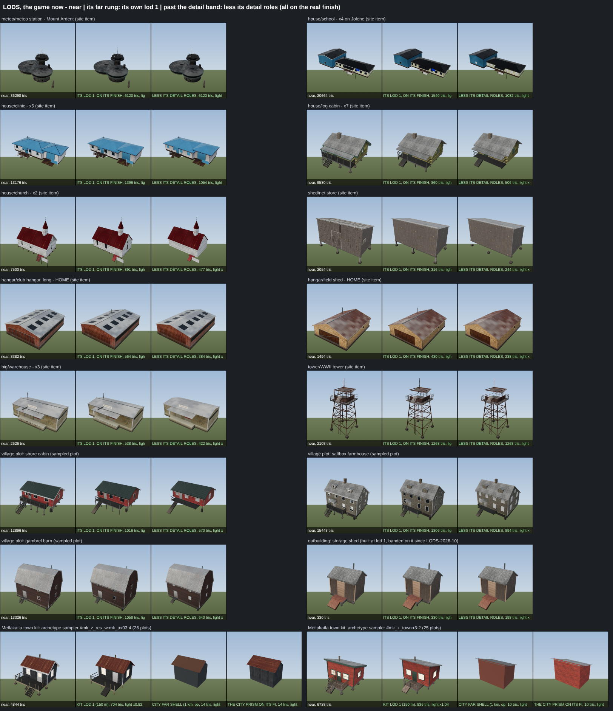

Made by `node tools/lods_sheet.js` (SwiftShader, headless; the numbers: `node tools/lods_audit.js`). Plan: [futureDesigns/LODS-2026-10.md](../../../futureDesigns/LODS-2026-10.md). The whole island's table: [audit.md](audit.md).

**light** = the rung's mean luminance over the near mesh's from camera C (1.00 = as bright); **black** = share of the rung's pixels darker than sRGB 38 from camera A; **leak** = share of the view looking INTO the building (25 views); **hole** = share of the near view where the rung shows something more than max(1.5 m, R/10) behind the near mesh's outside (see-through, a missing roof or storey); **roof** = the near mesh's roofed plan still roofed from straight above.

## In game (dev.html on SwiftShader, `tools/soft_still.js --orbit 160,28,420`, the same camera over HOME)

Before (master): the long club hangar's far rung is a washed-out box. After (this branch): its own lod 1 on its finish, the walls, the roof and its lights.

| before | after |
|---|---|
| 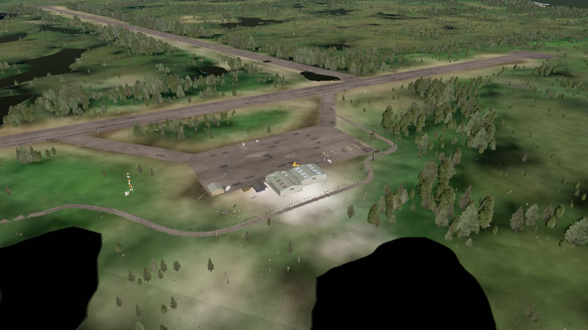 | 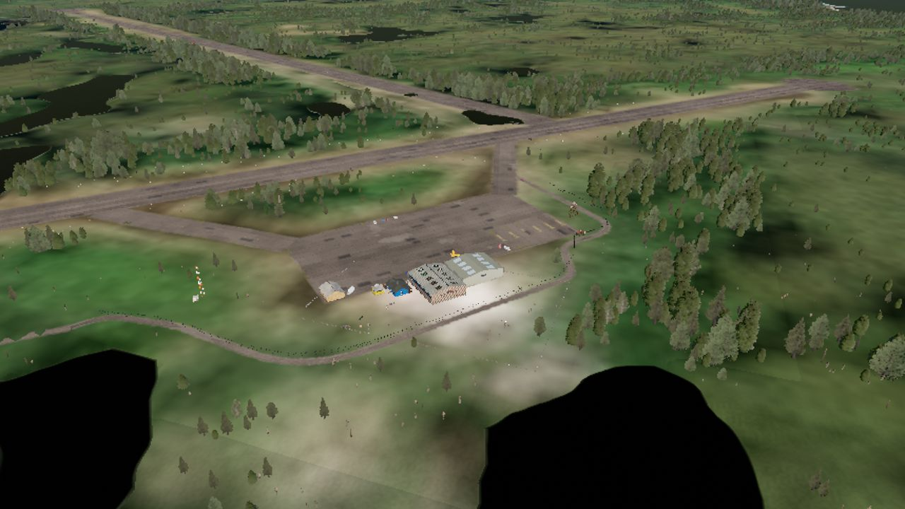 |

(and from 700 m: 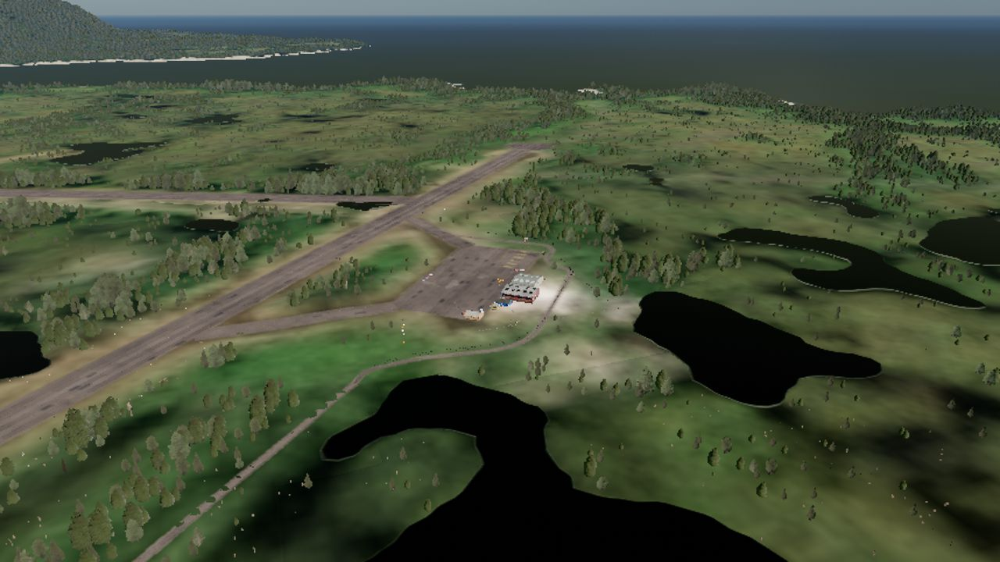 - no page error either run; roll-out to the stand 33 s vs 34 s before)

## meteo/meteo station - Mount Ardent (site item)

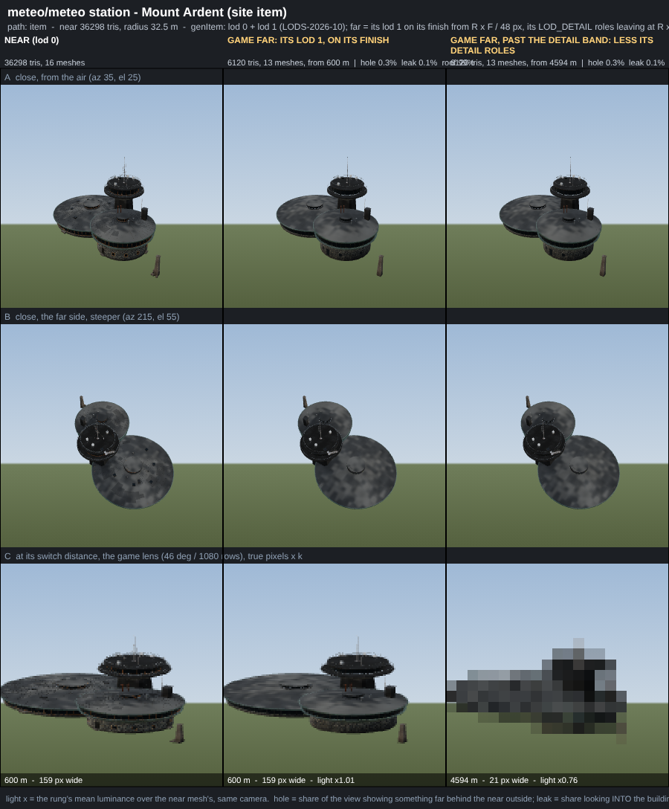

| rung | tris | meshes | from m | leak | hole | roof | light | black |
|---|---|---|---|---|---|---|---|---|
| NEAR (lod 0) | 36298 | 16 | - |  |  |  | 1.00 | 21% |
| GAME FAR: ITS LOD 1, ON ITS FINISH | 6120 | 13 | 600 | 0.1% | 0.3% | 100% | 1.01 | 26% |
| GAME FAR, PAST THE DETAIL BAND: LESS ITS DETAIL ROLES | 6120 | 13 | 4594 | 0.1% | 0.3% | 100% | 0.76 | 26% |

## house/school - x4 on Jolene (site item)

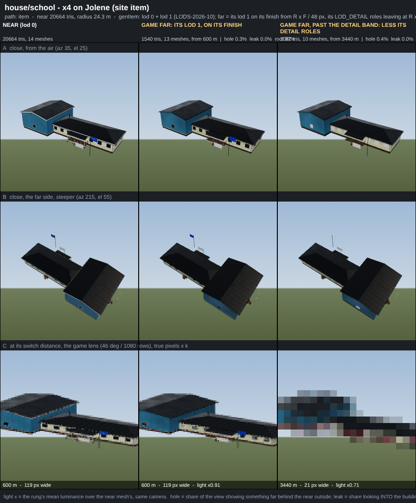

| rung | tris | meshes | from m | leak | hole | roof | light | black |
|---|---|---|---|---|---|---|---|---|
| NEAR (lod 0) | 20664 | 14 | - |  |  |  | 1.00 | 35% |
| GAME FAR: ITS LOD 1, ON ITS FINISH | 1540 | 13 | 600 | 0.0% | 0.3% | 97% | 0.91 | 37% |
| GAME FAR, PAST THE DETAIL BAND: LESS ITS DETAIL ROLES | 1082 | 10 | 3440 | 0.0% | 0.4% | 97% | 0.71 | 36% |

## house/clinic - x5 (site item)

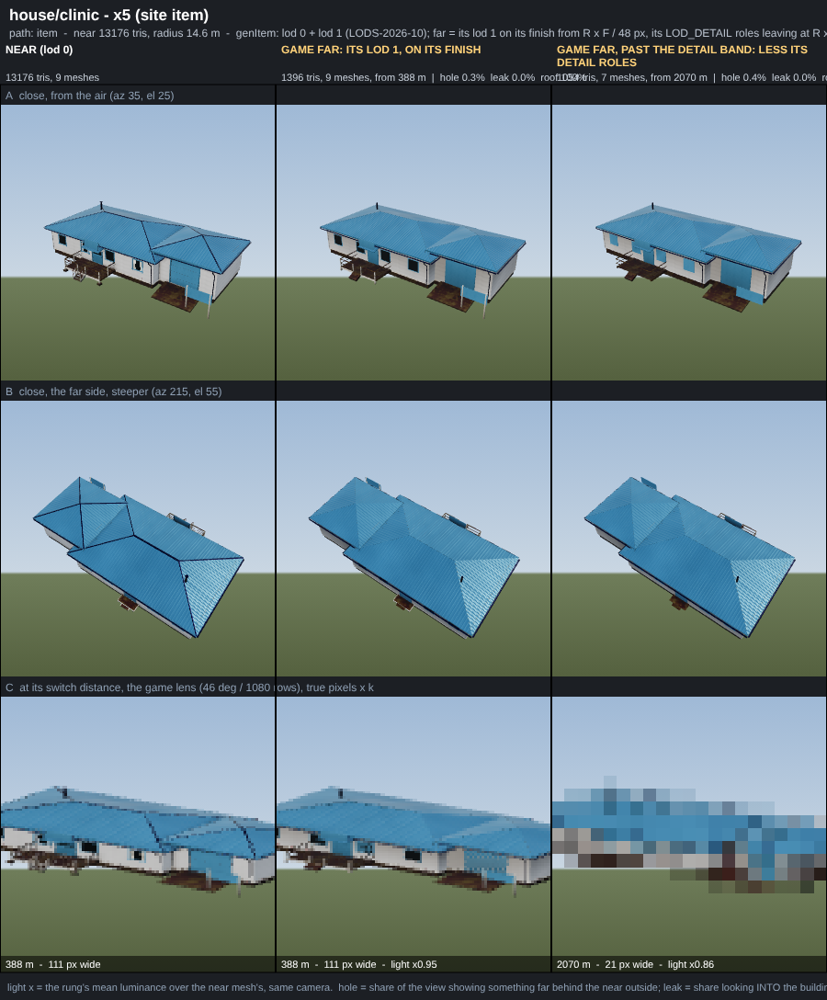

| rung | tris | meshes | from m | leak | hole | roof | light | black |
|---|---|---|---|---|---|---|---|---|
| NEAR (lod 0) | 13176 | 9 | - |  |  |  | 1.00 | 3.2% |
| GAME FAR: ITS LOD 1, ON ITS FINISH | 1396 | 9 | 388 | 0.0% | 0.3% | 100% | 0.95 | 4.2% |
| GAME FAR, PAST THE DETAIL BAND: LESS ITS DETAIL ROLES | 1054 | 7 | 2070 | 0.0% | 0.4% | 100% | 0.86 | 2.9% |

## house/log cabin - x7 (site item)

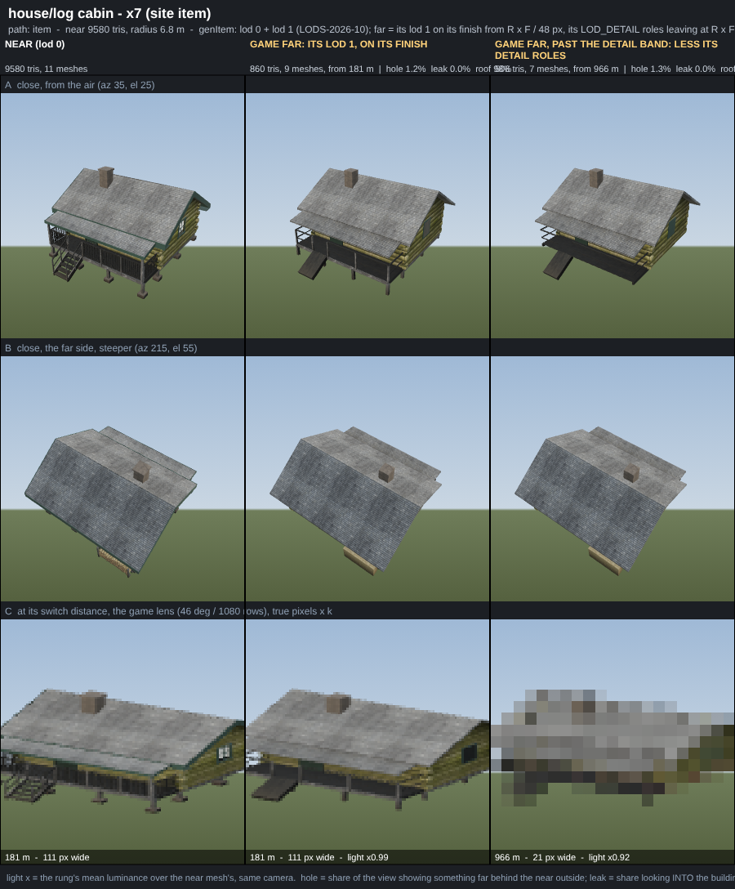

| rung | tris | meshes | from m | leak | hole | roof | light | black |
|---|---|---|---|---|---|---|---|---|
| NEAR (lod 0) | 9580 | 11 | - |  |  |  | 1.00 | 6.9% |
| GAME FAR: ITS LOD 1, ON ITS FINISH | 860 | 9 | 181 | 0.0% | 1.2% | 98% | 0.99 | 2.6% |
| GAME FAR, PAST THE DETAIL BAND: LESS ITS DETAIL ROLES | 506 | 7 | 966 | 0.0% | 1.3% | 98% | 0.92 | 2.5% |

## house/church - x2 (site item)

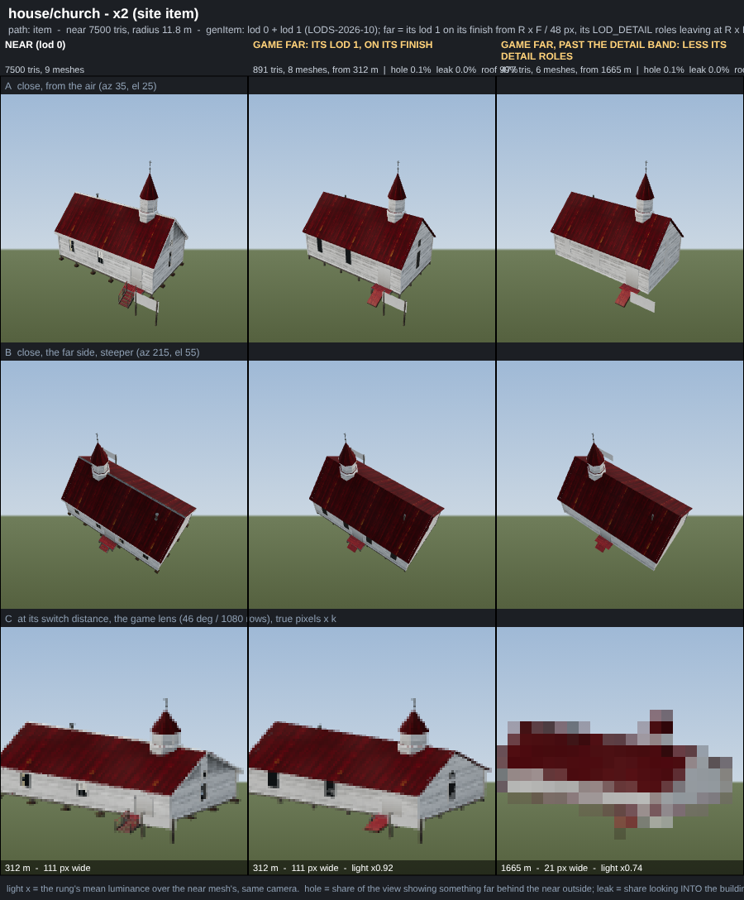

| rung | tris | meshes | from m | leak | hole | roof | light | black |
|---|---|---|---|---|---|---|---|---|
| NEAR (lod 0) | 7500 | 9 | - |  |  |  | 1.00 | 1.0% |
| GAME FAR: ITS LOD 1, ON ITS FINISH | 891 | 8 | 312 | 0.0% | 0.1% | 100% | 0.92 | 2.3% |
| GAME FAR, PAST THE DETAIL BAND: LESS ITS DETAIL ROLES | 477 | 6 | 1665 | 0.0% | 0.1% | 99% | 0.74 | 0.6% |

## shed/net store (site item)

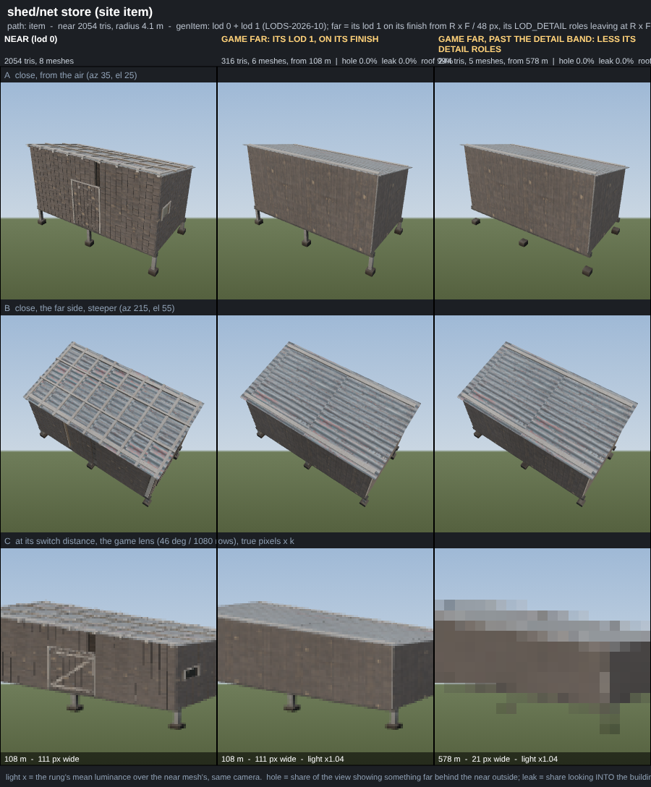

| rung | tris | meshes | from m | leak | hole | roof | light | black |
|---|---|---|---|---|---|---|---|---|
| NEAR (lod 0) | 2054 | 8 | - |  |  |  | 1.00 | 0.5% |
| GAME FAR: ITS LOD 1, ON ITS FINISH | 316 | 6 | 108 | 0.0% | 0.0% | 100% | 1.04 | 0.4% |
| GAME FAR, PAST THE DETAIL BAND: LESS ITS DETAIL ROLES | 244 | 5 | 578 | 0.0% | 0.0% | 100% | 1.04 | 0.3% |

## hangar/club hangar, long - HOME (site item)

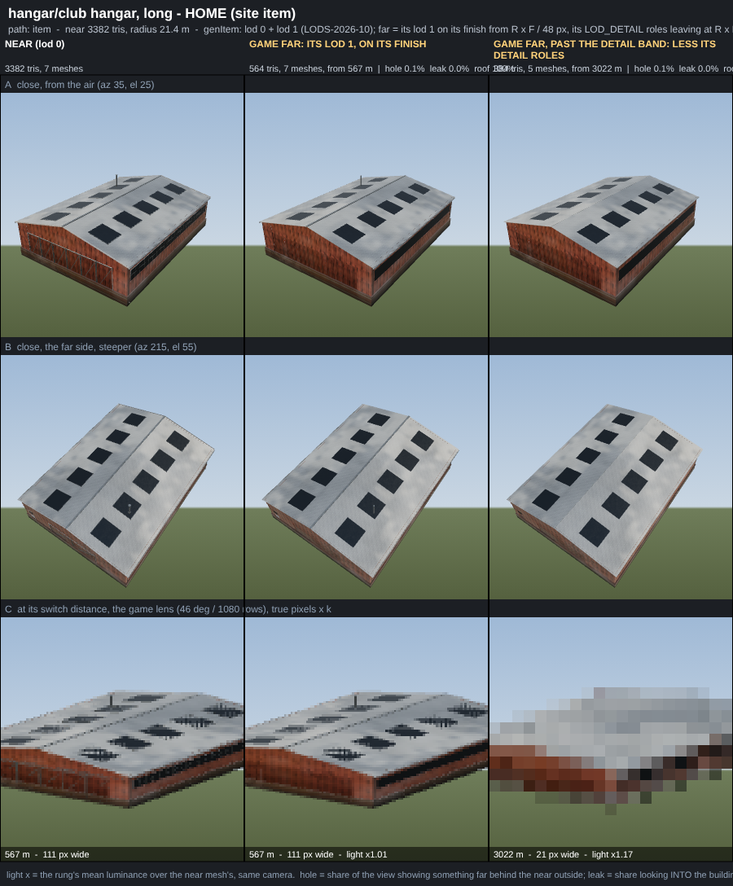

| rung | tris | meshes | from m | leak | hole | roof | light | black |
|---|---|---|---|---|---|---|---|---|
| NEAR (lod 0) | 3382 | 7 | - |  |  |  | 1.00 | 3.9% |
| GAME FAR: ITS LOD 1, ON ITS FINISH | 564 | 7 | 567 | 0.0% | 0.1% | 100% | 1.01 | 4.8% |
| GAME FAR, PAST THE DETAIL BAND: LESS ITS DETAIL ROLES | 384 | 5 | 3022 | 0.0% | 0.1% | 97% | 1.17 | 4.8% |

## hangar/field shed - HOME (site item)

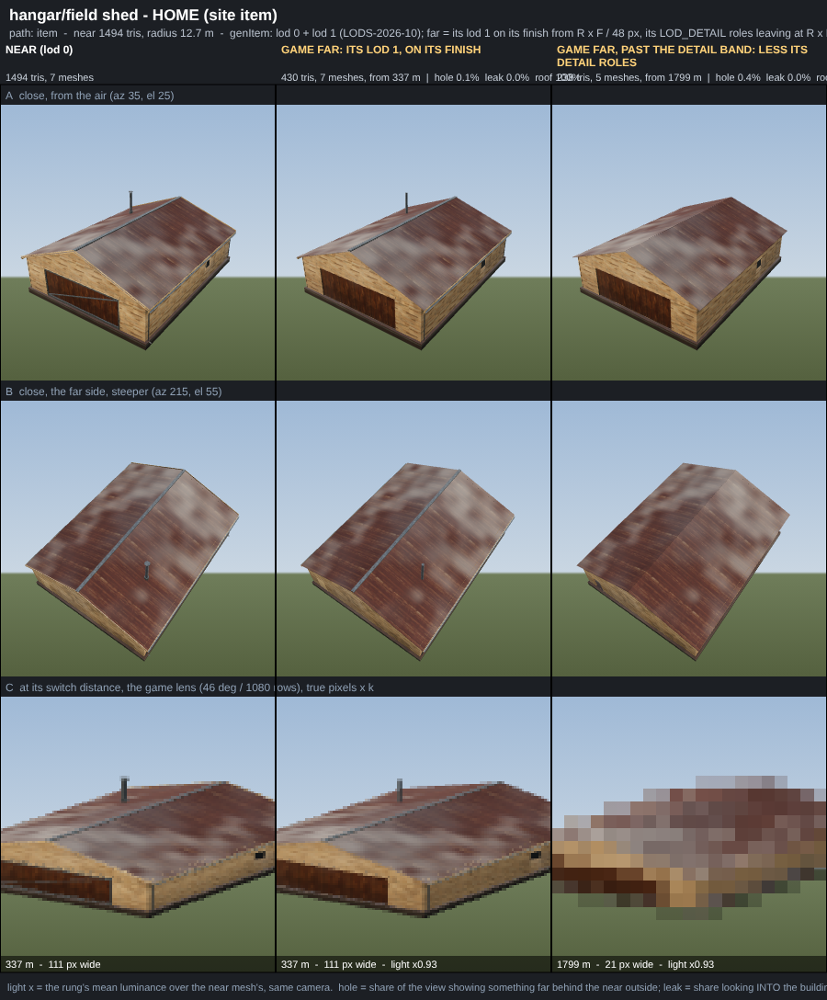

| rung | tris | meshes | from m | leak | hole | roof | light | black |
|---|---|---|---|---|---|---|---|---|
| NEAR (lod 0) | 1494 | 7 | - |  |  |  | 1.00 | 1.2% |
| GAME FAR: ITS LOD 1, ON ITS FINISH | 430 | 7 | 337 | 0.0% | 0.1% | 100% | 0.93 | 1.2% |
| GAME FAR, PAST THE DETAIL BAND: LESS ITS DETAIL ROLES | 238 | 5 | 1799 | 0.0% | 0.4% | 97% | 0.93 | 1.2% |

## big/warehouse - x3 (site item)

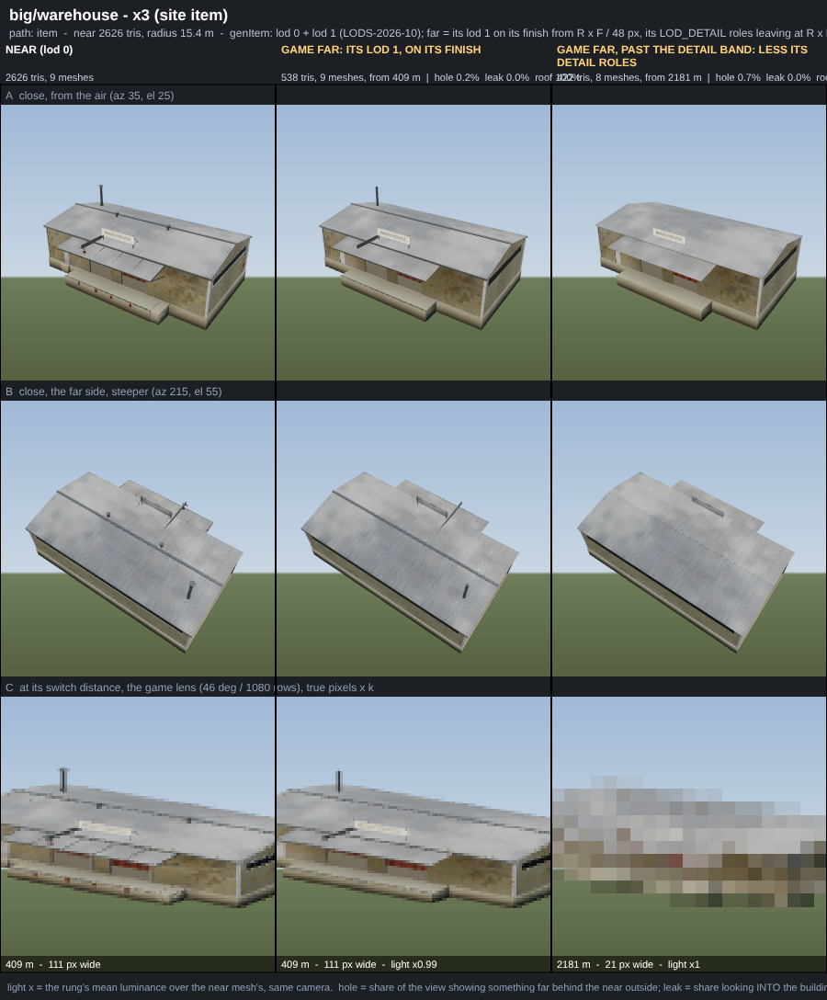

| rung | tris | meshes | from m | leak | hole | roof | light | black |
|---|---|---|---|---|---|---|---|---|
| NEAR (lod 0) | 2626 | 9 | - |  |  |  | 1.00 | 1.0% |
| GAME FAR: ITS LOD 1, ON ITS FINISH | 538 | 9 | 409 | 0.0% | 0.2% | 100% | 0.99 | 1.3% |
| GAME FAR, PAST THE DETAIL BAND: LESS ITS DETAIL ROLES | 422 | 8 | 2181 | 0.0% | 0.7% | 100% | 1.00 | 1.3% |

## tower/WWII tower (site item)

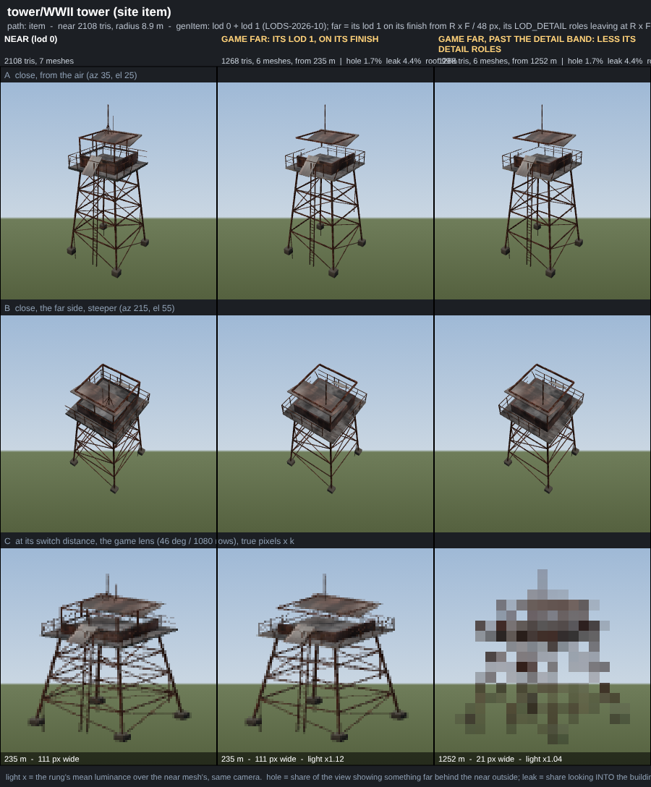

| rung | tris | meshes | from m | leak | hole | roof | light | black |
|---|---|---|---|---|---|---|---|---|
| NEAR (lod 0) | 2108 | 7 | - |  |  |  | 1.00 | 21% |
| GAME FAR: ITS LOD 1, ON ITS FINISH | 1268 | 6 | 235 | 4.4% | 1.7% | 99% | 1.12 | 20% |
| GAME FAR, PAST THE DETAIL BAND: LESS ITS DETAIL ROLES | 1268 | 6 | 1252 | 4.4% | 1.7% | 99% | 1.04 | 20% |

## village plot: shore cabin (sampled plot)

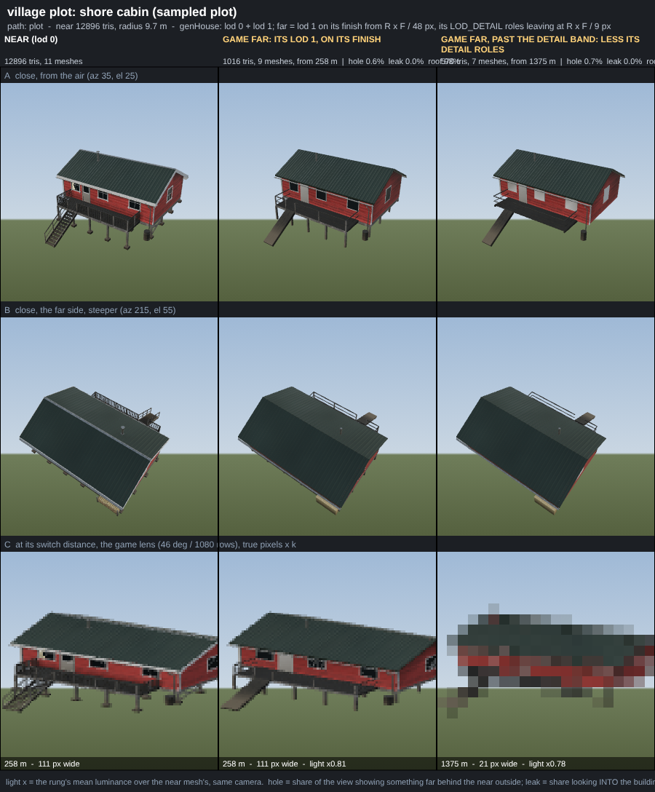

| rung | tris | meshes | from m | leak | hole | roof | light | black |
|---|---|---|---|---|---|---|---|---|
| NEAR (lod 0) | 12896 | 11 | - |  |  |  | 1.00 | 7.8% |
| GAME FAR: ITS LOD 1, ON ITS FINISH | 1016 | 9 | 258 | 0.0% | 0.6% | 98% | 0.81 | 5.6% |
| GAME FAR, PAST THE DETAIL BAND: LESS ITS DETAIL ROLES | 570 | 7 | 1375 | 0.0% | 0.7% | 98% | 0.78 | 2.6% |

## village plot: saltbox farmhouse (sampled plot)

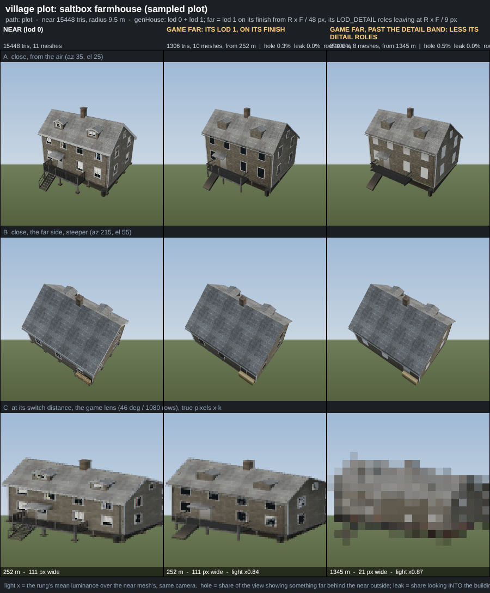

| rung | tris | meshes | from m | leak | hole | roof | light | black |
|---|---|---|---|---|---|---|---|---|
| NEAR (lod 0) | 15448 | 11 | - |  |  |  | 1.00 | 5.1% |
| GAME FAR: ITS LOD 1, ON ITS FINISH | 1306 | 10 | 252 | 0.0% | 0.3% | 100% | 0.84 | 6.0% |
| GAME FAR, PAST THE DETAIL BAND: LESS ITS DETAIL ROLES | 894 | 8 | 1345 | 0.0% | 0.5% | 100% | 0.87 | 3.2% |

## village plot: gambrel barn (sampled plot)

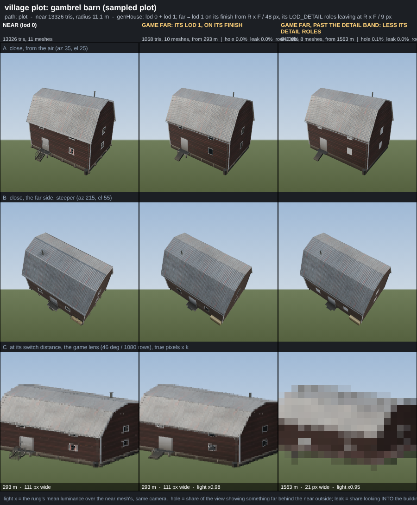

| rung | tris | meshes | from m | leak | hole | roof | light | black |
|---|---|---|---|---|---|---|---|---|
| NEAR (lod 0) | 13326 | 11 | - |  |  |  | 1.00 | 3.4% |
| GAME FAR: ITS LOD 1, ON ITS FINISH | 1058 | 10 | 293 | 0.0% | 0.0% | 100% | 0.98 | 5.8% |
| GAME FAR, PAST THE DETAIL BAND: LESS ITS DETAIL ROLES | 640 | 8 | 1563 | 0.0% | 0.1% | 100% | 0.95 | 5.3% |

## outbuilding: storage shed (built at lod 1, banded on it since LODS-2026-10)

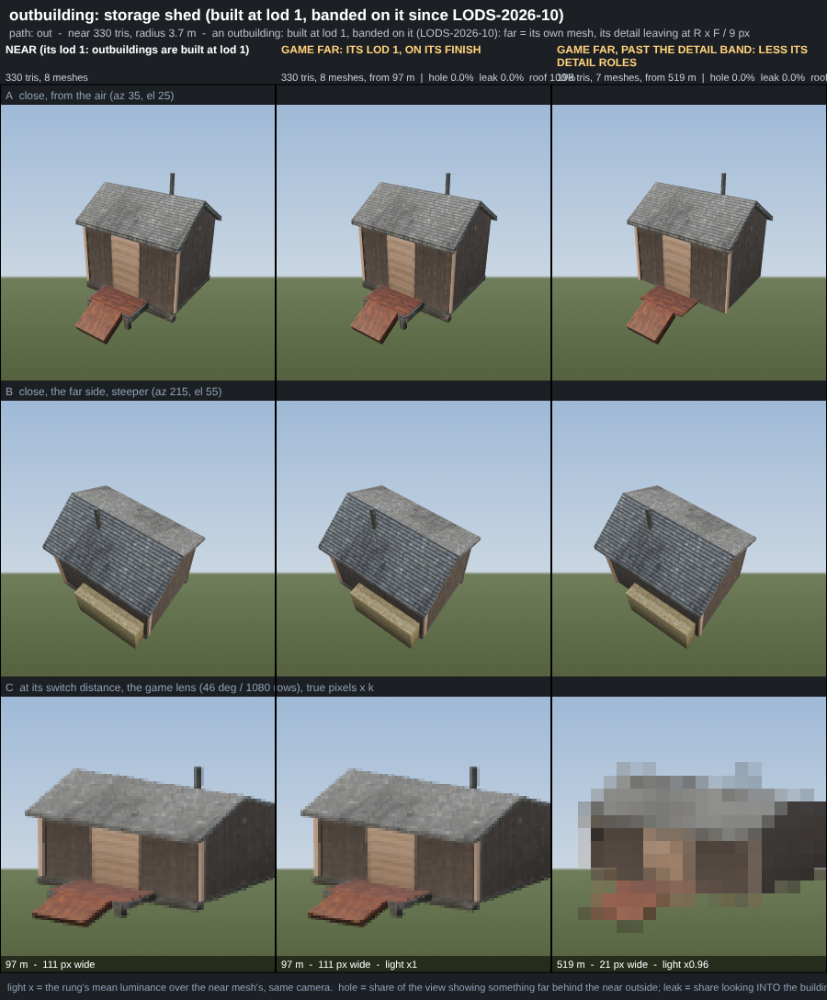

| rung | tris | meshes | from m | leak | hole | roof | light | black |
|---|---|---|---|---|---|---|---|---|
| NEAR (its lod 1: outbuildings are built at lod 1) | 330 | 8 | - |  |  |  | 1.00 | 0.3% |
| GAME FAR: ITS LOD 1, ON ITS FINISH | 330 | 8 | 97 | 0.0% | 0.0% | 100% | 1.00 | 0.3% |
| GAME FAR, PAST THE DETAIL BAND: LESS ITS DETAIL ROLES | 198 | 7 | 519 | 0.0% | 0.0% | 100% | 0.96 | 0.2% |

## Metlakatla town kit: archetype sampler #mk_z_res_w:mk_ax03:4 (26 plots)

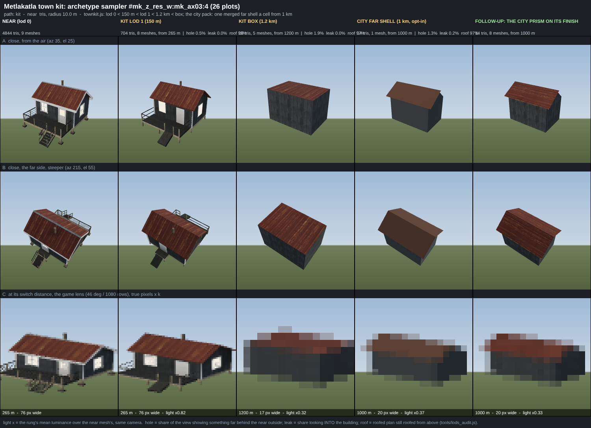

| rung | tris | meshes | from m | leak | hole | roof | light | black |
|---|---|---|---|---|---|---|---|---|
| NEAR (lod 0) | 4844 | 9 | - |  |  |  | 1.00 | 8.9% |
| KIT LOD 1 (150 m) | 704 | 8 | 265 | 0.0% | 0.5% | 99% | 0.82 | 12% |
| KIT BOX (1.2 km) | 10 | 5 | 1200 | 0.0% | 1.9% | 97% | 0.32 | 0.1% |
| CITY FAR SHELL (1 km, opt-in) | 14 | 1 | 1000 | 0.2% | 1.4% | 97% | 0.37 | 0.0% |
| FOLLOW-UP: THE CITY PRISM ON ITS FINISH | 14 | 8 | 1000 |  |  |  | 0.33 | 0.2% |

## Metlakatla town kit: archetype sampler #mk_z_town:r3:2 (25 plots)

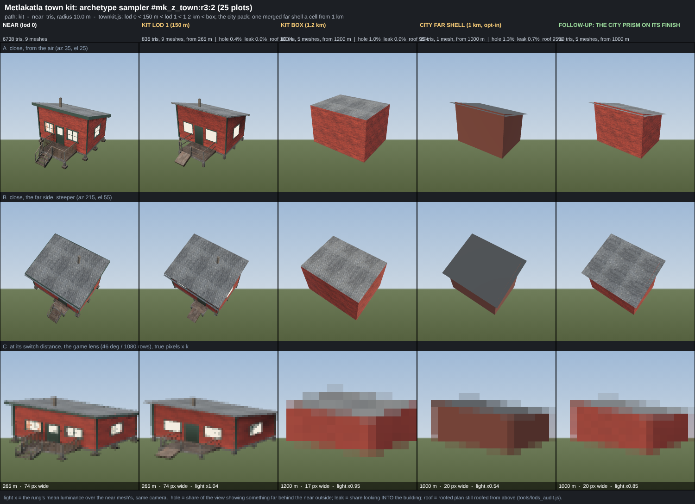

| rung | tris | meshes | from m | leak | hole | roof | light | black |
|---|---|---|---|---|---|---|---|---|
| NEAR (lod 0) | 6738 | 9 | - |  |  |  | 1.00 | 1.4% |
| KIT LOD 1 (150 m) | 836 | 9 | 265 | 0.0% | 0.4% | 100% | 1.04 | 0.1% |
| KIT BOX (1.2 km) | 10 | 5 | 1200 | 0.0% | 1.0% | 95% | 0.95 | 0.0% |
| CITY FAR SHELL (1 km, opt-in) | 10 | 1 | 1000 | 0.7% | 1.3% | 95% | 0.54 | 0.0% |
| FOLLOW-UP: THE CITY PRISM ON ITS FINISH | 10 | 5 | 1000 |  |  |  | 0.85 | 0.0% |

