# LODS - the whole catalogue (2026-10-27): every generated asset of the editor's site palette

Each sheet: one building, its NEAR mesh and every far rung the game draws of it (render_premises.js's own detailOf / lod1Bags / hlodMerge / hlodBoxes, lifted from the file by tools/_lods_rig.js), from the same cameras: **A** close from the air, **B** the far side steeper, **C** at the rung's switch distance through the game's lens (46 deg, 1080 rows) - true pixels, blown up. Green column = what the same generator's own lod 1 gives (the plan's fix, not the game today).

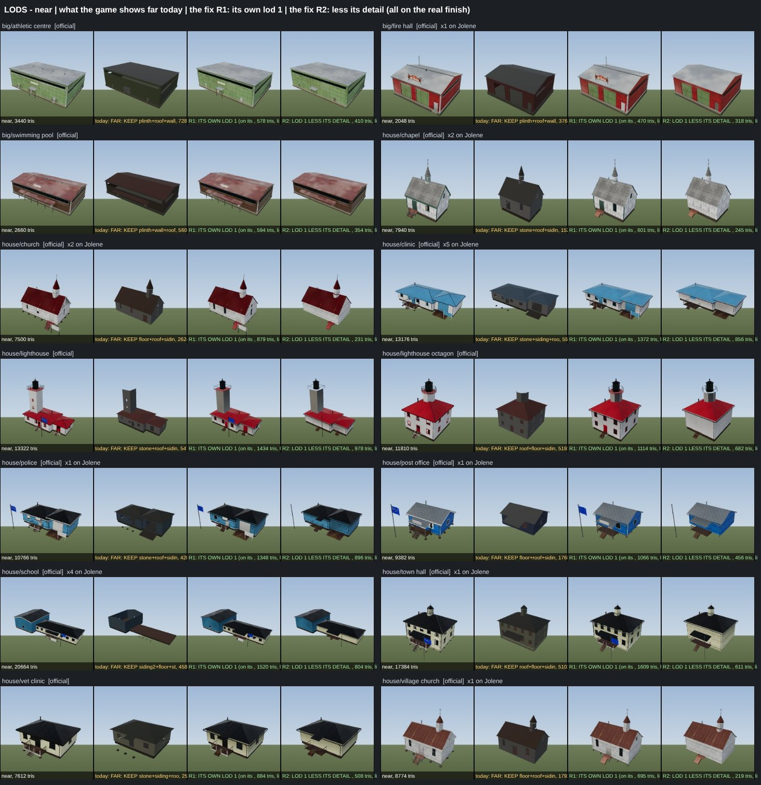

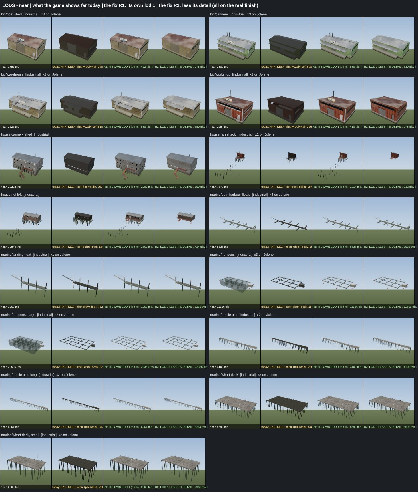

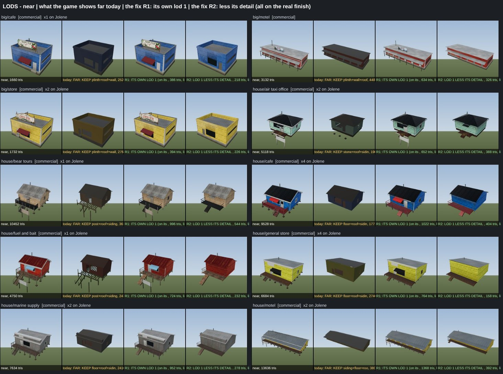

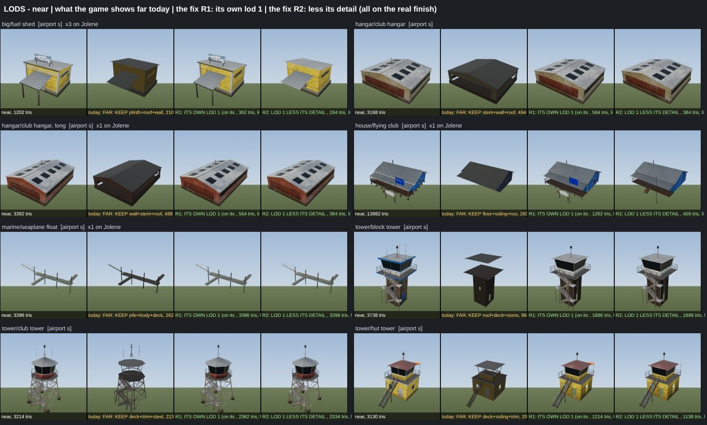

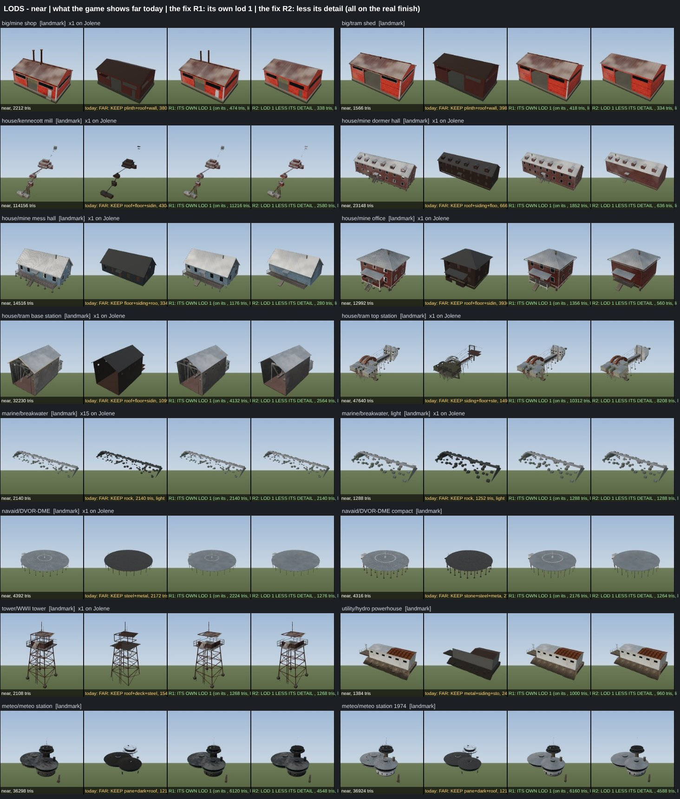

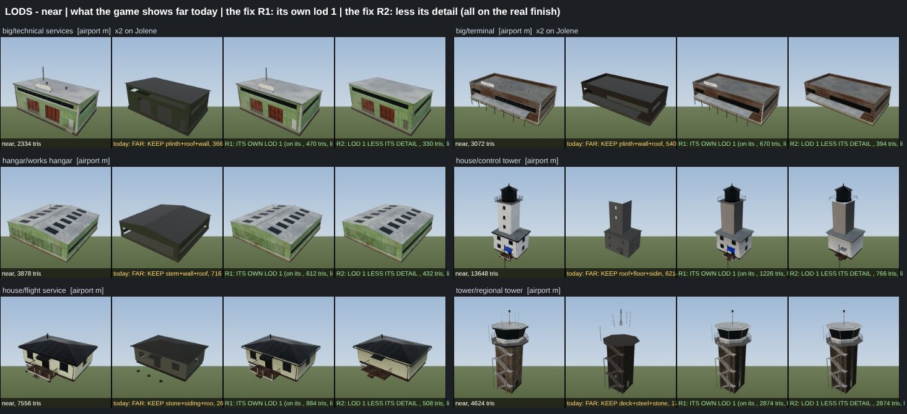

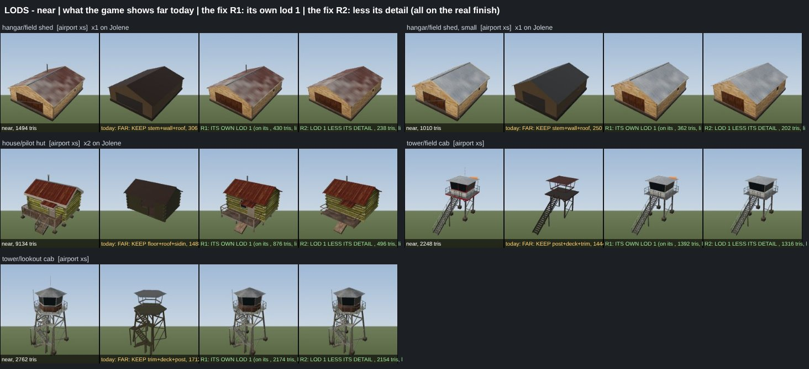

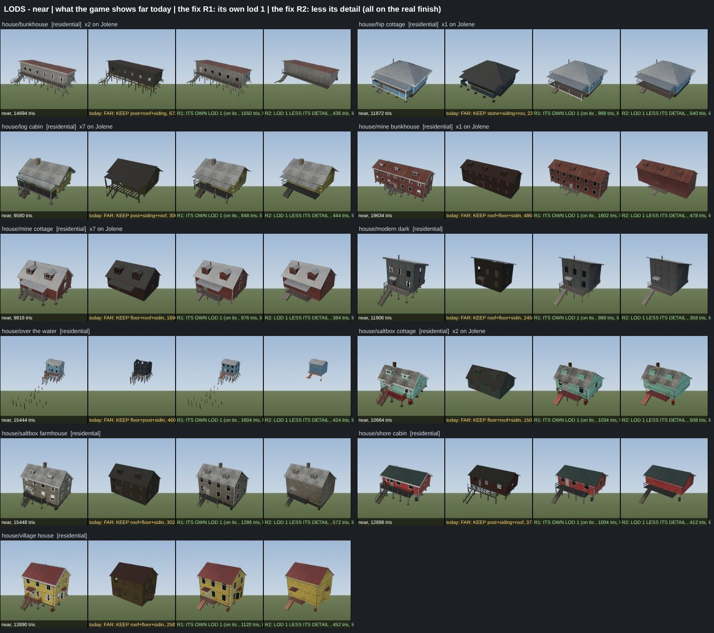

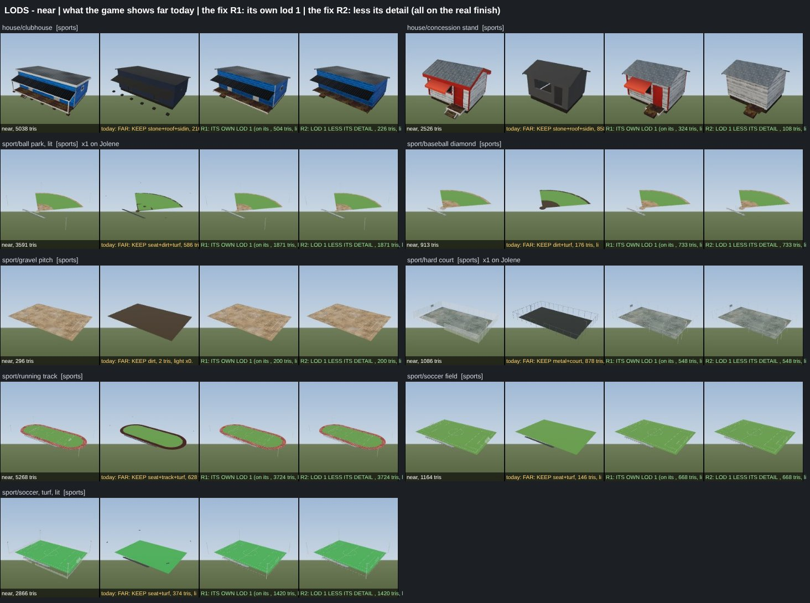

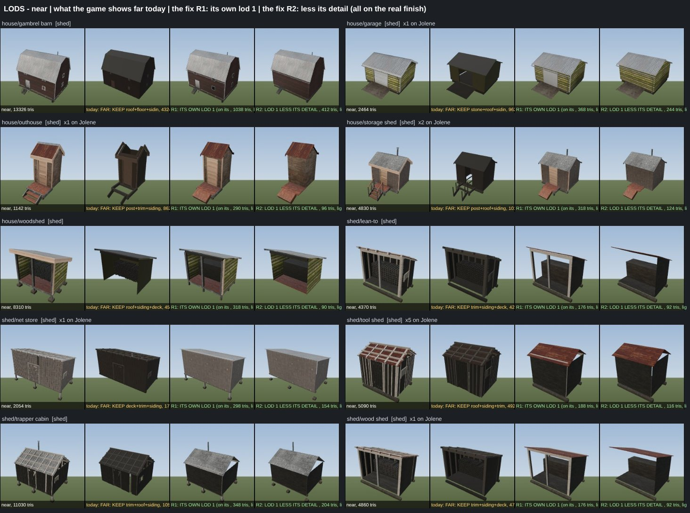

Made by `node tools/lods_sheet.js` (SwiftShader, headless; the numbers: `node tools/lods_audit.js`). Plan: [futureDesigns/LODS-2026-10.md](../../../futureDesigns/LODS-2026-10.md). The whole island's table: [audit.md](audit.md).

**light** = the rung's mean luminance over the near mesh's from camera C (1.00 = as bright); **black** = share of the rung's pixels darker than sRGB 38 from camera A; **leak** = share of the view looking INTO the building (25 views); **hole** = share of the near view where the rung shows something more than max(1.5 m, R/10) behind the near mesh's outside (see-through, a missing roof or storey); **roof** = the near mesh's roofed plan still roofed from straight above.

## big/athletic centre  [official]

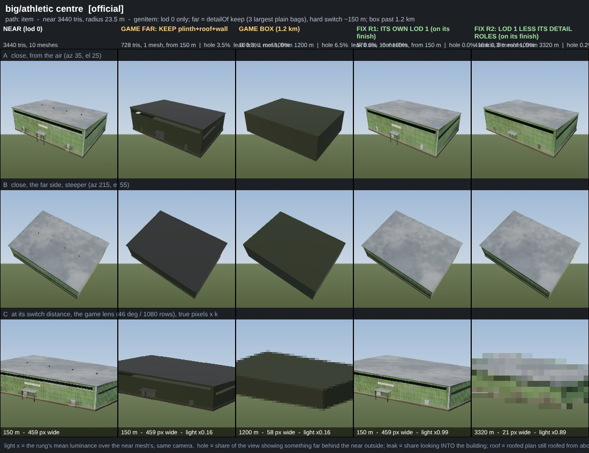

| rung | tris | meshes | from m | leak | hole | roof | light | black |
|---|---|---|---|---|---|---|---|---|
| NEAR (lod 0) | 3440 | 10 | - |  |  |  | 1.00 | 4.9% |
| GAME FAR: KEEP plinth+roof+wall | 728 | 1 | 150 | 0.3% | 3.5% | 100% | 0.16 | 1.2% |
| GAME BOX (1.2 km) | 10 | 1 | 1200 | 0.0% | 6.5% | 100% | 0.16 | 0.0% |
| FIX R1: ITS OWN LOD 1 (on its finish) | 578 | 10 | 150 | 0.3% | 0.0% | 100% | 0.99 | 5.6% |
| FIX R2: LOD 1 LESS ITS DETAIL ROLES (on its finish) | 410 | 6 | 3320 | 0.3% | 0.3% | 100% | 0.89 | 5.6% |

## big/boat shed  [industrial]  x3 on Jolene

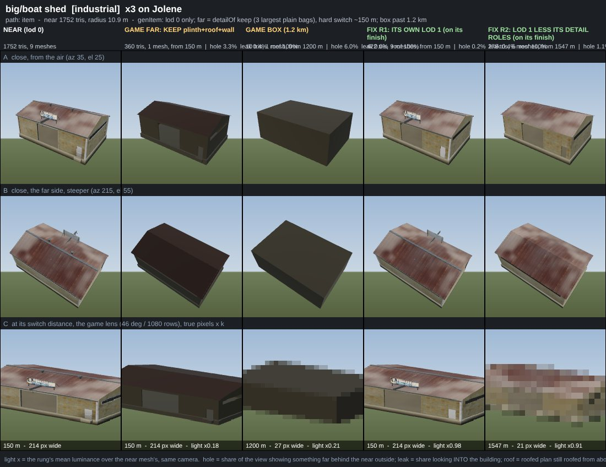

| rung | tris | meshes | from m | leak | hole | roof | light | black |
|---|---|---|---|---|---|---|---|---|
| NEAR (lod 0) | 1752 | 9 | - |  |  |  | 1.00 | 1.2% |
| GAME FAR: KEEP plinth+roof+wall | 360 | 1 | 150 | 0.4% | 3.3% | 100% | 0.18 | 1.0% |
| GAME BOX (1.2 km) | 10 | 1 | 1200 | 0.0% | 6.0% | 100% | 0.21 | 1.3% |
| FIX R1: ITS OWN LOD 1 (on its finish) | 422 | 9 | 150 | 0.4% | 0.2% | 100% | 0.98 | 1.5% |
| FIX R2: LOD 1 LESS ITS DETAIL ROLES (on its finish) | 278 | 6 | 1547 | 0.4% | 1.1% | 100% | 0.91 | 1.5% |

## big/cafe  [commercial]  x1 on Jolene

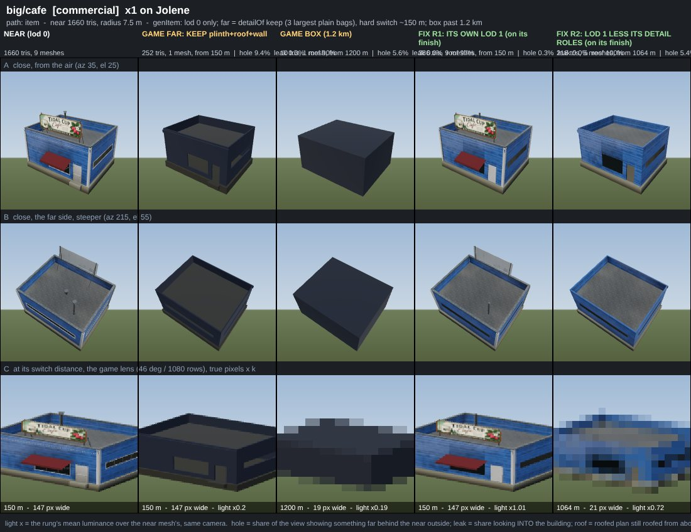

| rung | tris | meshes | from m | leak | hole | roof | light | black |
|---|---|---|---|---|---|---|---|---|
| NEAR (lod 0) | 1660 | 9 | - |  |  |  | 1.00 | 1.2% |
| GAME FAR: KEEP plinth+roof+wall | 252 | 1 | 150 | 0.0% | 9.4% | 90% | 0.20 | 6.4% |
| GAME BOX (1.2 km) | 10 | 1 | 1200 | 0.0% | 5.6% | 97% | 0.19 | 0.0% |
| FIX R1: ITS OWN LOD 1 (on its finish) | 386 | 9 | 150 | 0.0% | 0.3% | 100% | 1.01 | 1.4% |
| FIX R2: LOD 1 LESS ITS DETAIL ROLES (on its finish) | 218 | 5 | 1064 | 0.0% | 5.4% | 90% | 0.72 | 5.5% |

## big/cannery  [industrial]  x3 on Jolene

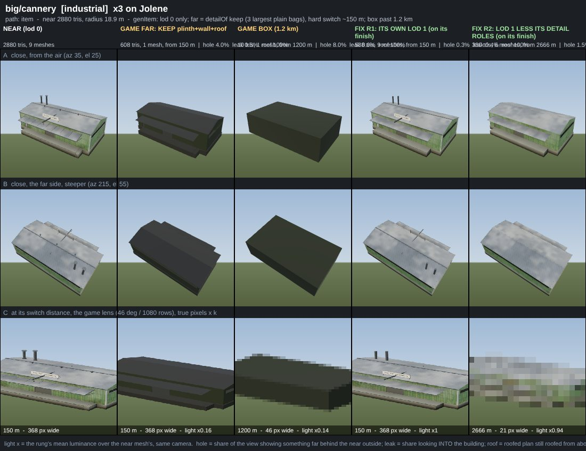

| rung | tris | meshes | from m | leak | hole | roof | light | black |
|---|---|---|---|---|---|---|---|---|
| NEAR (lod 0) | 2880 | 9 | - |  |  |  | 1.00 | 1.0% |
| GAME FAR: KEEP plinth+wall+roof | 608 | 1 | 150 | 0.5% | 4.0% | 100% | 0.16 | 0.3% |
| GAME BOX (1.2 km) | 10 | 1 | 1200 | 0.0% | 8.0% | 100% | 0.14 | 0.0% |
| FIX R1: ITS OWN LOD 1 (on its finish) | 538 | 9 | 150 | 0.4% | 0.3% | 100% | 1.00 | 1.2% |
| FIX R2: LOD 1 LESS ITS DETAIL ROLES (on its finish) | 330 | 6 | 2666 | 0.5% | 1.5% | 100% | 0.94 | 1.2% |

## big/fire hall  [official]  x1 on Jolene

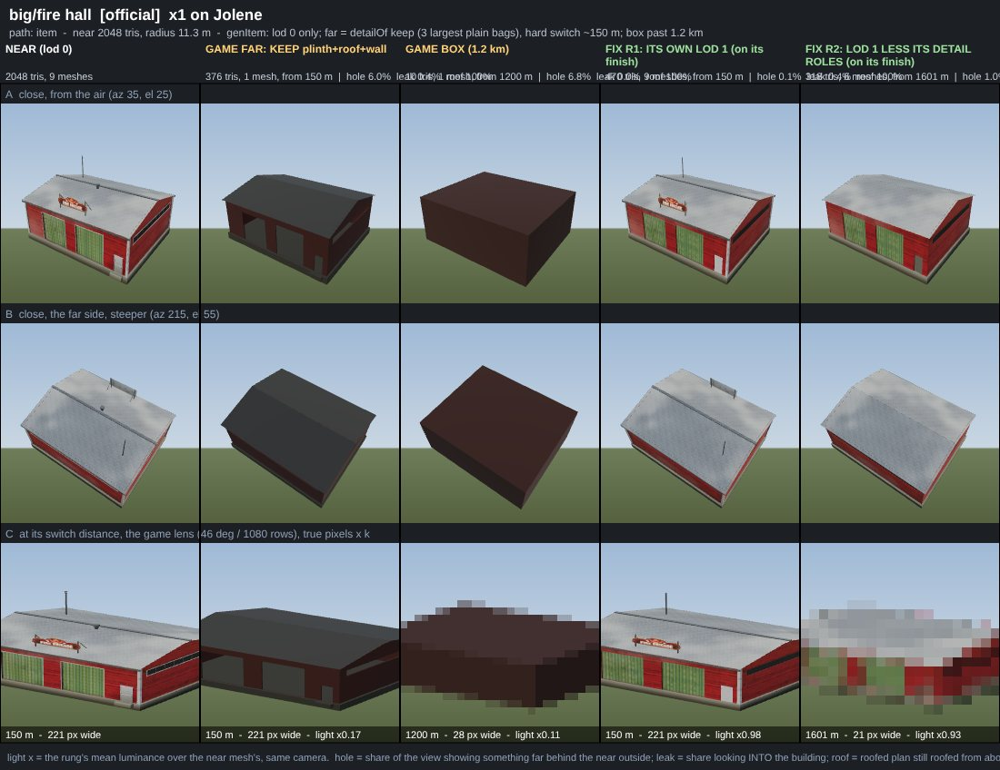

| rung | tris | meshes | from m | leak | hole | roof | light | black |
|---|---|---|---|---|---|---|---|---|
| NEAR (lod 0) | 2048 | 9 | - |  |  |  | 1.00 | 1.7% |
| GAME FAR: KEEP plinth+roof+wall | 376 | 1 | 150 | 0.4% | 6.0% | 100% | 0.17 | 3.5% |
| GAME BOX (1.2 km) | 10 | 1 | 1200 | 0.0% | 6.8% | 100% | 0.11 | 5.5% |
| FIX R1: ITS OWN LOD 1 (on its finish) | 470 | 9 | 150 | 0.4% | 0.1% | 100% | 0.98 | 2.1% |
| FIX R2: LOD 1 LESS ITS DETAIL ROLES (on its finish) | 318 | 6 | 1601 | 0.4% | 1.0% | 100% | 0.93 | 2.1% |

## big/fuel shed  [airport s]  x3 on Jolene

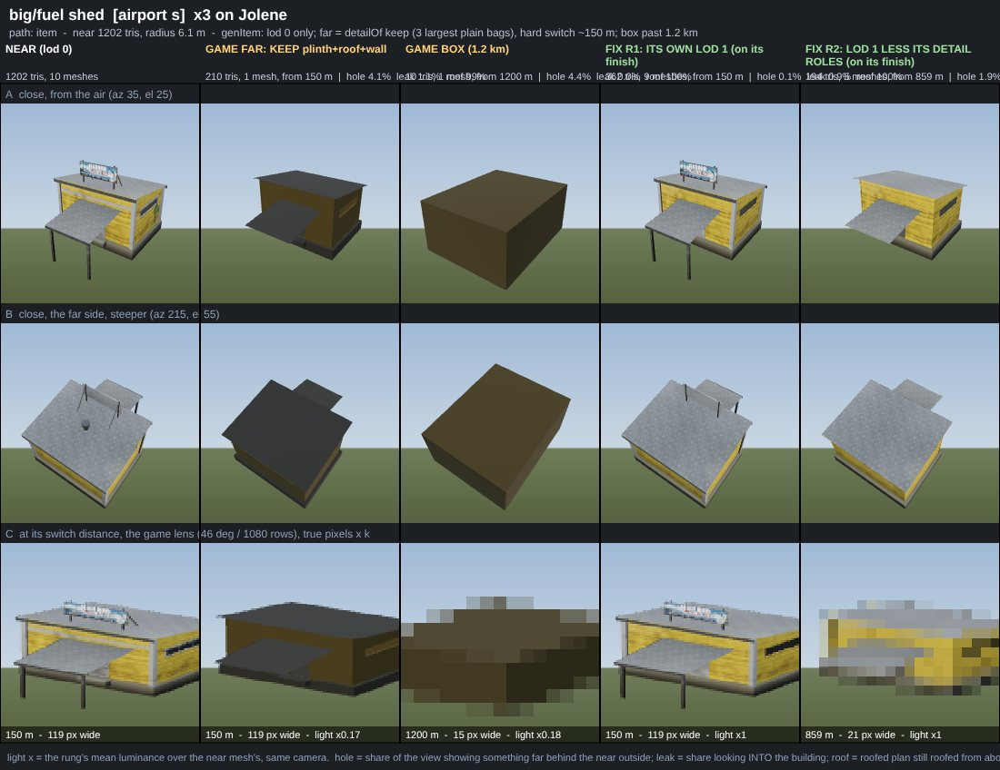

| rung | tris | meshes | from m | leak | hole | roof | light | black |
|---|---|---|---|---|---|---|---|---|
| NEAR (lod 0) | 1202 | 10 | - |  |  |  | 1.00 | 1.9% |
| GAME FAR: KEEP plinth+roof+wall | 210 | 1 | 150 | 1.1% | 4.1% | 99% | 0.17 | 3.1% |
| GAME BOX (1.2 km) | 10 | 1 | 1200 | 0.0% | 4.4% | 100% | 0.18 | 0.0% |
| FIX R1: ITS OWN LOD 1 (on its finish) | 362 | 9 | 150 | 0.9% | 0.1% | 100% | 1.00 | 1.9% |
| FIX R2: LOD 1 LESS ITS DETAIL ROLES (on its finish) | 194 | 5 | 859 | 1.1% | 1.9% | 99% | 1.00 | 1.1% |

## big/mine shop  [landmark]  x1 on Jolene

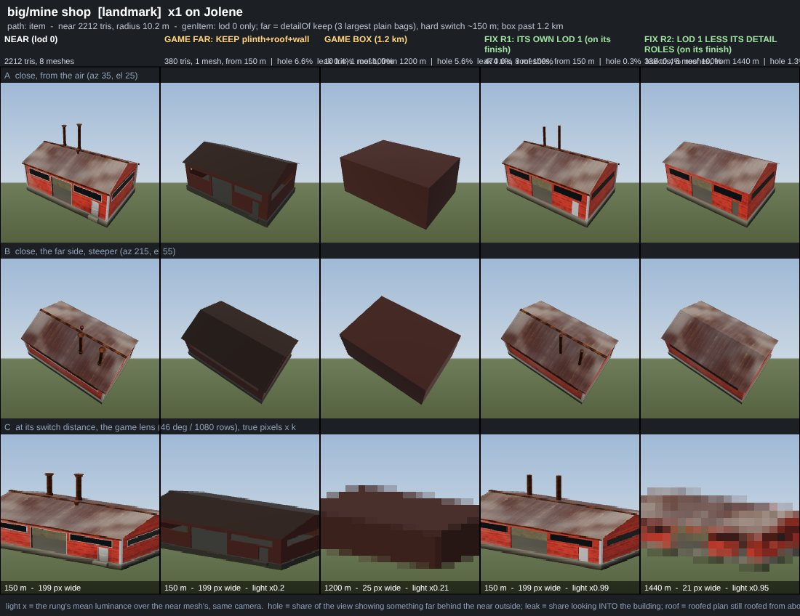

| rung | tris | meshes | from m | leak | hole | roof | light | black |
|---|---|---|---|---|---|---|---|---|
| NEAR (lod 0) | 2212 | 8 | - |  |  |  | 1.00 | 6.1% |
| GAME FAR: KEEP plinth+roof+wall | 380 | 1 | 150 | 0.4% | 6.6% | 100% | 0.20 | 1.1% |
| GAME BOX (1.2 km) | 10 | 1 | 1200 | 0.0% | 5.7% | 100% | 0.21 | 0.0% |
| FIX R1: ITS OWN LOD 1 (on its finish) | 474 | 8 | 150 | 0.4% | 0.3% | 100% | 0.99 | 6.7% |
| FIX R2: LOD 1 LESS ITS DETAIL ROLES (on its finish) | 338 | 6 | 1440 | 0.4% | 1.3% | 100% | 0.95 | 6.4% |

## big/motel  [commercial]

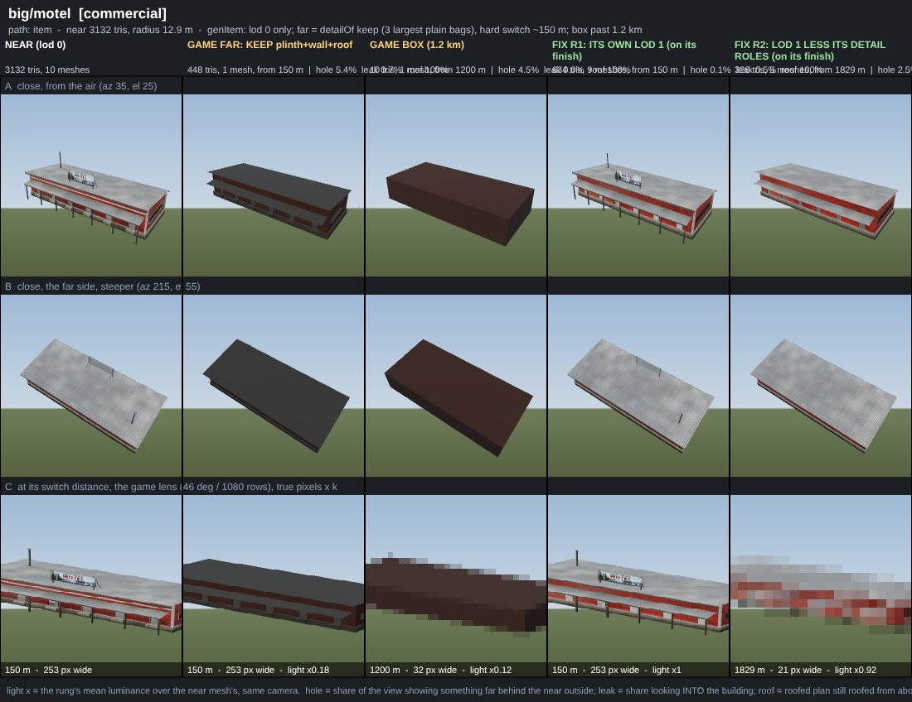

| rung | tris | meshes | from m | leak | hole | roof | light | black |
|---|---|---|---|---|---|---|---|---|
| NEAR (lod 0) | 3132 | 10 | - |  |  |  | 1.00 | 0.9% |
| GAME FAR: KEEP plinth+wall+roof | 448 | 1 | 150 | 0.7% | 5.4% | 100% | 0.18 | 0.3% |
| GAME BOX (1.2 km) | 10 | 1 | 1200 | 0.0% | 4.5% | 100% | 0.12 | 0.0% |
| FIX R1: ITS OWN LOD 1 (on its finish) | 634 | 9 | 150 | 0.5% | 0.1% | 100% | 1.00 | 1.3% |
| FIX R2: LOD 1 LESS ITS DETAIL ROLES (on its finish) | 326 | 5 | 1829 | 0.7% | 2.5% | 100% | 0.92 | 0.9% |

## big/store  [commercial]  x2 on Jolene

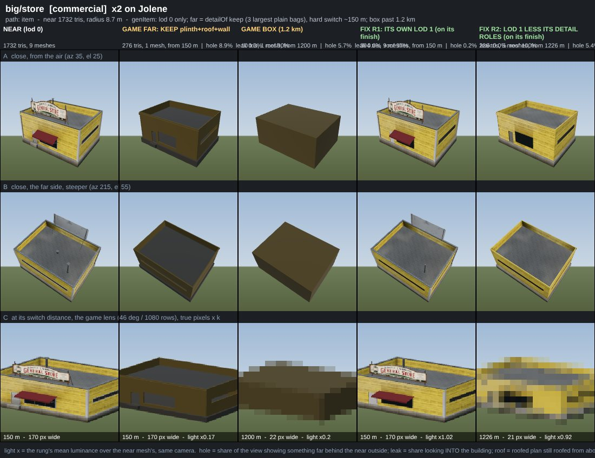

| rung | tris | meshes | from m | leak | hole | roof | light | black |
|---|---|---|---|---|---|---|---|---|
| NEAR (lod 0) | 1732 | 9 | - |  |  |  | 1.00 | 1.7% |
| GAME FAR: KEEP plinth+roof+wall | 276 | 1 | 150 | 0.0% | 8.9% | 90% | 0.17 | 1.1% |
| GAME BOX (1.2 km) | 10 | 1 | 1200 | 0.0% | 5.7% | 97% | 0.20 | 0.0% |
| FIX R1: ITS OWN LOD 1 (on its finish) | 394 | 9 | 150 | 0.0% | 0.2% | 100% | 1.02 | 2.0% |
| FIX R2: LOD 1 LESS ITS DETAIL ROLES (on its finish) | 226 | 5 | 1226 | 0.0% | 5.5% | 90% | 0.92 | 5.7% |

## big/swimming pool  [official]

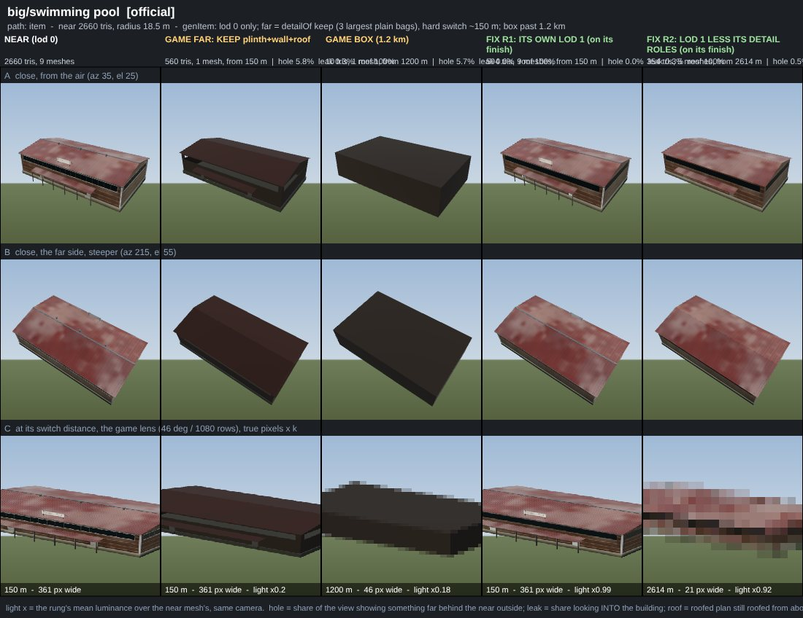

| rung | tris | meshes | from m | leak | hole | roof | light | black |
|---|---|---|---|---|---|---|---|---|
| NEAR (lod 0) | 2660 | 9 | - |  |  |  | 1.00 | 8.3% |
| GAME FAR: KEEP plinth+wall+roof | 560 | 1 | 150 | 0.3% | 5.8% | 100% | 0.20 | 15% |
| GAME BOX (1.2 km) | 10 | 1 | 1200 | 0.0% | 5.7% | 100% | 0.18 | 9.9% |
| FIX R1: ITS OWN LOD 1 (on its finish) | 594 | 9 | 150 | 0.3% | 0.0% | 100% | 0.99 | 9.6% |
| FIX R2: LOD 1 LESS ITS DETAIL ROLES (on its finish) | 354 | 5 | 2614 | 0.3% | 0.5% | 100% | 0.92 | 9.7% |

## big/technical services  [airport m]  x2 on Jolene

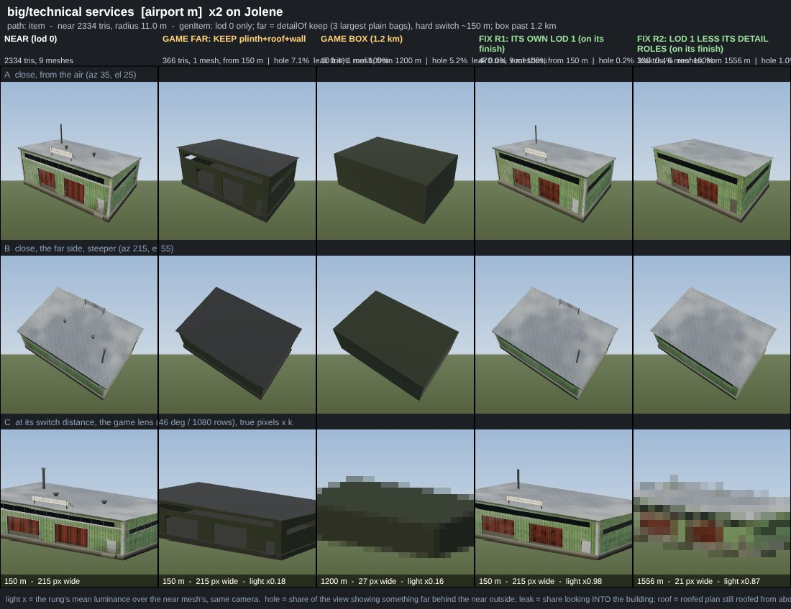

| rung | tris | meshes | from m | leak | hole | roof | light | black |
|---|---|---|---|---|---|---|---|---|
| NEAR (lod 0) | 2334 | 9 | - |  |  |  | 1.00 | 6.4% |
| GAME FAR: KEEP plinth+roof+wall | 366 | 1 | 150 | 0.4% | 7.1% | 100% | 0.18 | 2.6% |
| GAME BOX (1.2 km) | 10 | 1 | 1200 | 0.0% | 5.2% | 100% | 0.16 | 0.0% |
| FIX R1: ITS OWN LOD 1 (on its finish) | 470 | 9 | 150 | 0.4% | 0.2% | 100% | 0.98 | 8.0% |
| FIX R2: LOD 1 LESS ITS DETAIL ROLES (on its finish) | 330 | 6 | 1556 | 0.4% | 1.0% | 100% | 0.87 | 8.1% |

## big/terminal  [airport m]  x2 on Jolene

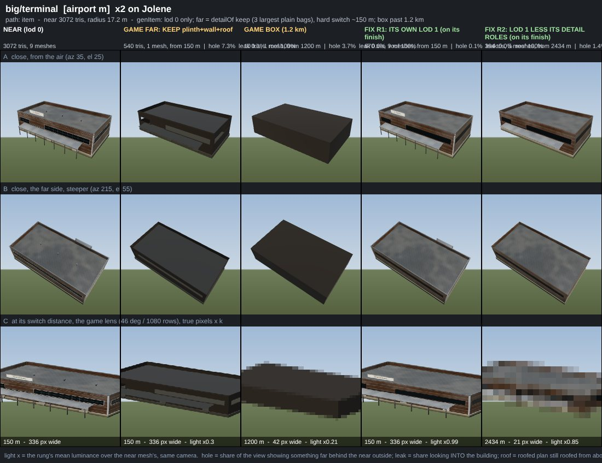

| rung | tris | meshes | from m | leak | hole | roof | light | black |
|---|---|---|---|---|---|---|---|---|
| NEAR (lod 0) | 3072 | 9 | - |  |  |  | 1.00 | 7.2% |
| GAME FAR: KEEP plinth+wall+roof | 540 | 1 | 150 | 0.1% | 7.3% | 100% | 0.30 | 26% |
| GAME BOX (1.2 km) | 10 | 1 | 1200 | 0.0% | 3.7% | 100% | 0.21 | 9.4% |
| FIX R1: ITS OWN LOD 1 (on its finish) | 670 | 9 | 150 | 0.0% | 0.1% | 100% | 0.99 | 9.2% |
| FIX R2: LOD 1 LESS ITS DETAIL ROLES (on its finish) | 394 | 5 | 2434 | 0.1% | 1.4% | 100% | 0.85 | 9.1% |

## big/tram shed  [landmark]

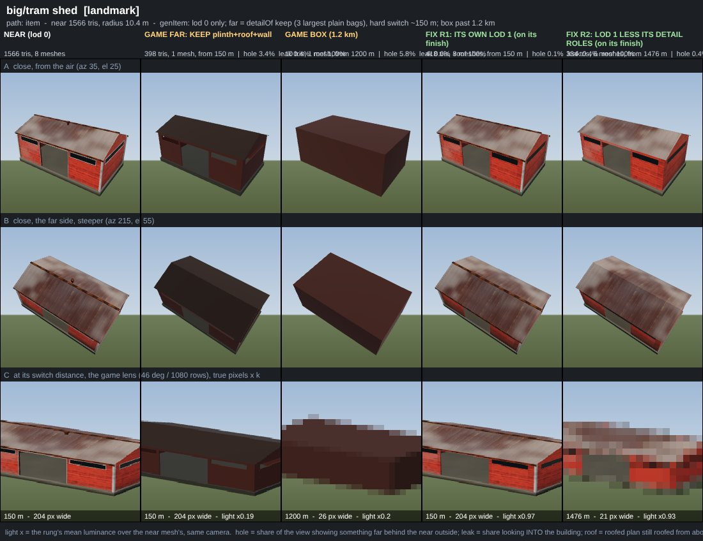

| rung | tris | meshes | from m | leak | hole | roof | light | black |
|---|---|---|---|---|---|---|---|---|
| NEAR (lod 0) | 1566 | 8 | - |  |  |  | 1.00 | 4.0% |
| GAME FAR: KEEP plinth+roof+wall | 398 | 1 | 150 | 0.4% | 3.4% | 100% | 0.19 | 0.3% |
| GAME BOX (1.2 km) | 10 | 1 | 1200 | 0.0% | 5.9% | 100% | 0.20 | 0.0% |
| FIX R1: ITS OWN LOD 1 (on its finish) | 418 | 8 | 150 | 0.4% | 0.1% | 100% | 0.97 | 4.4% |
| FIX R2: LOD 1 LESS ITS DETAIL ROLES (on its finish) | 334 | 6 | 1476 | 0.4% | 0.4% | 100% | 0.93 | 4.5% |

## big/warehouse  [industrial]  x3 on Jolene

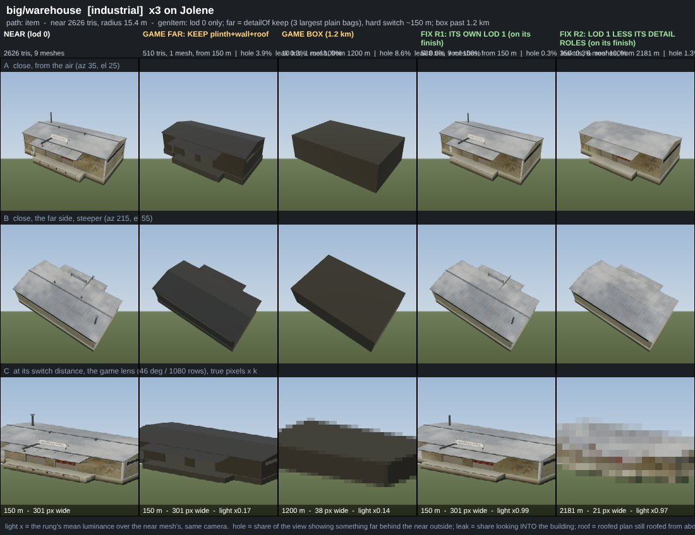

| rung | tris | meshes | from m | leak | hole | roof | light | black |
|---|---|---|---|---|---|---|---|---|
| NEAR (lod 0) | 2626 | 9 | - |  |  |  | 1.00 | 0.9% |
| GAME FAR: KEEP plinth+wall+roof | 510 | 1 | 150 | 0.3% | 4.0% | 100% | 0.17 | 0.0% |
| GAME BOX (1.2 km) | 10 | 1 | 1200 | 0.0% | 8.6% | 100% | 0.14 | 0.0% |
| FIX R1: ITS OWN LOD 1 (on its finish) | 538 | 9 | 150 | 0.3% | 0.3% | 100% | 0.99 | 1.2% |
| FIX R2: LOD 1 LESS ITS DETAIL ROLES (on its finish) | 350 | 6 | 2181 | 0.3% | 1.3% | 100% | 0.97 | 1.2% |

## big/workshop  [industrial]  x3 on Jolene

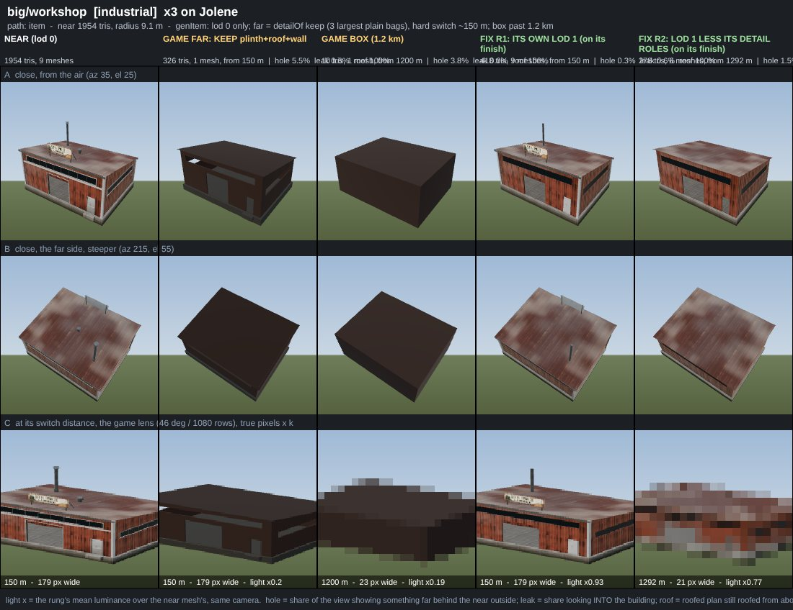

| rung | tris | meshes | from m | leak | hole | roof | light | black |
|---|---|---|---|---|---|---|---|---|
| NEAR (lod 0) | 1954 | 9 | - |  |  |  | 1.00 | 5.8% |
| GAME FAR: KEEP plinth+roof+wall | 326 | 1 | 150 | 0.6% | 5.5% | 100% | 0.20 | 14% |
| GAME BOX (1.2 km) | 10 | 1 | 1200 | 0.0% | 3.8% | 100% | 0.19 | 16% |
| FIX R1: ITS OWN LOD 1 (on its finish) | 418 | 9 | 150 | 0.6% | 0.3% | 100% | 0.93 | 7.1% |
| FIX R2: LOD 1 LESS ITS DETAIL ROLES (on its finish) | 278 | 6 | 1292 | 0.6% | 1.5% | 100% | 0.77 | 7.2% |

## hangar/club hangar  [airport s]

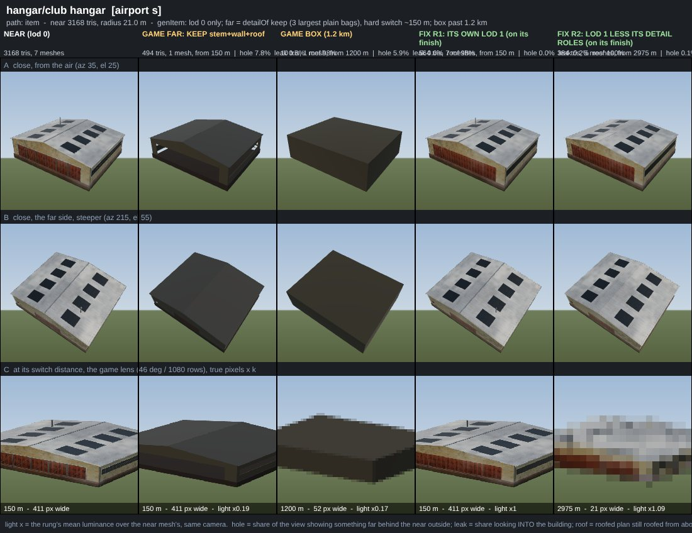

| rung | tris | meshes | from m | leak | hole | roof | light | black |
|---|---|---|---|---|---|---|---|---|
| NEAR (lod 0) | 3168 | 7 | - |  |  |  | 1.00 | 2.1% |
| GAME FAR: KEEP stem+wall+roof | 494 | 1 | 150 | 0.6% | 7.8% | 98% | 0.19 | 12% |
| GAME BOX (1.2 km) | 10 | 1 | 1200 | 0.0% | 5.9% | 98% | 0.17 | 12% |
| FIX R1: ITS OWN LOD 1 (on its finish) | 564 | 7 | 150 | 0.2% | 0.0% | 100% | 1.00 | 2.8% |
| FIX R2: LOD 1 LESS ITS DETAIL ROLES (on its finish) | 384 | 5 | 2975 | 0.2% | 0.1% | 98% | 1.09 | 2.8% |

## hangar/club hangar, long  [airport s]  x1 on Jolene

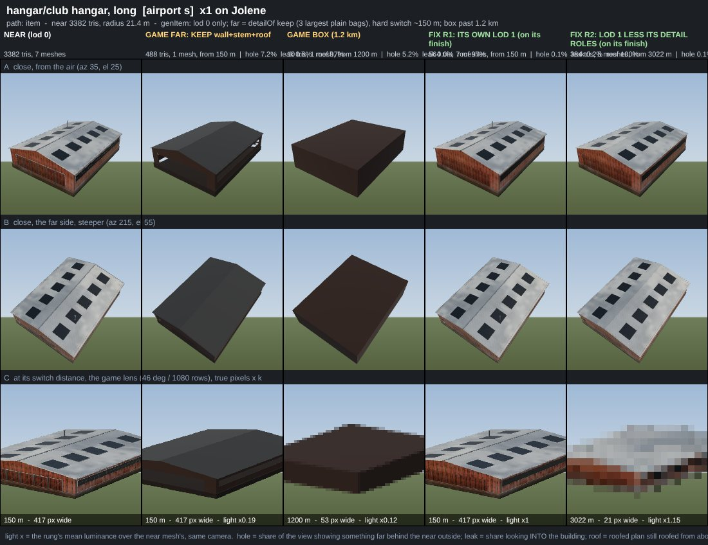

| rung | tris | meshes | from m | leak | hole | roof | light | black |
|---|---|---|---|---|---|---|---|---|
| NEAR (lod 0) | 3382 | 7 | - |  |  |  | 1.00 | 3.8% |
| GAME FAR: KEEP wall+stem+roof | 488 | 1 | 150 | 0.6% | 7.2% | 97% | 0.19 | 16% |
| GAME BOX (1.2 km) | 10 | 1 | 1200 | 0.0% | 5.2% | 97% | 0.12 | 18% |
| FIX R1: ITS OWN LOD 1 (on its finish) | 564 | 7 | 150 | 0.2% | 0.1% | 100% | 1.00 | 4.6% |
| FIX R2: LOD 1 LESS ITS DETAIL ROLES (on its finish) | 384 | 5 | 3022 | 0.2% | 0.1% | 97% | 1.15 | 4.6% |

## hangar/field shed  [airport xs]  x1 on Jolene

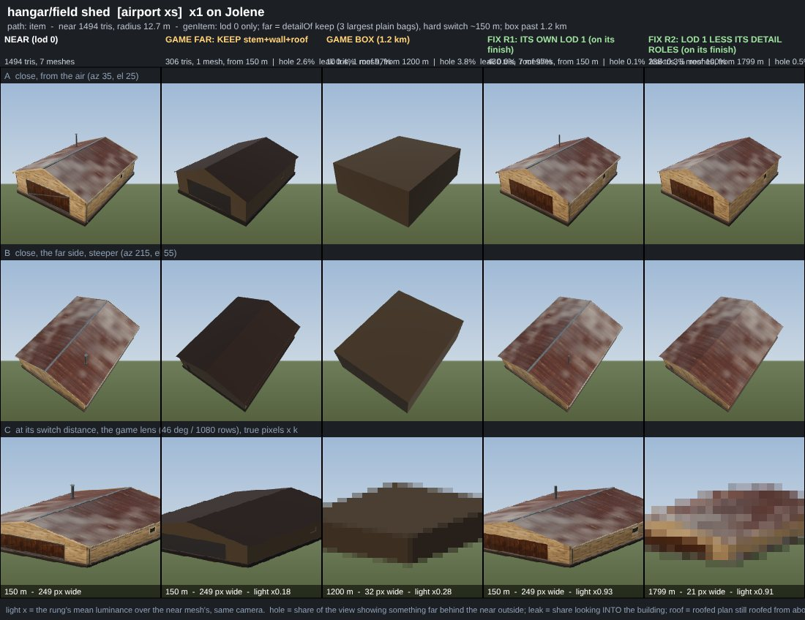

| rung | tris | meshes | from m | leak | hole | roof | light | black |
|---|---|---|---|---|---|---|---|---|
| NEAR (lod 0) | 1494 | 7 | - |  |  |  | 1.00 | 1.1% |
| GAME FAR: KEEP stem+wall+roof | 306 | 1 | 150 | 0.4% | 2.6% | 97% | 0.18 | 6.0% |
| GAME BOX (1.2 km) | 10 | 1 | 1200 | 0.0% | 3.8% | 97% | 0.28 | 0.0% |
| FIX R1: ITS OWN LOD 1 (on its finish) | 430 | 7 | 150 | 0.3% | 0.1% | 100% | 0.93 | 1.2% |
| FIX R2: LOD 1 LESS ITS DETAIL ROLES (on its finish) | 238 | 5 | 1799 | 0.4% | 0.5% | 97% | 0.91 | 1.2% |

## hangar/field shed, small  [airport xs]  x1 on Jolene

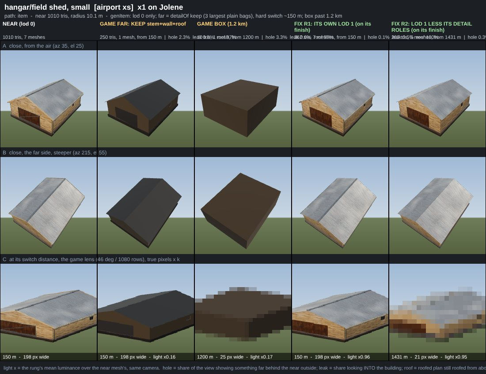

| rung | tris | meshes | from m | leak | hole | roof | light | black |
|---|---|---|---|---|---|---|---|---|
| NEAR (lod 0) | 1010 | 7 | - |  |  |  | 1.00 | 1.3% |
| GAME FAR: KEEP stem+wall+roof | 250 | 1 | 150 | 0.6% | 2.3% | 97% | 0.16 | 6.9% |
| GAME BOX (1.2 km) | 10 | 1 | 1200 | 0.0% | 3.3% | 97% | 0.17 | 0.0% |
| FIX R1: ITS OWN LOD 1 (on its finish) | 362 | 7 | 150 | 0.5% | 0.1% | 100% | 0.96 | 1.3% |
| FIX R2: LOD 1 LESS ITS DETAIL ROLES (on its finish) | 202 | 5 | 1431 | 0.6% | 0.3% | 97% | 0.95 | 1.3% |

## hangar/works hangar  [airport m]

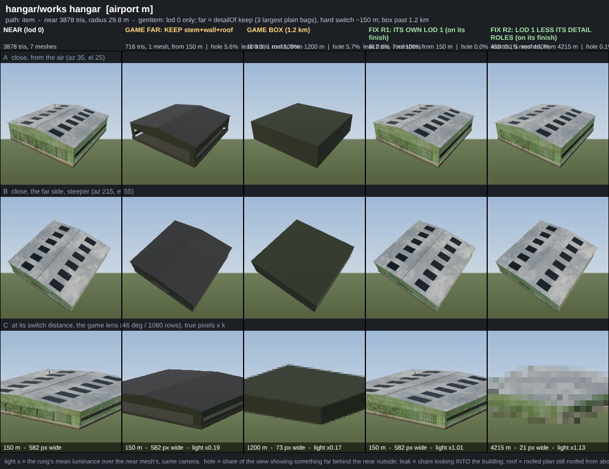

| rung | tris | meshes | from m | leak | hole | roof | light | black |
|---|---|---|---|---|---|---|---|---|
| NEAR (lod 0) | 3878 | 7 | - |  |  |  | 1.00 | 1.8% |
| GAME FAR: KEEP stem+wall+roof | 716 | 1 | 150 | 0.3% | 5.6% | 100% | 0.19 | 1.5% |
| GAME BOX (1.2 km) | 10 | 1 | 1200 | 0.0% | 5.7% | 100% | 0.17 | 0.6% |
| FIX R1: ITS OWN LOD 1 (on its finish) | 612 | 7 | 150 | 0.1% | 0.0% | 100% | 1.01 | 2.2% |
| FIX R2: LOD 1 LESS ITS DETAIL ROLES (on its finish) | 432 | 5 | 4215 | 0.1% | 0.1% | 100% | 1.13 | 2.2% |

## house/air taxi office  [commercial]  x2 on Jolene

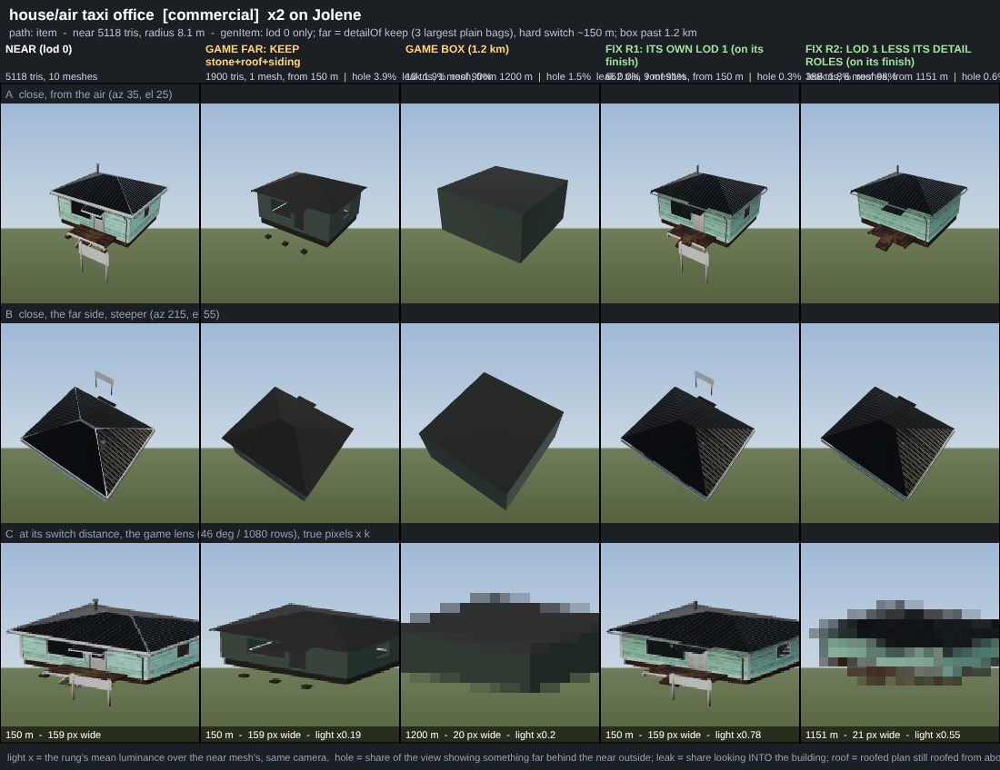

| rung | tris | meshes | from m | leak | hole | roof | light | black |
|---|---|---|---|---|---|---|---|---|
| NEAR (lod 0) | 5118 | 10 | - |  |  |  | 1.00 | 31% |
| GAME FAR: KEEP stone+roof+siding | 1900 | 1 | 150 | 1.9% | 3.9% | 90% | 0.19 | 12% |
| GAME BOX (1.2 km) | 10 | 1 | 1200 | 0.0% | 1.5% | 91% | 0.20 | 0.0% |
| FIX R1: ITS OWN LOD 1 (on its finish) | 652 | 9 | 150 | 1.8% | 0.3% | 98% | 0.78 | 33% |
| FIX R2: LOD 1 LESS ITS DETAIL ROLES (on its finish) | 388 | 6 | 1151 | 1.8% | 0.6% | 98% | 0.55 | 33% |

## house/bear tours  [commercial]  x1 on Jolene

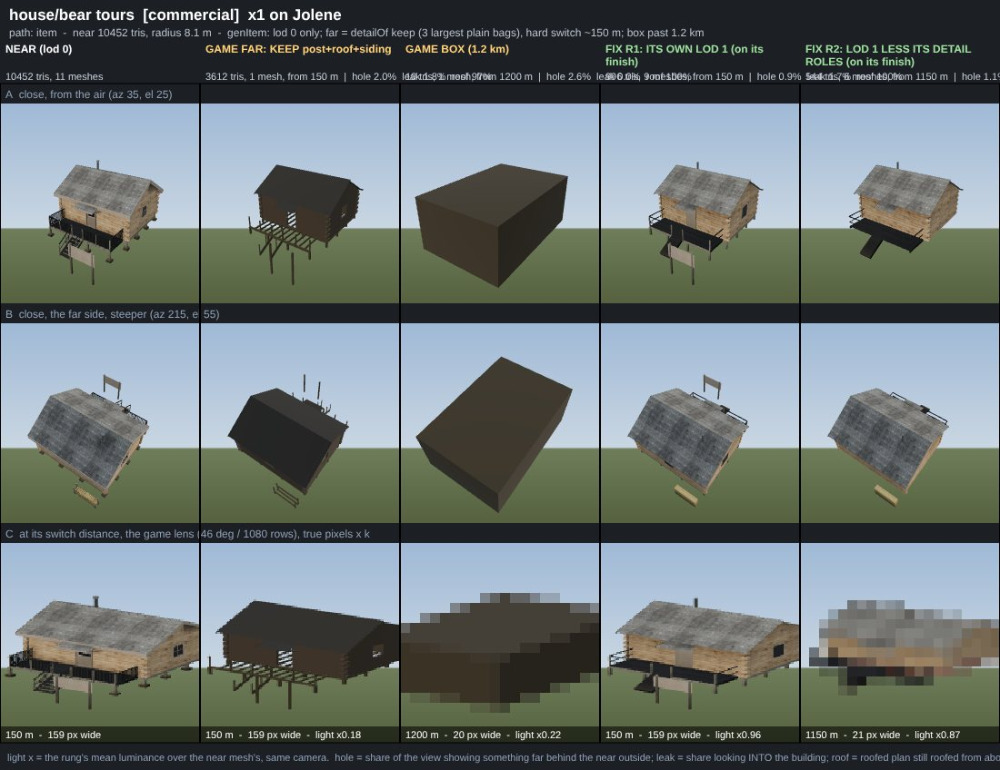

| rung | tris | meshes | from m | leak | hole | roof | light | black |
|---|---|---|---|---|---|---|---|---|
| NEAR (lod 0) | 10452 | 11 | - |  |  |  | 1.00 | 14% |
| GAME FAR: KEEP post+roof+siding | 3612 | 1 | 150 | 1.8% | 2.0% | 97% | 0.18 | 2.9% |
| GAME BOX (1.2 km) | 10 | 1 | 1200 | 0.0% | 2.6% | 100% | 0.22 | 0.0% |
| FIX R1: ITS OWN LOD 1 (on its finish) | 996 | 9 | 150 | 1.7% | 0.9% | 100% | 0.96 | 15% |
| FIX R2: LOD 1 LESS ITS DETAIL ROLES (on its finish) | 544 | 6 | 1150 | 1.7% | 1.1% | 100% | 0.87 | 18% |

## house/bunkhouse  [residential]  x2 on Jolene

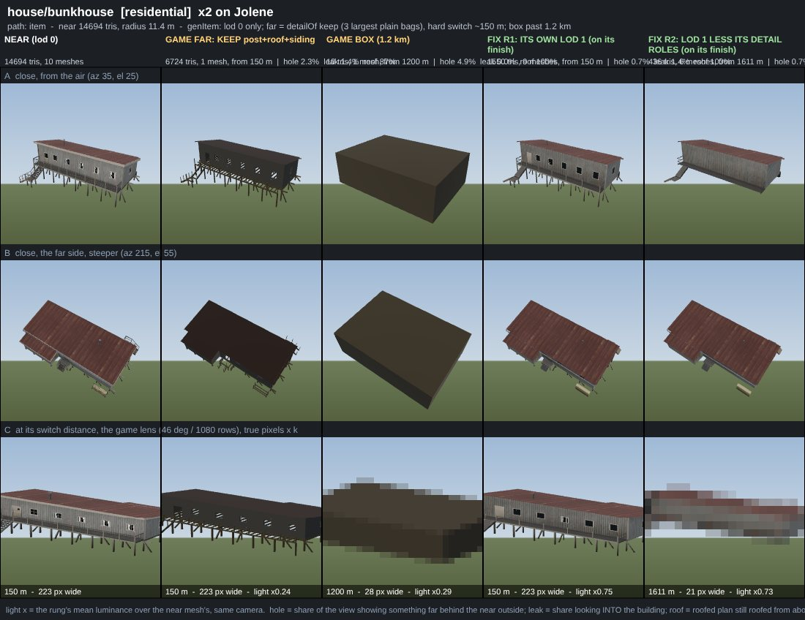

| rung | tris | meshes | from m | leak | hole | roof | light | black |
|---|---|---|---|---|---|---|---|---|
| NEAR (lod 0) | 14694 | 10 | - |  |  |  | 1.00 | 2.2% |
| GAME FAR: KEEP post+roof+siding | 6724 | 1 | 150 | 1.4% | 2.3% | 87% | 0.24 | 4.8% |
| GAME BOX (1.2 km) | 10 | 1 | 1200 | 0.0% | 4.9% | 100% | 0.29 | 0.0% |
| FIX R1: ITS OWN LOD 1 (on its finish) | 1550 | 9 | 150 | 1.4% | 0.7% | 100% | 0.75 | 4.1% |
| FIX R2: LOD 1 LESS ITS DETAIL ROLES (on its finish) | 436 | 6 | 1611 | 1.4% | 0.7% | 99% | 0.73 | 0.4% |

## house/cafe  [commercial]  x4 on Jolene

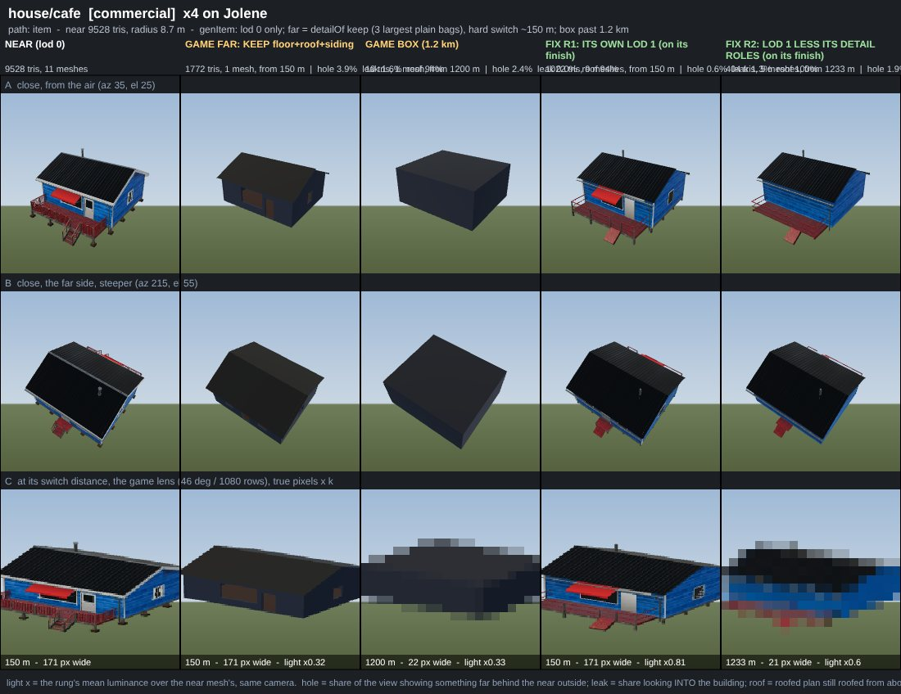

| rung | tris | meshes | from m | leak | hole | roof | light | black |
|---|---|---|---|---|---|---|---|---|
| NEAR (lod 0) | 9528 | 11 | - |  |  |  | 1.00 | 35% |
| GAME FAR: KEEP floor+roof+siding | 1772 | 1 | 150 | 1.6% | 3.9% | 94% | 0.32 | 0.7% |
| GAME BOX (1.2 km) | 10 | 1 | 1200 | 0.0% | 2.4% | 94% | 0.33 | 0.0% |
| FIX R1: ITS OWN LOD 1 (on its finish) | 1022 | 9 | 150 | 1.3% | 0.6% | 100% | 0.81 | 38% |
| FIX R2: LOD 1 LESS ITS DETAIL ROLES (on its finish) | 404 | 5 | 1233 | 1.4% | 1.9% | 97% | 0.60 | 37% |

## house/cannery shed  [industrial]

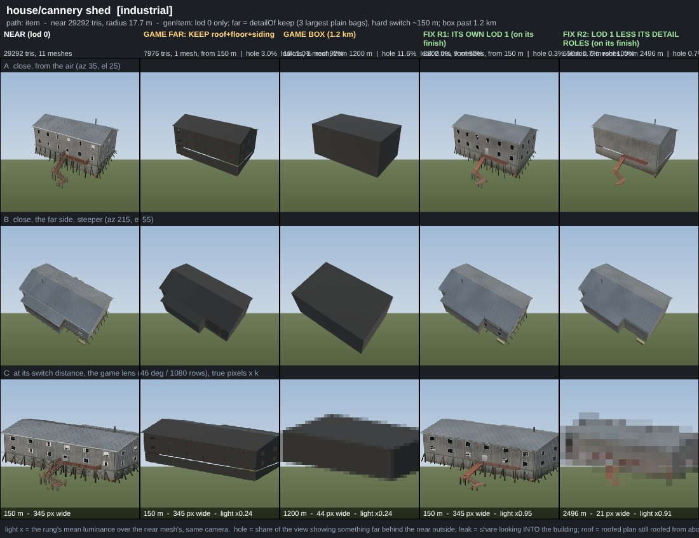

| rung | tris | meshes | from m | leak | hole | roof | light | black |
|---|---|---|---|---|---|---|---|---|
| NEAR (lod 0) | 29292 | 11 | - |  |  |  | 1.00 | 2.5% |
| GAME FAR: KEEP roof+floor+siding | 7976 | 1 | 150 | 1.0% | 3.0% | 92% | 0.24 | 0.4% |
| GAME BOX (1.2 km) | 10 | 1 | 1200 | 0.0% | 12% | 92% | 0.24 | 0.0% |
| FIX R1: ITS OWN LOD 1 (on its finish) | 2202 | 9 | 150 | 0.7% | 0.3% | 100% | 0.95 | 3.7% |
| FIX R2: LOD 1 LESS ITS DETAIL ROLES (on its finish) | 550 | 6 | 2496 | 0.9% | 0.7% | 98% | 0.91 | 0.0% |

## house/chapel  [official]  x2 on Jolene

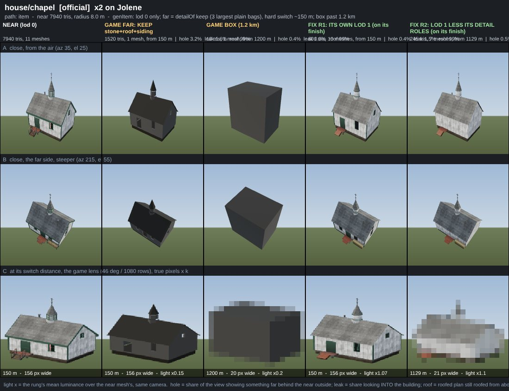

| rung | tris | meshes | from m | leak | hole | roof | light | black |
|---|---|---|---|---|---|---|---|---|
| NEAR (lod 0) | 7940 | 11 | - |  |  |  | 1.00 | 1.7% |
| GAME FAR: KEEP stone+roof+siding | 1520 | 1 | 150 | 1.7% | 3.2% | 99% | 0.15 | 8.4% |
| GAME BOX (1.2 km) | 10 | 1 | 1200 | 0.0% | 0.4% | 99% | 0.20 | 0.0% |
| FIX R1: ITS OWN LOD 1 (on its finish) | 601 | 10 | 150 | 1.5% | 0.4% | 99% | 1.07 | 2.5% |
| FIX R2: LOD 1 LESS ITS DETAIL ROLES (on its finish) | 245 | 7 | 1129 | 1.6% | 0.5% | 99% | 1.10 | 1.5% |

## house/church  [official]  x2 on Jolene

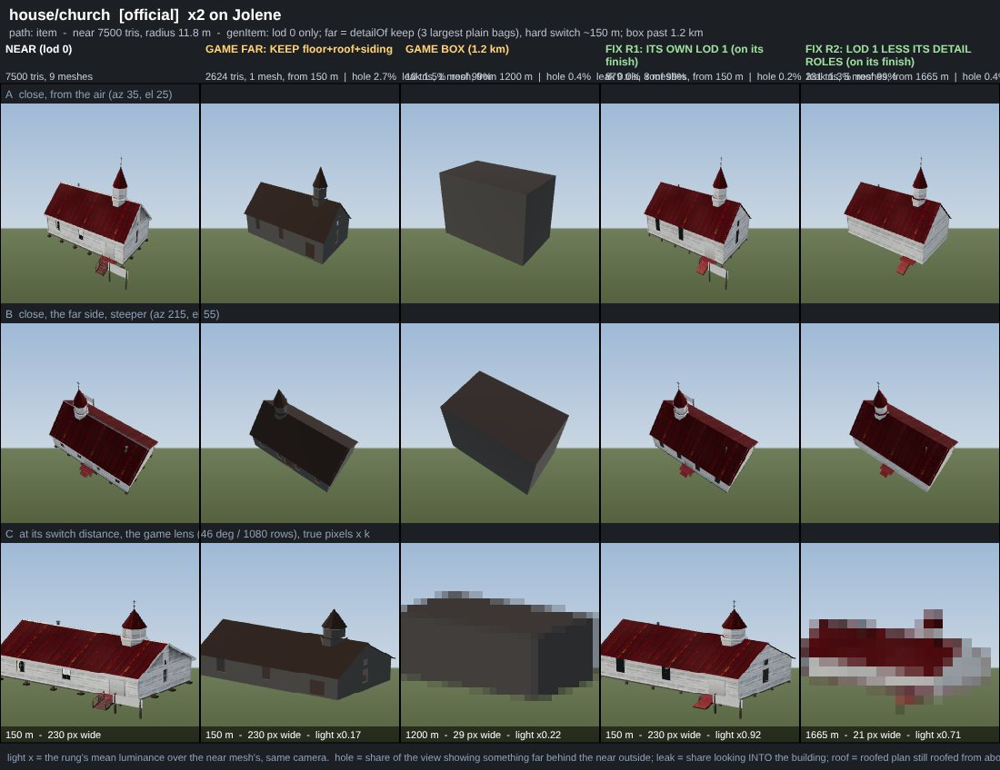

| rung | tris | meshes | from m | leak | hole | roof | light | black |
|---|---|---|---|---|---|---|---|---|
| NEAR (lod 0) | 7500 | 9 | - |  |  |  | 1.00 | 0.7% |
| GAME FAR: KEEP floor+roof+siding | 2624 | 1 | 150 | 1.5% | 2.7% | 99% | 0.17 | 2.3% |
| GAME BOX (1.2 km) | 10 | 1 | 1200 | 0.0% | 0.4% | 99% | 0.22 | 0.0% |
| FIX R1: ITS OWN LOD 1 (on its finish) | 879 | 8 | 150 | 1.3% | 0.2% | 100% | 0.92 | 2.1% |
| FIX R2: LOD 1 LESS ITS DETAIL ROLES (on its finish) | 231 | 5 | 1665 | 1.4% | 0.4% | 99% | 0.71 | 0.5% |

## house/clinic  [official]  x5 on Jolene

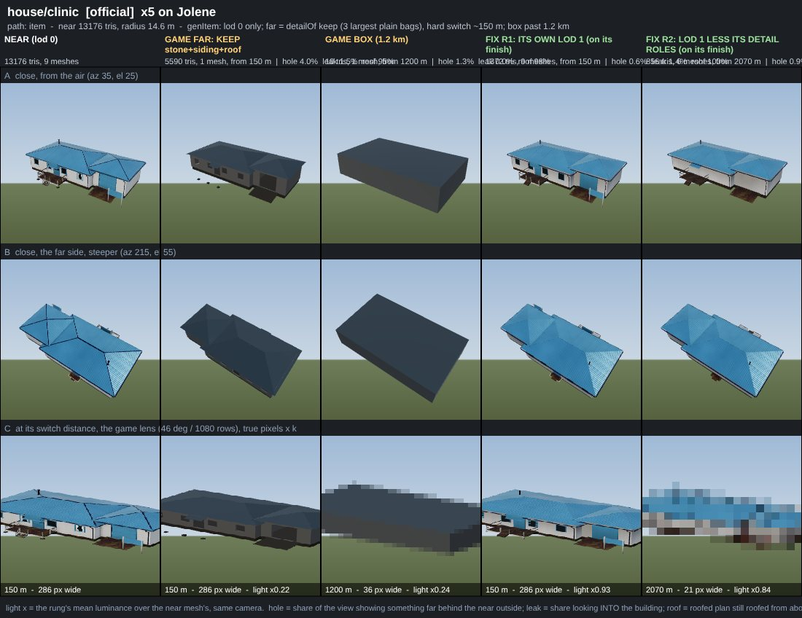

| rung | tris | meshes | from m | leak | hole | roof | light | black |
|---|---|---|---|---|---|---|---|---|
| NEAR (lod 0) | 13176 | 9 | - |  |  |  | 1.00 | 2.8% |
| GAME FAR: KEEP stone+siding+roof | 5590 | 1 | 150 | 1.5% | 4.0% | 95% | 0.22 | 4.8% |
| GAME BOX (1.2 km) | 10 | 1 | 1200 | 0.0% | 1.3% | 98% | 0.24 | 0.0% |
| FIX R1: ITS OWN LOD 1 (on its finish) | 1372 | 9 | 150 | 1.4% | 0.6% | 100% | 0.93 | 3.8% |
| FIX R2: LOD 1 LESS ITS DETAIL ROLES (on its finish) | 856 | 6 | 2070 | 1.5% | 0.9% | 100% | 0.84 | 3.1% |

## house/clubhouse  [sports]

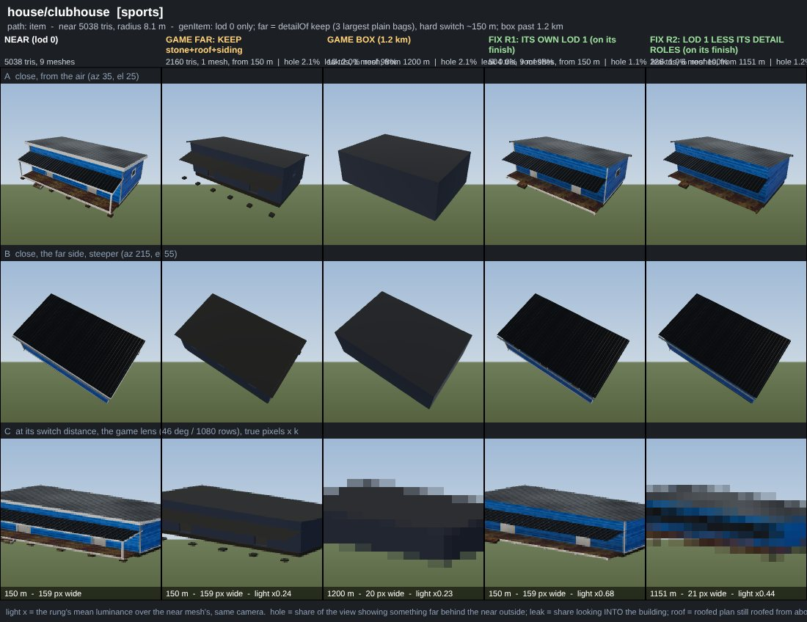

| rung | tris | meshes | from m | leak | hole | roof | light | black |
|---|---|---|---|---|---|---|---|---|
| NEAR (lod 0) | 5038 | 9 | - |  |  |  | 1.00 | 17% |
| GAME FAR: KEEP stone+roof+siding | 2160 | 1 | 150 | 2.0% | 2.1% | 98% | 0.24 | 7.3% |
| GAME BOX (1.2 km) | 10 | 1 | 1200 | 0.0% | 2.1% | 98% | 0.23 | 0.0% |
| FIX R1: ITS OWN LOD 1 (on its finish) | 504 | 9 | 150 | 1.9% | 1.1% | 100% | 0.68 | 18% |
| FIX R2: LOD 1 LESS ITS DETAIL ROLES (on its finish) | 226 | 6 | 1151 | 1.9% | 1.2% | 100% | 0.44 | 19% |

## house/concession stand  [sports]

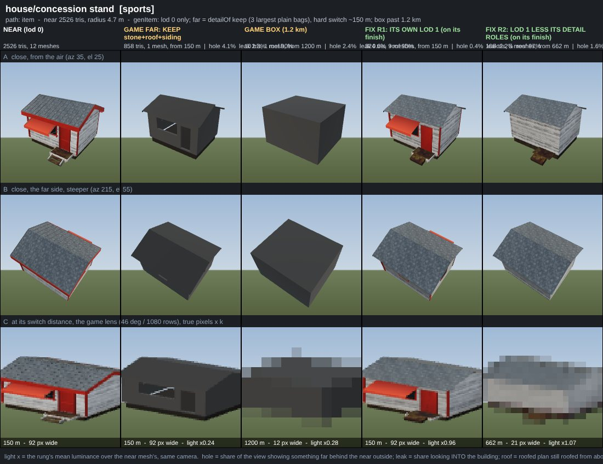

| rung | tris | meshes | from m | leak | hole | roof | light | black |
|---|---|---|---|---|---|---|---|---|
| NEAR (lod 0) | 2526 | 12 | - |  |  |  | 1.00 | 1.5% |
| GAME FAR: KEEP stone+roof+siding | 858 | 1 | 150 | 2.3% | 4.1% | 90% | 0.24 | 6.4% |
| GAME BOX (1.2 km) | 10 | 1 | 1200 | 0.0% | 2.4% | 90% | 0.28 | 0.0% |
| FIX R1: ITS OWN LOD 1 (on its finish) | 324 | 9 | 150 | 2.2% | 0.4% | 97% | 0.96 | 2.1% |
| FIX R2: LOD 1 LESS ITS DETAIL ROLES (on its finish) | 108 | 5 | 662 | 2.2% | 1.6% | 90% | 1.07 | 2.3% |

## house/control tower  [airport m]

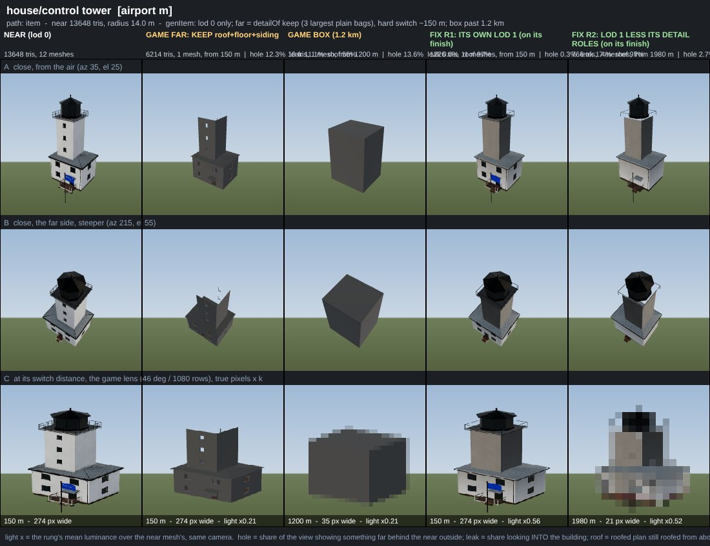

| rung | tris | meshes | from m | leak | hole | roof | light | black |
|---|---|---|---|---|---|---|---|---|
| NEAR (lod 0) | 13648 | 12 | - |  |  |  | 1.00 | 19% |
| GAME FAR: KEEP roof+floor+siding | 6214 | 1 | 150 | 11% | 12% | 55% | 0.21 | 0.0% |
| GAME BOX (1.2 km) | 10 | 1 | 1200 | 0.0% | 14% | 97% | 0.21 | 0.0% |
| FIX R1: ITS OWN LOD 1 (on its finish) | 1226 | 11 | 150 | 1.5% | 0.3% | 97% | 0.56 | 17% |
| FIX R2: LOD 1 LESS ITS DETAIL ROLES (on its finish) | 766 | 7 | 1980 | 2.7% | 2.7% | 82% | 0.52 | 14% |

## house/fish shack  [industrial]  x2 on Jolene

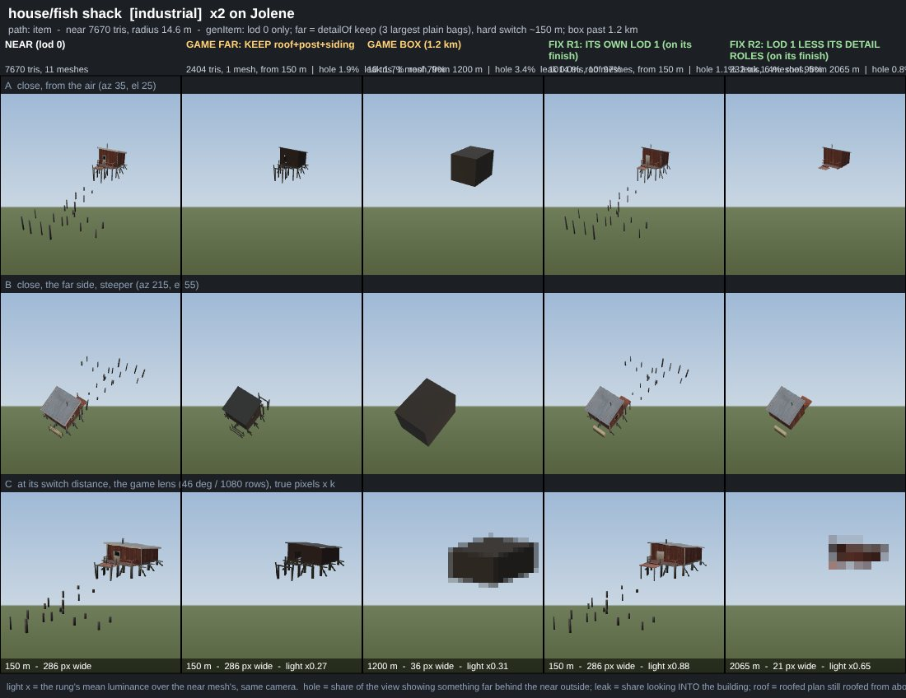

| rung | tris | meshes | from m | leak | hole | roof | light | black |
|---|---|---|---|---|---|---|---|---|
| NEAR (lod 0) | 7670 | 11 | - |  |  |  | 1.00 | 12% |
| GAME FAR: KEEP roof+post+siding | 2404 | 1 | 150 | 1.7% | 1.9% | 79% | 0.27 | 37% |
| GAME BOX (1.2 km) | 10 | 1 | 1200 | 0.0% | 3.4% | 97% | 0.31 | 31% |
| FIX R1: ITS OWN LOD 1 (on its finish) | 1014 | 10 | 150 | 1.4% | 1.1% | 96% | 0.88 | 12% |
| FIX R2: LOD 1 LESS ITS DETAIL ROLES (on its finish) | 232 | 6 | 2065 | 1.8% | 0.8% | 91% | 0.65 | 0.0% |

## house/flight service  [airport m]

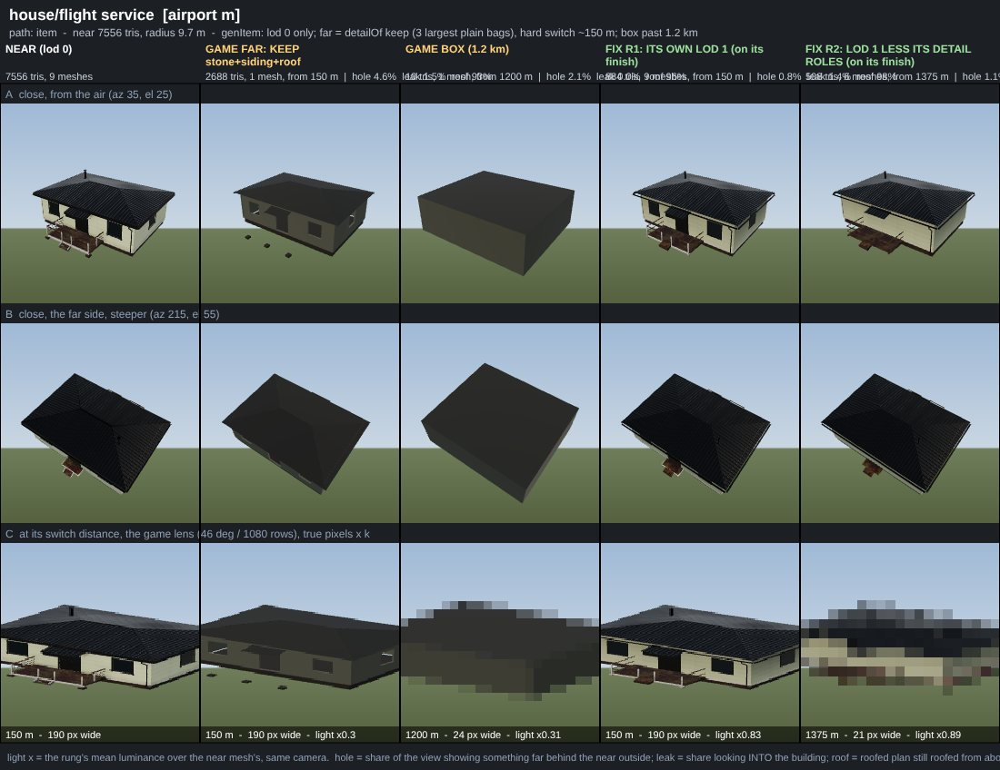

| rung | tris | meshes | from m | leak | hole | roof | light | black |
|---|---|---|---|---|---|---|---|---|
| NEAR (lod 0) | 7556 | 9 | - |  |  |  | 1.00 | 37% |
| GAME FAR: KEEP stone+siding+roof | 2688 | 1 | 150 | 1.5% | 4.6% | 93% | 0.30 | 5.8% |
| GAME BOX (1.2 km) | 10 | 1 | 1200 | 0.0% | 2.1% | 96% | 0.31 | 0.0% |
| FIX R1: ITS OWN LOD 1 (on its finish) | 884 | 9 | 150 | 1.4% | 0.8% | 98% | 0.83 | 34% |
| FIX R2: LOD 1 LESS ITS DETAIL ROLES (on its finish) | 508 | 6 | 1375 | 1.4% | 1.1% | 98% | 0.89 | 27% |

## house/flying club  [airport s]  x1 on Jolene

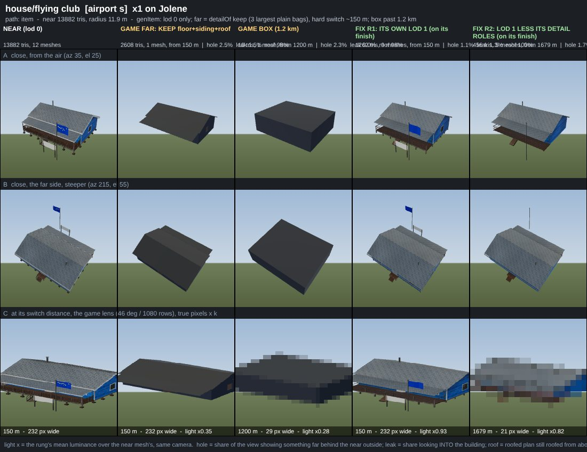

| rung | tris | meshes | from m | leak | hole | roof | light | black |
|---|---|---|---|---|---|---|---|---|
| NEAR (lod 0) | 13882 | 12 | - |  |  |  | 1.00 | 1.8% |
| GAME FAR: KEEP floor+siding+roof | 2608 | 1 | 150 | 1.5% | 2.5% | 98% | 0.35 | 0.0% |
| GAME BOX (1.2 km) | 10 | 1 | 1200 | 0.0% | 2.3% | 98% | 0.28 | 0.0% |
| FIX R1: ITS OWN LOD 1 (on its finish) | 1262 | 9 | 150 | 1.3% | 1.1% | 100% | 0.93 | 1.0% |
| FIX R2: LOD 1 LESS ITS DETAIL ROLES (on its finish) | 456 | 5 | 1679 | 1.4% | 1.7% | 100% | 0.82 | 0.5% |

## house/fuel and bait  [commercial]  x1 on Jolene

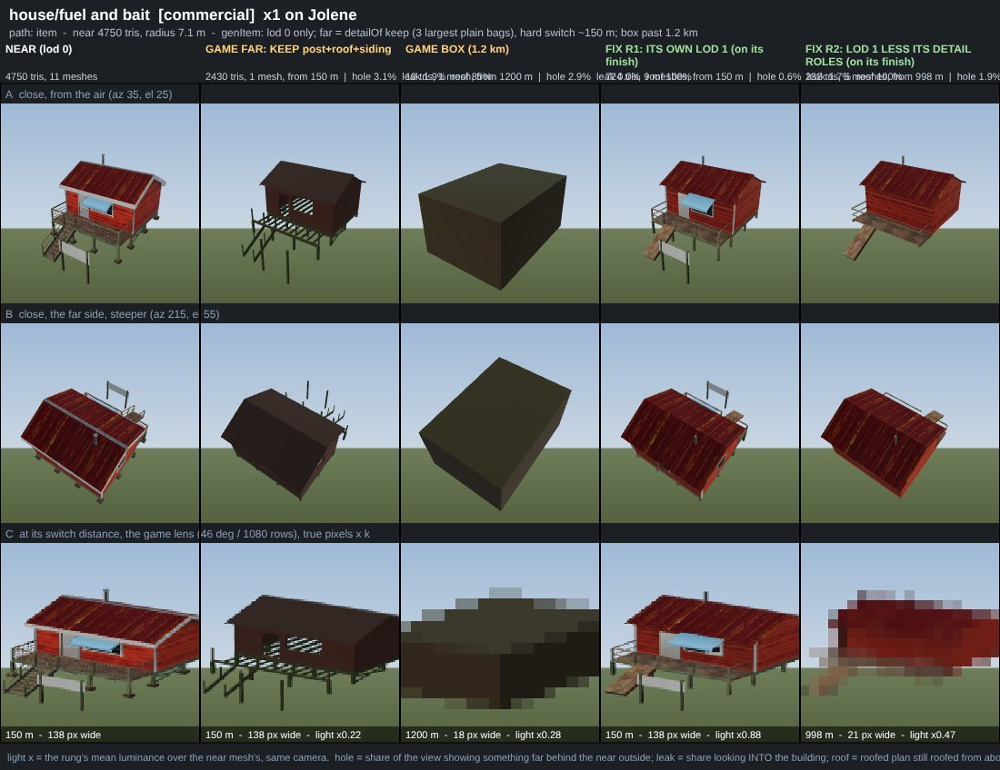

| rung | tris | meshes | from m | leak | hole | roof | light | black |
|---|---|---|---|---|---|---|---|---|
| NEAR (lod 0) | 4750 | 11 | - |  |  |  | 1.00 | 2.4% |
| GAME FAR: KEEP post+roof+siding | 2430 | 1 | 150 | 1.9% | 3.1% | 85% | 0.22 | 14% |
| GAME BOX (1.2 km) | 10 | 1 | 1200 | 0.0% | 2.9% | 100% | 0.28 | 28% |
| FIX R1: ITS OWN LOD 1 (on its finish) | 724 | 9 | 150 | 1.8% | 0.6% | 100% | 0.88 | 2.1% |
| FIX R2: LOD 1 LESS ITS DETAIL ROLES (on its finish) | 232 | 5 | 998 | 1.9% | 1.9% | 97% | 0.47 | 1.0% |

## house/gambrel barn  [shed]

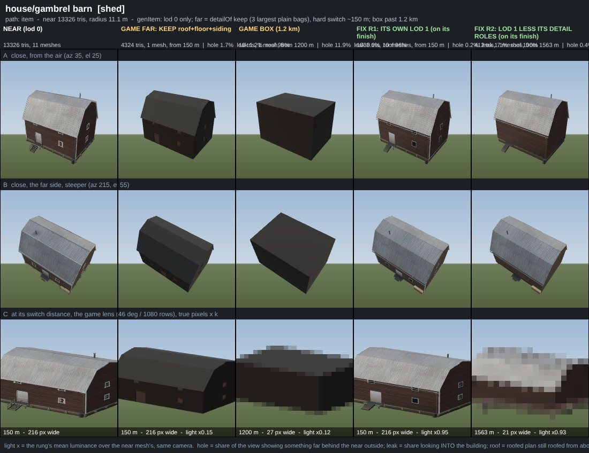

| rung | tris | meshes | from m | leak | hole | roof | light | black |
|---|---|---|---|---|---|---|---|---|
| NEAR (lod 0) | 13326 | 11 | - |  |  |  | 1.00 | 2.8% |
| GAME FAR: KEEP roof+floor+siding | 4324 | 1 | 150 | 1.2% | 1.7% | 96% | 0.15 | 45% |
| GAME BOX (1.2 km) | 10 | 1 | 1200 | 0.0% | 12% | 96% | 0.12 | 70% |
| FIX R1: ITS OWN LOD 1 (on its finish) | 1038 | 10 | 150 | 1.1% | 0.2% | 100% | 0.95 | 6.2% |
| FIX R2: LOD 1 LESS ITS DETAIL ROLES (on its finish) | 412 | 7 | 1563 | 1.3% | 0.4% | 100% | 0.93 | 5.8% |

## house/garage  [shed]  x1 on Jolene

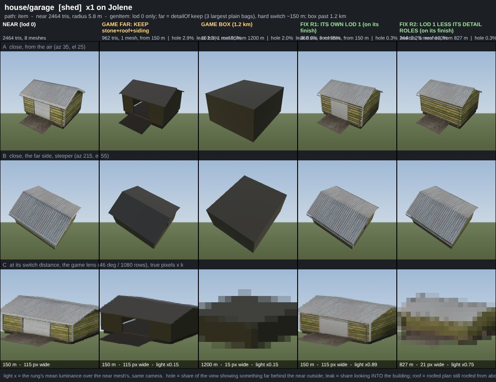

| rung | tris | meshes | from m | leak | hole | roof | light | black |
|---|---|---|---|---|---|---|---|---|
| NEAR (lod 0) | 2464 | 8 | - |  |  |  | 1.00 | 1.0% |
| GAME FAR: KEEP stone+roof+siding | 962 | 1 | 150 | 2.3% | 2.9% | 95% | 0.15 | 19% |
| GAME BOX (1.2 km) | 10 | 1 | 1200 | 0.0% | 1.9% | 97% | 0.15 | 22% |
| FIX R1: ITS OWN LOD 1 (on its finish) | 368 | 8 | 150 | 2.2% | 0.3% | 100% | 0.89 | 1.2% |
| FIX R2: LOD 1 LESS ITS DETAIL ROLES (on its finish) | 244 | 5 | 827 | 2.2% | 0.3% | 100% | 0.75 | 1.6% |

## house/general store  [commercial]  x4 on Jolene

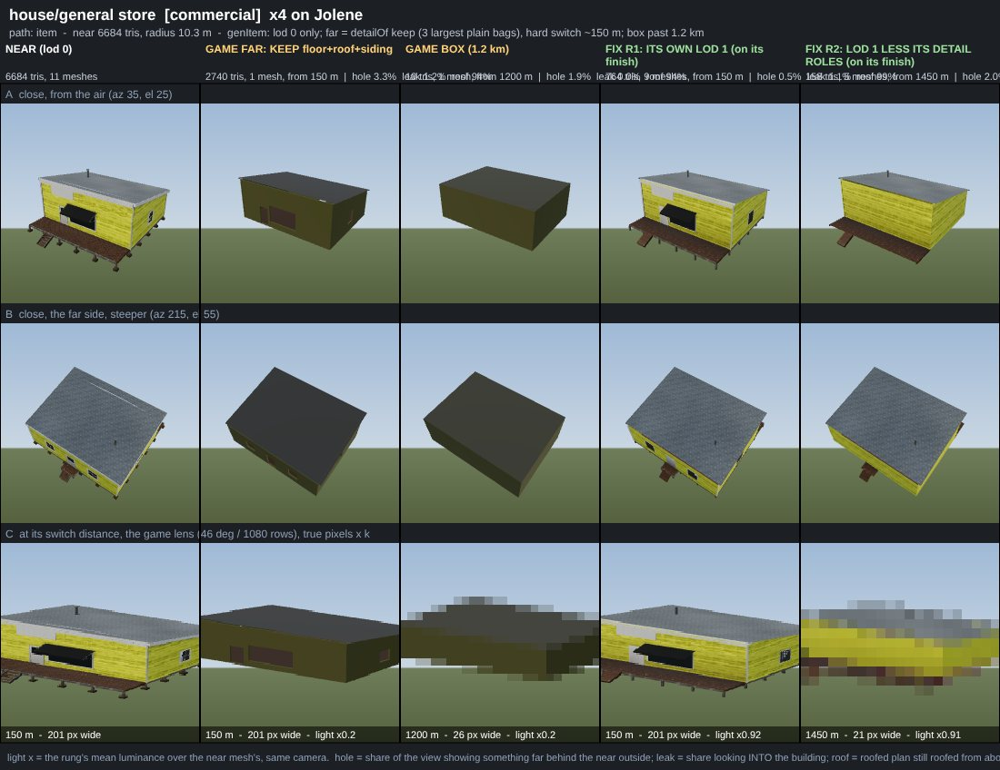

| rung | tris | meshes | from m | leak | hole | roof | light | black |
|---|---|---|---|---|---|---|---|---|
| NEAR (lod 0) | 6684 | 11 | - |  |  |  | 1.00 | 6.5% |
| GAME FAR: KEEP floor+roof+siding | 2740 | 1 | 150 | 1.2% | 3.3% | 94% | 0.20 | 0.0% |
| GAME BOX (1.2 km) | 10 | 1 | 1200 | 0.0% | 1.9% | 94% | 0.20 | 0.0% |
| FIX R1: ITS OWN LOD 1 (on its finish) | 764 | 9 | 150 | 1.1% | 0.5% | 99% | 0.92 | 6.7% |
| FIX R2: LOD 1 LESS ITS DETAIL ROLES (on its finish) | 158 | 5 | 1450 | 1.1% | 2.0% | 94% | 0.91 | 0.3% |

## house/hip cottage  [residential]  x1 on Jolene

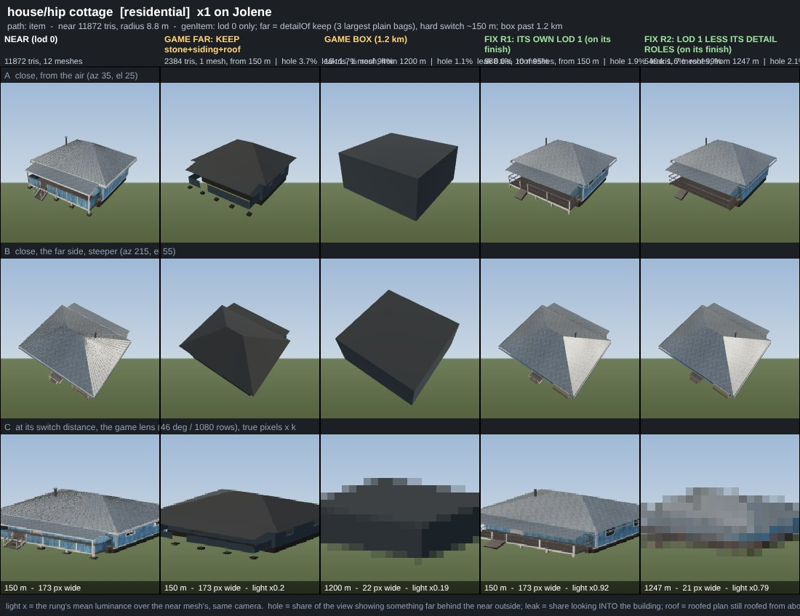

| rung | tris | meshes | from m | leak | hole | roof | light | black |
|---|---|---|---|---|---|---|---|---|
| NEAR (lod 0) | 11872 | 12 | - |  |  |  | 1.00 | 1.5% |
| GAME FAR: KEEP stone+siding+roof | 2384 | 1 | 150 | 1.7% | 3.6% | 95% | 0.20 | 7.9% |
| GAME BOX (1.2 km) | 10 | 1 | 1200 | 0.0% | 1.1% | 95% | 0.19 | 0.0% |
| FIX R1: ITS OWN LOD 1 (on its finish) | 988 | 10 | 150 | 1.6% | 1.9% | 99% | 0.92 | 1.7% |
| FIX R2: LOD 1 LESS ITS DETAIL ROLES (on its finish) | 540 | 7 | 1247 | 1.6% | 2.1% | 99% | 0.79 | 1.8% |

## house/kennecott mill  [landmark]  x1 on Jolene

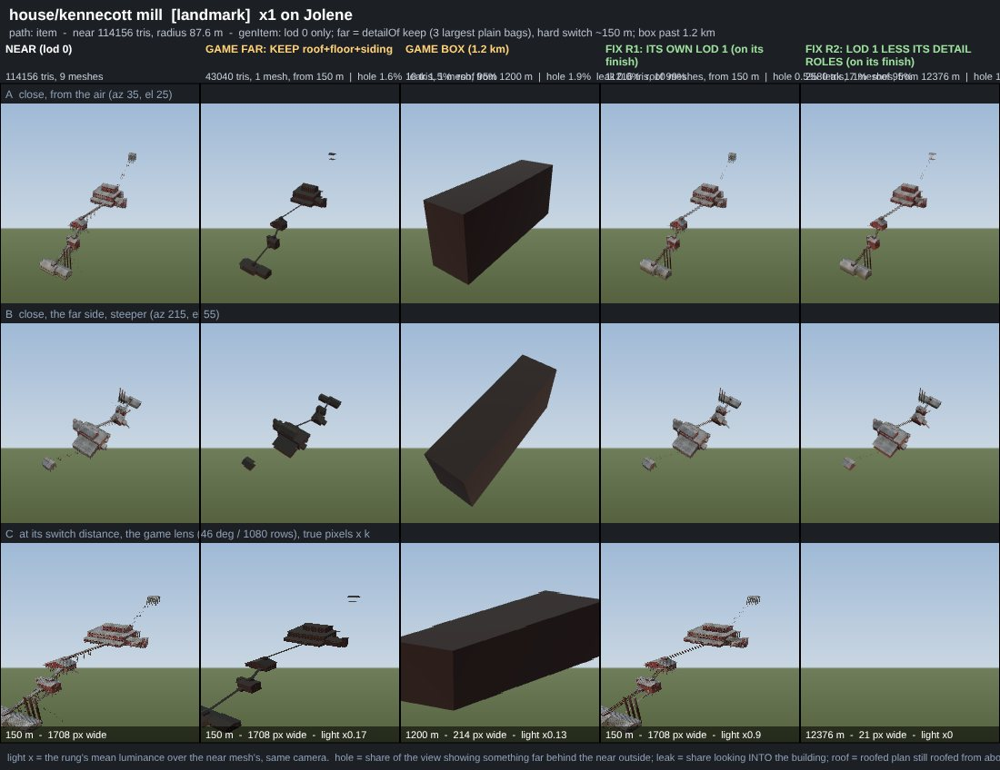

| rung | tris | meshes | from m | leak | hole | roof | light | black |
|---|---|---|---|---|---|---|---|---|
| NEAR (lod 0) | 114156 | 9 | - |  |  |  | 1.00 | 1.7% |
| GAME FAR: KEEP roof+floor+siding | 43040 | 1 | 150 | 1.5% | 1.6% | 95% | 0.17 | 11% |
| GAME BOX (1.2 km) | 10 | 1 | 1200 | 0.0% | 1.9% | 100% | 0.13 | 50% |
| FIX R1: ITS OWN LOD 1 (on its finish) | 11216 | 10 | 150 | 1.1% | 0.5% | 95% | 0.90 | 2.3% |
| FIX R2: LOD 1 LESS ITS DETAIL ROLES (on its finish) | 2580 | 7 | 12376 | 1.3% | 1.0% | 95% | 0.00 | 2.2% |

## house/lighthouse  [official]

| rung | tris | meshes | from m | leak | hole | roof | light | black |
|---|---|---|---|---|---|---|---|---|
| NEAR (lod 0) | 13322 | 11 | - |  |  |  | 1.00 | 6.9% |
| GAME FAR: KEEP stone+roof+siding | 5476 | 1 | 150 | 6.1% | 7.7% | 79% | 0.20 | 5.5% |
| GAME BOX (1.2 km) | 10 | 1 | 1200 | 0.0% | 8.6% | 93% | 0.23 | 0.0% |
| FIX R1: ITS OWN LOD 1 (on its finish) | 1434 | 11 | 150 | 1.5% | 0.3% | 98% | 0.62 | 7.4% |
| FIX R2: LOD 1 LESS ITS DETAIL ROLES (on its finish) | 978 | 7 | 1991 | 3.5% | 3.4% | 88% | 0.47 | 6.8% |

## house/lighthouse octagon  [official]

| rung | tris | meshes | from m | leak | hole | roof | light | black |
|---|---|---|---|---|---|---|---|---|
| NEAR (lod 0) | 11810 | 9 | - |  |  |  | 1.00 | 8.5% |
| GAME FAR: KEEP roof+floor+siding | 5192 | 1 | 150 | 3.7% | 7.9% | 96% | 0.20 | 0.0% |
| GAME BOX (1.2 km) | 10 | 1 | 1200 | 0.0% | 6.6% | 96% | 0.21 | 0.0% |
| FIX R1: ITS OWN LOD 1 (on its finish) | 1114 | 10 | 150 | 1.3% | 0.2% | 100% | 0.83 | 10% |
| FIX R2: LOD 1 LESS ITS DETAIL ROLES (on its finish) | 682 | 7 | 1608 | 2.1% | 2.3% | 100% | 0.82 | 7.3% |

## house/log cabin  [residential]  x7 on Jolene

| rung | tris | meshes | from m | leak | hole | roof | light | black |
|---|---|---|---|---|---|---|---|---|
| NEAR (lod 0) | 9580 | 11 | - |  |  |  | 1.00 | 6.9% |
| GAME FAR: KEEP post+siding+roof | 3068 | 1 | 150 | 1.9% | 2.8% | 98% | 0.17 | 15% |
| GAME BOX (1.2 km) | 10 | 1 | 1200 | 0.0% | 2.8% | 98% | 0.18 | 21% |
| FIX R1: ITS OWN LOD 1 (on its finish) | 848 | 9 | 150 | 1.9% | 2.0% | 98% | 0.98 | 2.6% |
| FIX R2: LOD 1 LESS ITS DETAIL ROLES (on its finish) | 444 | 6 | 966 | 1.9% | 2.0% | 98% | 0.91 | 2.4% |

## house/marine supply  [commercial]  x2 on Jolene

| rung | tris | meshes | from m | leak | hole | roof | light | black |
|---|---|---|---|---|---|---|---|---|
| NEAR (lod 0) | 7634 | 10 | - |  |  |  | 1.00 | 4.6% |
| GAME FAR: KEEP floor+roof+siding | 2410 | 1 | 150 | 1.3% | 3.2% | 82% | 0.22 | 0.6% |
| GAME BOX (1.2 km) | 10 | 1 | 1200 | 0.0% | 2.6% | 82% | 0.22 | 0.0% |
| FIX R1: ITS OWN LOD 1 (on its finish) | 952 | 8 | 150 | 1.1% | 0.5% | 100% | 0.92 | 4.8% |
| FIX R2: LOD 1 LESS ITS DETAIL ROLES (on its finish) | 278 | 5 | 1455 | 1.1% | 1.0% | 99% | 0.84 | 0.5% |

## house/mine bunkhouse  [residential]  x1 on Jolene

| rung | tris | meshes | from m | leak | hole | roof | light | black |
|---|---|---|---|---|---|---|---|---|
| NEAR (lod 0) | 19634 | 11 | - |  |  |  | 1.00 | 2.2% |
| GAME FAR: KEEP roof+floor+siding | 4868 | 1 | 150 | 0.9% | 3.2% | 99% | 0.22 | 16% |
| GAME BOX (1.2 km) | 10 | 1 | 1200 | 0.0% | 4.5% | 99% | 0.22 | 12% |
| FIX R1: ITS OWN LOD 1 (on its finish) | 1602 | 9 | 150 | 1.6% | 0.5% | 100% | 0.69 | 6.2% |
| FIX R2: LOD 1 LESS ITS DETAIL ROLES (on its finish) | 478 | 6 | 1669 | 1.6% | 0.5% | 100% | 0.60 | 0.2% |

## house/mine cottage  [residential]  x7 on Jolene

| rung | tris | meshes | from m | leak | hole | roof | light | black |
|---|---|---|---|---|---|---|---|---|
| NEAR (lod 0) | 9816 | 11 | - |  |  |  | 1.00 | 1.7% |
| GAME FAR: KEEP floor+roof+siding | 1696 | 1 | 150 | 1.4% | 2.7% | 98% | 0.16 | 18% |
| GAME BOX (1.2 km) | 10 | 1 | 1200 | 0.0% | 1.8% | 98% | 0.12 | 20% |
| FIX R1: ITS OWN LOD 1 (on its finish) | 976 | 9 | 150 | 1.9% | 1.1% | 98% | 0.91 | 0.8% |
| FIX R2: LOD 1 LESS ITS DETAIL ROLES (on its finish) | 384 | 6 | 1065 | 2.0% | 1.2% | 98% | 0.93 | 0.8% |

## house/mine dormer hall  [landmark]  x1 on Jolene

| rung | tris | meshes | from m | leak | hole | roof | light | black |
|---|---|---|---|---|---|---|---|---|
| NEAR (lod 0) | 23148 | 11 | - |  |  |  | 1.00 | 2.0% |
| GAME FAR: KEEP roof+siding+floor | 6660 | 1 | 150 | 0.9% | 3.2% | 100% | 0.14 | 15% |
| GAME BOX (1.2 km) | 10 | 1 | 1200 | 0.0% | 6.1% | 100% | 0.11 | 8.3% |
| FIX R1: ITS OWN LOD 1 (on its finish) | 1852 | 9 | 150 | 1.1% | 0.3% | 100% | 0.94 | 3.9% |
| FIX R2: LOD 1 LESS ITS DETAIL ROLES (on its finish) | 636 | 6 | 2269 | 1.2% | 0.4% | 100% | 0.90 | 0.1% |

## house/mine mess hall  [landmark]  x1 on Jolene

| rung | tris | meshes | from m | leak | hole | roof | light | black |
|---|---|---|---|---|---|---|---|---|
| NEAR (lod 0) | 14516 | 12 | - |  |  |  | 1.00 | 1.9% |
| GAME FAR: KEEP floor+siding+roof | 3344 | 1 | 150 | 1.4% | 3.1% | 97% | 0.11 | 6.2% |
| GAME BOX (1.2 km) | 10 | 1 | 1200 | 0.0% | 3.4% | 97% | 0.09 | 5.1% |
| FIX R1: ITS OWN LOD 1 (on its finish) | 1176 | 9 | 150 | 1.2% | 0.8% | 98% | 1.03 | 3.0% |
| FIX R2: LOD 1 LESS ITS DETAIL ROLES (on its finish) | 280 | 6 | 1672 | 1.3% | 0.9% | 98% | 1.00 | 0.1% |

## house/mine office  [landmark]  x1 on Jolene

| rung | tris | meshes | from m | leak | hole | roof | light | black |
|---|---|---|---|---|---|---|---|---|
| NEAR (lod 0) | 12992 | 10 | - |  |  |  | 1.00 | 2.2% |
| GAME FAR: KEEP roof+floor+siding | 3936 | 1 | 150 | 1.8% | 5.4% | 94% | 0.20 | 18% |
| GAME BOX (1.2 km) | 10 | 1 | 1200 | 0.0% | 2.6% | 95% | 0.17 | 23% |
| FIX R1: ITS OWN LOD 1 (on its finish) | 1356 | 9 | 150 | 1.4% | 1.5% | 99% | 0.98 | 3.8% |
| FIX R2: LOD 1 LESS ITS DETAIL ROLES (on its finish) | 560 | 6 | 1440 | 1.6% | 1.8% | 99% | 0.84 | 0.3% |

## house/modern dark  [residential]

| rung | tris | meshes | from m | leak | hole | roof | light | black |
|---|---|---|---|---|---|---|---|---|
| NEAR (lod 0) | 11906 | 11 | - |  |  |  | 1.00 | 5.3% |
| GAME FAR: KEEP roof+floor+siding | 2456 | 1 | 150 | 1.6% | 5.6% | 84% | 0.23 | 84% |
| GAME BOX (1.2 km) | 10 | 1 | 1200 | 0.0% | 2.6% | 89% | 0.22 | 76% |
| FIX R1: ITS OWN LOD 1 (on its finish) | 988 | 9 | 150 | 1.4% | 1.3% | 98% | 0.89 | 9.9% |
| FIX R2: LOD 1 LESS ITS DETAIL ROLES (on its finish) | 358 | 6 | 1292 | 1.4% | 1.4% | 98% | 0.90 | 2.2% |

## house/motel  [commercial]  x2 on Jolene

| rung | tris | meshes | from m | leak | hole | roof | light | black |
|---|---|---|---|---|---|---|---|---|
| NEAR (lod 0) | 13636 | 10 | - |  |  |  | 1.00 | 0.7% |
| GAME FAR: KEEP siding+floor+roof | 3804 | 1 | 150 | 1.6% | 1.9% | 98% | 0.35 | 0.0% |
| GAME BOX (1.2 km) | 10 | 1 | 1200 | 0.0% | 2.0% | 98% | 0.32 | 0.0% |
| FIX R1: ITS OWN LOD 1 (on its finish) | 1368 | 8 | 150 | 1.5% | 0.8% | 100% | 0.97 | 0.4% |
| FIX R2: LOD 1 LESS ITS DETAIL ROLES (on its finish) | 392 | 5 | 2046 | 1.5% | 1.0% | 100% | 0.91 | 0.2% |

## house/net loft  [industrial]

| rung | tris | meshes | from m | leak | hole | roof | light | black |
|---|---|---|---|---|---|---|---|---|
| NEAR (lod 0) | 12844 | 11 | - |  |  |  | 1.00 | 8.3% |
| GAME FAR: KEEP roof+siding+post | 5586 | 1 | 150 | 1.1% | 2.1% | 80% | 0.22 | 27% |
| GAME BOX (1.2 km) | 10 | 1 | 1200 | 0.0% | 7.4% | 99% | 0.21 | 17% |
| FIX R1: ITS OWN LOD 1 (on its finish) | 1562 | 10 | 150 | 1.0% | 0.5% | 99% | 0.96 | 7.9% |
| FIX R2: LOD 1 LESS ITS DETAIL ROLES (on its finish) | 424 | 6 | 2474 | 1.1% | 0.3% | 95% | 1.05 | 0.0% |

## house/outhouse  [shed]  x1 on Jolene

| rung | tris | meshes | from m | leak | hole | roof | light | black |
|---|---|---|---|---|---|---|---|---|
| NEAR (lod 0) | 1142 | 7 | - |  |  |  | 1.00 | 1.0% |
| GAME FAR: KEEP post+trim+siding | 862 | 1 | 150 | 0.1% | 3.5% | 52% | 0.19 | 29% |
| GAME BOX (1.2 km) | 10 | 1 | 1200 | 0.0% | 0.4% | 100% | 0.23 | 15% |
| FIX R1: ITS OWN LOD 1 (on its finish) | 290 | 6 | 150 | 3.5% | 0.7% | 90% | 0.84 | 0.9% |
| FIX R2: LOD 1 LESS ITS DETAIL ROLES (on its finish) | 96 | 4 | 349 | 3.7% | 0.8% | 90% | 0.52 | 0.9% |

## house/over the water  [residential]

| rung | tris | meshes | from m | leak | hole | roof | light | black |
|---|---|---|---|---|---|---|---|---|
| NEAR (lod 0) | 15444 | 11 | - |  |  |  | 1.00 | 7.5% |
| GAME FAR: KEEP floor+post+siding | 4600 | 1 | 150 | 0.0% | 25% | 64% | 0.14 | 16% |
| GAME BOX (1.2 km) | 10 | 1 | 1200 | 0.0% | 12% | 99% | 0.17 | 29% |
| FIX R1: ITS OWN LOD 1 (on its finish) | 1604 | 10 | 150 | 1.2% | 0.9% | 99% | 0.89 | 11% |
| FIX R2: LOD 1 LESS ITS DETAIL ROLES (on its finish) | 424 | 6 | 2416 | 1.5% | 0.5% | 97% | 0.99 | 0.1% |

## house/pilot hut  [airport xs]  x2 on Jolene

| rung | tris | meshes | from m | leak | hole | roof | light | black |
|---|---|---|---|---|---|---|---|---|
| NEAR (lod 0) | 9134 | 11 | - |  |  |  | 1.00 | 0.8% |
| GAME FAR: KEEP floor+roof+siding | 1488 | 1 | 150 | 2.3% | 2.2% | 97% | 0.26 | 16% |
| GAME BOX (1.2 km) | 10 | 1 | 1200 | 0.0% | 1.7% | 98% | 0.32 | 20% |
| FIX R1: ITS OWN LOD 1 (on its finish) | 876 | 9 | 150 | 1.9% | 1.1% | 99% | 0.79 | 1.3% |
| FIX R2: LOD 1 LESS ITS DETAIL ROLES (on its finish) | 496 | 6 | 838 | 2.0% | 1.2% | 99% | 0.68 | 0.8% |

## house/police  [official]  x1 on Jolene

| rung | tris | meshes | from m | leak | hole | roof | light | black |
|---|---|---|---|---|---|---|---|---|
| NEAR (lod 0) | 10766 | 11 | - |  |  |  | 1.00 | 35% |
| GAME FAR: KEEP stone+roof+siding | 4200 | 1 | 150 | 1.7% | 3.9% | 97% | 0.21 | 14% |
| GAME BOX (1.2 km) | 10 | 1 | 1200 | 0.0% | 1.1% | 98% | 0.21 | 0.0% |
| FIX R1: ITS OWN LOD 1 (on its finish) | 1348 | 10 | 150 | 1.5% | 0.3% | 100% | 0.80 | 37% |
| FIX R2: LOD 1 LESS ITS DETAIL ROLES (on its finish) | 896 | 6 | 1724 | 1.6% | 0.9% | 99% | 0.36 | 40% |

## house/post office  [official]  x1 on Jolene

| rung | tris | meshes | from m | leak | hole | roof | light | black |
|---|---|---|---|---|---|---|---|---|
| NEAR (lod 0) | 9382 | 12 | - |  |  |  | 1.00 | 2.8% |
| GAME FAR: KEEP floor+roof+siding | 1768 | 1 | 150 | 1.9% | 3.6% | 93% | 0.30 | 0.0% |
| GAME BOX (1.2 km) | 10 | 1 | 1200 | 0.0% | 2.3% | 95% | 0.25 | 0.0% |
| FIX R1: ITS OWN LOD 1 (on its finish) | 1066 | 9 | 150 | 1.7% | 0.9% | 96% | 0.92 | 3.3% |
| FIX R2: LOD 1 LESS ITS DETAIL ROLES (on its finish) | 456 | 5 | 1351 | 1.8% | 1.5% | 96% | 0.74 | 1.2% |

## house/saltbox cottage  [residential]  x2 on Jolene

| rung | tris | meshes | from m | leak | hole | roof | light | black |
|---|---|---|---|---|---|---|---|---|
| NEAR (lod 0) | 10664 | 11 | - |  |  |  | 1.00 | 2.1% |
| GAME FAR: KEEP floor+roof+siding | 1502 | 1 | 150 | 1.6% | 2.3% | 96% | 0.18 | 1.8% |
| GAME BOX (1.2 km) | 10 | 1 | 1200 | 0.0% | 2.2% | 97% | 0.21 | 0.0% |
| FIX R1: ITS OWN LOD 1 (on its finish) | 1034 | 10 | 150 | 1.9% | 0.8% | 99% | 0.92 | 2.3% |
| FIX R2: LOD 1 LESS ITS DETAIL ROLES (on its finish) | 508 | 7 | 1135 | 2.0% | 0.9% | 99% | 0.92 | 0.5% |

## house/saltbox farmhouse  [residential]

| rung | tris | meshes | from m | leak | hole | roof | light | black |
|---|---|---|---|---|---|---|---|---|
| NEAR (lod 0) | 15448 | 11 | - |  |  |  | 1.00 | 5.1% |
| GAME FAR: KEEP roof+floor+siding | 3022 | 1 | 150 | 1.0% | 3.8% | 95% | 0.14 | 19% |
| GAME BOX (1.2 km) | 10 | 1 | 1200 | 0.0% | 4.0% | 97% | 0.14 | 20% |
| FIX R1: ITS OWN LOD 1 (on its finish) | 1286 | 10 | 150 | 1.4% | 0.6% | 100% | 0.81 | 7.2% |
| FIX R2: LOD 1 LESS ITS DETAIL ROLES (on its finish) | 572 | 7 | 1345 | 1.6% | 0.9% | 100% | 0.73 | 3.1% |

## house/school  [official]  x4 on Jolene

| rung | tris | meshes | from m | leak | hole | roof | light | black |
|---|---|---|---|---|---|---|---|---|
| NEAR (lod 0) | 20664 | 14 | - |  |  |  | 1.00 | 34% |
| GAME FAR: KEEP siding2+floor+stone | 4588 | 1 | 150 | 0.0% | 54% | 2.4% | 0.28 | 7.4% |
| GAME BOX (1.2 km) | 10 | 1 | 1200 | 0.0% | 3.0% | 95% | 0.40 | 0.0% |
| FIX R1: ITS OWN LOD 1 (on its finish) | 1520 | 13 | 150 | 0.8% | 0.4% | 97% | 0.84 | 35% |
| FIX R2: LOD 1 LESS ITS DETAIL ROLES (on its finish) | 804 | 8 | 3440 | 0.8% | 0.7% | 97% | 0.52 | 34% |

## house/shore cabin  [residential]

| rung | tris | meshes | from m | leak | hole | roof | light | black |
|---|---|---|---|---|---|---|---|---|
| NEAR (lod 0) | 12896 | 11 | - |  |  |  | 1.00 | 7.1% |
| GAME FAR: KEEP post+siding+roof | 3736 | 1 | 150 | 1.6% | 2.8% | 85% | 0.28 | 19% |
| GAME BOX (1.2 km) | 10 | 1 | 1200 | 0.0% | 4.3% | 98% | 0.35 | 21% |
| FIX R1: ITS OWN LOD 1 (on its finish) | 1004 | 9 | 150 | 1.4% | 0.8% | 98% | 0.82 | 5.7% |
| FIX R2: LOD 1 LESS ITS DETAIL ROLES (on its finish) | 412 | 6 | 1375 | 1.5% | 0.9% | 98% | 0.70 | 1.9% |

## house/storage shed  [shed]  x2 on Jolene

| rung | tris | meshes | from m | leak | hole | roof | light | black |
|---|---|---|---|---|---|---|---|---|
| NEAR (lod 0) | 4830 | 9 | - |  |  |  | 1.00 | 1.5% |
| GAME FAR: KEEP post+roof+siding | 1018 | 1 | 150 | 3.0% | 1.8% | 94% | 0.14 | 28% |
| GAME BOX (1.2 km) | 10 | 1 | 1200 | 0.0% | 1.4% | 100% | 0.16 | 29% |
| FIX R1: ITS OWN LOD 1 (on its finish) | 318 | 8 | 150 | 2.9% | 0.7% | 99% | 0.94 | 0.4% |
| FIX R2: LOD 1 LESS ITS DETAIL ROLES (on its finish) | 124 | 6 | 534 | 3.0% | 0.7% | 99% | 0.79 | 0.2% |

## house/town hall  [official]  x1 on Jolene

| rung | tris | meshes | from m | leak | hole | roof | light | black |
|---|---|---|---|---|---|---|---|---|
| NEAR (lod 0) | 17384 | 11 | - |  |  |  | 1.00 | 48% |
| GAME FAR: KEEP roof+floor+siding | 5102 | 1 | 150 | 1.5% | 6.8% | 94% | 0.25 | 13% |
| GAME BOX (1.2 km) | 10 | 1 | 1200 | 0.0% | 1.3% | 95% | 0.27 | 0.0% |
| FIX R1: ITS OWN LOD 1 (on its finish) | 1609 | 10 | 150 | 1.0% | 1.0% | 97% | 0.90 | 49% |
| FIX R2: LOD 1 LESS ITS DETAIL ROLES (on its finish) | 611 | 6 | 1908 | 1.4% | 1.7% | 97% | 0.80 | 42% |

## house/tram base station  [landmark]  x1 on Jolene

| rung | tris | meshes | from m | leak | hole | roof | light | black |
|---|---|---|---|---|---|---|---|---|
| NEAR (lod 0) | 32230 | 15 | - |  |  |  | 1.00 | 4.7% |
| GAME FAR: KEEP roof+floor+siding | 10992 | 1 | 150 | 0.8% | 12% | 77% | 0.14 | 47% |
| GAME BOX (1.2 km) | 10 | 1 | 1200 | 0.0% | 10% | 98% | 0.17 | 36% |
| FIX R1: ITS OWN LOD 1 (on its finish) | 4132 | 15 | 150 | 0.9% | 0.6% | 99% | 0.91 | 5.6% |
| FIX R2: LOD 1 LESS ITS DETAIL ROLES (on its finish) | 2564 | 11 | 3105 | 1.0% | 1.6% | 99% | 0.82 | 8.0% |

## house/tram top station  [landmark]  x1 on Jolene

| rung | tris | meshes | from m | leak | hole | roof | light | black |
|---|---|---|---|---|---|---|---|---|
| NEAR (lod 0) | 47640 | 18 | - |  |  |  | 1.00 | 2.9% |
| GAME FAR: KEEP siding+floor+steel | 14996 | 1 | 150 | 0.0% | 26% | 92% | 0.24 | 0.1% |
| GAME BOX (1.2 km) | 10 | 1 | 1200 | 0.0% | 3.0% | 100% | 0.26 | 0.0% |
| FIX R1: ITS OWN LOD 1 (on its finish) | 10312 | 18 | 150 | 1.3% | 1.4% | 100% | 0.95 | 2.7% |
| FIX R2: LOD 1 LESS ITS DETAIL ROLES (on its finish) | 8208 | 13 | 5453 | 1.4% | 1.5% | 100% | 0.00 | 0.7% |

## house/vet clinic  [official]

| rung | tris | meshes | from m | leak | hole | roof | light | black |
|---|---|---|---|---|---|---|---|---|
| NEAR (lod 0) | 7612 | 9 | - |  |  |  | 1.00 | 49% |
| GAME FAR: KEEP stone+siding+roof | 2592 | 1 | 150 | 1.2% | 3.5% | 94% | 0.29 | 10% |
| GAME BOX (1.2 km) | 10 | 1 | 1200 | 0.0% | 1.3% | 96% | 0.30 | 0.0% |
| FIX R1: ITS OWN LOD 1 (on its finish) | 884 | 9 | 150 | 1.1% | 0.5% | 100% | 0.83 | 45% |
| FIX R2: LOD 1 LESS ITS DETAIL ROLES (on its finish) | 508 | 6 | 1321 | 1.2% | 0.7% | 100% | 0.74 | 40% |

## house/village church  [official]  x1 on Jolene

| rung | tris | meshes | from m | leak | hole | roof | light | black |
|---|---|---|---|---|---|---|---|---|
| NEAR (lod 0) | 8774 | 11 | - |  |  |  | 1.00 | 1.6% |
| GAME FAR: KEEP floor+roof+siding | 1792 | 1 | 150 | 1.8% | 2.9% | 96% | 0.15 | 1.6% |
| GAME BOX (1.2 km) | 10 | 1 | 1200 | 0.0% | 0.3% | 96% | 0.19 | 0.0% |
| FIX R1: ITS OWN LOD 1 (on its finish) | 695 | 9 | 150 | 1.6% | 0.4% | 97% | 1.00 | 2.6% |
| FIX R2: LOD 1 LESS ITS DETAIL ROLES (on its finish) | 219 | 6 | 1163 | 1.8% | 0.4% | 97% | 0.96 | 0.2% |

## house/village house  [residential]

| rung | tris | meshes | from m | leak | hole | roof | light | black |
|---|---|---|---|---|---|---|---|---|
| NEAR (lod 0) | 13890 | 11 | - |  |  |  | 1.00 | 2.9% |
| GAME FAR: KEEP roof+floor+siding | 2582 | 1 | 150 | 1.5% | 5.0% | 93% | 0.16 | 2.2% |
| GAME BOX (1.2 km) | 10 | 1 | 1200 | 0.0% | 3.5% | 95% | 0.19 | 0.0% |
| FIX R1: ITS OWN LOD 1 (on its finish) | 1120 | 9 | 150 | 1.4% | 0.5% | 97% | 0.81 | 6.3% |
| FIX R2: LOD 1 LESS ITS DETAIL ROLES (on its finish) | 452 | 6 | 1171 | 1.5% | 0.6% | 97% | 0.91 | 0.2% |

## house/woodshed  [shed]

| rung | tris | meshes | from m | leak | hole | roof | light | black |
|---|---|---|---|---|---|---|---|---|
| NEAR (lod 0) | 8310 | 9 | - |  |  |  | 1.00 | 14% |
| GAME FAR: KEEP roof+siding+deck | 4502 | 1 | 150 | 4.1% | 2.6% | 95% | 0.20 | 80% |
| GAME BOX (1.2 km) | 10 | 1 | 1200 | 0.0% | 0.5% | 95% | 0.13 | 74% |
| FIX R1: ITS OWN LOD 1 (on its finish) | 318 | 7 | 150 | 2.8% | 1.4% | 96% | 0.79 | 20% |
| FIX R2: LOD 1 LESS ITS DETAIL ROLES (on its finish) | 90 | 5 | 494 | 3.6% | 2.8% | 96% | 0.74 | 22% |

## marine/boat harbour floats  [industrial]  x4 on Jolene

| rung | tris | meshes | from m | leak | hole | roof | light | black |
|---|---|---|---|---|---|---|---|---|
| NEAR (lod 0) | 8536 | 6 | - |  |  |  | 1.00 | 0.0% |
| GAME FAR: KEEP beam+deck+body | 6852 | 1 | 150 | 0.0% | 0.5% | 99% | 0.28 | 0.4% |
| GAME BOX (1.2 km) | 10 | 1 | 1200 | 0.0% | 0.6% | 100% | 0.30 | 0.0% |
| FIX R1: ITS OWN LOD 1 (on its finish) | 8536 | 6 | 150 | 0.2% | 0.0% | 100% | 1.00 | 0.0% |
| FIX R2: LOD 1 LESS ITS DETAIL ROLES (on its finish) | 8536 | 6 | 5682 | 0.2% | 0.0% | 100% | 0.00 | 0.0% |

## marine/breakwater  [landmark]  x15 on Jolene

| rung | tris | meshes | from m | leak | hole | roof | light | black |
|---|---|---|---|---|---|---|---|---|
| NEAR (lod 0) | 2140 | 1 | - |  |  |  | 1.00 | 0.0% |
| GAME FAR: KEEP rock | 2140 | 1 | 150 | 61% | 0.0% | 100% | 0.24 | 11% |
| GAME BOX (1.2 km) | 10 | 1 | 1200 | 0.0% | 0.1% | 100% | 0.27 | 0.0% |
| FIX R1: ITS OWN LOD 1 (on its finish) | 2140 | 1 | 150 | 61% | 0.0% | 100% | 1.00 | 0.0% |
| FIX R2: LOD 1 LESS ITS DETAIL ROLES (on its finish) | 2140 | 1 | 8908 | 61% | 0.0% | 100% | 0.00 | 0.0% |

## marine/breakwater, light  [landmark]  x1 on Jolene

| rung | tris | meshes | from m | leak | hole | roof | light | black |
|---|---|---|---|---|---|---|---|---|
| NEAR (lod 0) | 1288 | 3 | - |  |  |  | 1.00 | 0.0% |
| GAME FAR: KEEP rock | 1252 | 1 | 150 | 59% | 0.1% | 100% | 0.24 | 16% |
| GAME BOX (1.2 km) | 10 | 1 | 1200 | 0.0% | 0.6% | 100% | 0.28 | 0.0% |
| FIX R1: ITS OWN LOD 1 (on its finish) | 1288 | 3 | 150 | 59% | 0.0% | 100% | 1.00 | 0.0% |
| FIX R2: LOD 1 LESS ITS DETAIL ROLES (on its finish) | 1288 | 3 | 5515 | 59% | 0.0% | 100% | 0.00 | 0.0% |

## marine/landing float  [industrial]  x1 on Jolene

| rung | tris | meshes | from m | leak | hole | roof | light | black |
|---|---|---|---|---|---|---|---|---|
| NEAR (lod 0) | 1268 | 6 | - |  |  |  | 1.00 | 0.9% |
| GAME FAR: KEEP pile+body+deck | 752 | 1 | 150 | 0.0% | 0.7% | 100% | 0.20 | 28% |
| GAME BOX (1.2 km) | 10 | 1 | 1200 | 0.0% | 1.5% | 100% | 0.16 | 0.0% |
| FIX R1: ITS OWN LOD 1 (on its finish) | 1268 | 6 | 150 | 0.7% | 0.0% | 100% | 1.00 | 0.9% |
| FIX R2: LOD 1 LESS ITS DETAIL ROLES (on its finish) | 1268 | 6 | 2556 | 0.7% | 0.0% | 100% | 1.00 | 0.9% |

## marine/net pens  [industrial]  x3 on Jolene

| rung | tris | meshes | from m | leak | hole | roof | light | black |
|---|---|---|---|---|---|---|---|---|
| NEAR (lod 0) | 11636 | 5 | - |  |  |  | 1.00 | 0.0% |
| GAME FAR: KEEP steel+deck+body | 11332 | 1 | 150 | 0.0% | 0.0% | 52% | 0.68 | 0.0% |
| GAME BOX (1.2 km) | 10 | 1 | 1200 | 0.0% | 0.0% | 99% | 0.72 | 0.0% |
| FIX R1: ITS OWN LOD 1 (on its finish) | 11556 | 4 | 150 | 0.0% | 0.0% | 52% | 2.44 | 0.0% |
| FIX R2: LOD 1 LESS ITS DETAIL ROLES (on its finish) | 11556 | 4 | 5450 | 0.0% | 0.0% | 52% | 0.00 | 0.0% |

## marine/net pens, large  [industrial]  x2 on Jolene

| rung | tris | meshes | from m | leak | hole | roof | light | black |
|---|---|---|---|---|---|---|---|---|
| NEAR (lod 0) | 22506 | 5 | - |  |  |  | 1.00 | 0.1% |
| GAME FAR: KEEP steel+deck+body | 22132 | 1 | 150 | 0.0% | 0.0% | 41% | 0.81 | 0.0% |
| GAME BOX (1.2 km) | 10 | 1 | 1200 | 0.0% | 0.0% | 100% | 0.90 | 0.0% |
| FIX R1: ITS OWN LOD 1 (on its finish) | 22356 | 4 | 150 | 0.0% | 0.0% | 41% | 2.82 | 0.0% |
| FIX R2: LOD 1 LESS ITS DETAIL ROLES (on its finish) | 22356 | 4 | 7355 | 0.0% | 0.0% | 41% | 0.00 | 0.0% |

## marine/seaplane float  [airport s]  x1 on Jolene

| rung | tris | meshes | from m | leak | hole | roof | light | black |
|---|---|---|---|---|---|---|---|---|
| NEAR (lod 0) | 3396 | 6 | - |  |  |  | 1.00 | 0.7% |
| GAME FAR: KEEP pile+body+deck | 2624 | 1 | 150 | 0.0% | 0.3% | 85% | 0.23 | 16% |
| GAME BOX (1.2 km) | 10 | 1 | 1200 | 0.0% | 1.1% | 100% | 0.23 | 0.0% |
| FIX R1: ITS OWN LOD 1 (on its finish) | 3396 | 6 | 150 | 0.4% | 0.0% | 100% | 1.00 | 0.7% |
| FIX R2: LOD 1 LESS ITS DETAIL ROLES (on its finish) | 3396 | 6 | 3523 | 0.4% | 0.0% | 100% | 1.06 | 0.7% |

## marine/trestle pier  [industrial]  x7 on Jolene

| rung | tris | meshes | from m | leak | hole | roof | light | black |
|---|---|---|---|---|---|---|---|---|
| NEAR (lod 0) | 4100 | 5 | - |  |  |  | 1.00 | 0.3% |
| GAME FAR: KEEP beam+pile+deck | 2204 | 1 | 150 | 0.0% | 0.1% | 96% | 0.18 | 41% |
| GAME BOX (1.2 km) | 10 | 1 | 1200 | 0.0% | 6.3% | 100% | 0.14 | 0.1% |
| FIX R1: ITS OWN LOD 1 (on its finish) | 4100 | 5 | 150 | 0.0% | 0.0% | 96% | 1.00 | 0.3% |
| FIX R2: LOD 1 LESS ITS DETAIL ROLES (on its finish) | 4100 | 5 | 5129 | 0.0% | 0.0% | 96% | 0.00 | 0.3% |

## marine/trestle pier, long  [industrial]  x2 on Jolene

| rung | tris | meshes | from m | leak | hole | roof | light | black |
|---|---|---|---|---|---|---|---|---|
| NEAR (lod 0) | 6264 | 5 | - |  |  |  | 1.00 | 0.1% |
| GAME FAR: KEEP beam+pile+deck | 3144 | 1 | 150 | 0.0% | 0.0% | 97% | 0.18 | 36% |
| GAME BOX (1.2 km) | 10 | 1 | 1200 | 0.0% | 0.3% | 100% | 0.13 | 0.4% |
| FIX R1: ITS OWN LOD 1 (on its finish) | 6264 | 5 | 150 | 0.0% | 0.0% | 97% | 1.00 | 0.1% |
| FIX R2: LOD 1 LESS ITS DETAIL ROLES (on its finish) | 6264 | 5 | 9344 | 0.0% | 0.0% | 97% | 0.00 | 0.1% |

## marine/wharf deck  [industrial]  x3 on Jolene

| rung | tris | meshes | from m | leak | hole | roof | light | black |
|---|---|---|---|---|---|---|---|---|
| NEAR (lod 0) | 5692 | 5 | - |  |  |  | 1.00 | 0.2% |
| GAME FAR: KEEP beam+pile+deck | 4484 | 1 | 150 | 0.0% | 0.1% | 100% | 0.22 | 18% |
| GAME BOX (1.2 km) | 10 | 1 | 1200 | 0.0% | 9.7% | 100% | 0.15 | 6.5% |
| FIX R1: ITS OWN LOD 1 (on its finish) | 5692 | 5 | 150 | 0.0% | 0.0% | 100% | 1.00 | 0.2% |
| FIX R2: LOD 1 LESS ITS DETAIL ROLES (on its finish) | 5692 | 5 | 3826 | 0.0% | 0.0% | 100% | 0.79 | 0.2% |

## marine/wharf deck, small  [industrial]  x2 on Jolene

| rung | tris | meshes | from m | leak | hole | roof | light | black |
|---|---|---|---|---|---|---|---|---|
| NEAR (lod 0) | 2960 | 5 | - |  |  |  | 1.00 | 0.5% |
| GAME FAR: KEEP beam+pile+deck | 2208 | 1 | 150 | 0.0% | 0.2% | 99% | 0.22 | 28% |
| GAME BOX (1.2 km) | 10 | 1 | 1200 | 0.0% | 9.2% | 100% | 0.16 | 9.5% |
| FIX R1: ITS OWN LOD 1 (on its finish) | 2960 | 5 | 150 | 0.0% | 0.0% | 99% | 1.00 | 0.5% |
| FIX R2: LOD 1 LESS ITS DETAIL ROLES (on its finish) | 2960 | 5 | 2184 | 0.0% | 0.0% | 99% | 0.79 | 0.5% |

## navaid/DVOR-DME  [landmark]  x1 on Jolene

| rung | tris | meshes | from m | leak | hole | roof | light | black |
|---|---|---|---|---|---|---|---|---|
| NEAR (lod 0) | 4392 | 7 | - |  |  |  | 1.00 | 0.2% |
| GAME FAR: KEEP steel+metal | 2172 | 1 | 150 | 0.0% | 0.1% | 99% | 0.25 | 0.2% |
| GAME BOX (1.2 km) | 10 | 1 | 1200 | 0.0% | 0.2% | 99% | 0.29 | 0.0% |
| FIX R1: ITS OWN LOD 1 (on its finish) | 2224 | 7 | 150 | 0.0% | 0.0% | 99% | 0.97 | 0.0% |
| FIX R2: LOD 1 LESS ITS DETAIL ROLES (on its finish) | 1276 | 6 | 4976 | 0.0% | 0.1% | 99% | 0.97 | 0.0% |

## navaid/DVOR-DME compact  [landmark]

| rung | tris | meshes | from m | leak | hole | roof | light | black |
|---|---|---|---|---|---|---|---|---|
| NEAR (lod 0) | 4316 | 7 | - |  |  |  | 1.00 | 0.5% |
| GAME FAR: KEEP stone+steel+metal | 2766 | 1 | 150 | 0.1% | 1.8% | 98% | 0.24 | 2.1% |
| GAME BOX (1.2 km) | 10 | 1 | 1200 | 0.0% | 0.0% | 100% | 0.24 | 0.0% |
| FIX R1: ITS OWN LOD 1 (on its finish) | 2176 | 7 | 150 | 0.0% | 0.1% | 100% | 0.98 | 0.0% |
| FIX R2: LOD 1 LESS ITS DETAIL ROLES (on its finish) | 1264 | 6 | 3428 | 0.1% | 0.8% | 100% | 0.94 | 0.0% |

## shed/lean-to  [shed]

| rung | tris | meshes | from m | leak | hole | roof | light | black |
|---|---|---|---|---|---|---|---|---|
| NEAR (lod 0) | 4370 | 6 | - |  |  |  | 1.00 | 30% |
| GAME FAR: KEEP trim+siding+deck | 4212 | 1 | 150 | 0.0% | 4.0% | 52% | 0.28 | 55% |
| GAME BOX (1.2 km) | 10 | 1 | 1200 | 0.0% | 0.4% | 100% | 0.23 | 66% |
| FIX R1: ITS OWN LOD 1 (on its finish) | 176 | 5 | 150 | 2.8% | 2.7% | 96% | 0.81 | 26% |
| FIX R2: LOD 1 LESS ITS DETAIL ROLES (on its finish) | 92 | 3 | 370 | 4.8% | 5.2% | 96% | 0.39 | 28% |

## shed/net store  [shed]  x1 on Jolene

| rung | tris | meshes | from m | leak | hole | roof | light | black |
|---|---|---|---|---|---|---|---|---|
| NEAR (lod 0) | 2054 | 8 | - |  |  |  | 1.00 | 0.4% |
| GAME FAR: KEEP deck+trim+siding | 1776 | 1 | 150 | 0.0% | 19% | 26% | 0.15 | 26% |
| GAME BOX (1.2 km) | 10 | 1 | 1200 | 0.0% | 0.6% | 100% | 0.20 | 14% |
| FIX R1: ITS OWN LOD 1 (on its finish) | 298 | 6 | 150 | 0.0% | 0.0% | 100% | 1.06 | 0.4% |
| FIX R2: LOD 1 LESS ITS DETAIL ROLES (on its finish) | 154 | 4 | 578 | 0.0% | 0.0% | 100% | 1.04 | 0.3% |

## shed/tool shed  [shed]  x5 on Jolene

| rung | tris | meshes | from m | leak | hole | roof | light | black |
|---|---|---|---|---|---|---|---|---|
| NEAR (lod 0) | 5090 | 6 | - |  |  |  | 1.00 | 32% |
| GAME FAR: KEEP roof+siding+trim | 4920 | 1 | 150 | 0.0% | 0.1% | 100% | 0.27 | 44% |
| GAME BOX (1.2 km) | 10 | 1 | 1200 | 0.0% | 0.2% | 100% | 0.24 | 23% |
| FIX R1: ITS OWN LOD 1 (on its finish) | 188 | 4 | 150 | 1.2% | 1.2% | 100% | 0.40 | 51% |
| FIX R2: LOD 1 LESS ITS DETAIL ROLES (on its finish) | 116 | 3 | 334 | 1.6% | 1.7% | 100% | 0.34 | 52% |

## shed/trapper cabin  [shed]

| rung | tris | meshes | from m | leak | hole | roof | light | black |
|---|---|---|---|---|---|---|---|---|
| NEAR (lod 0) | 11030 | 8 | - |  |  |  | 1.00 | 38% |
| GAME FAR: KEEP trim+roof+siding | 10572 | 1 | 150 | 0.0% | 0.1% | 100% | 0.19 | 47% |
| GAME BOX (1.2 km) | 10 | 1 | 1200 | 0.0% | 0.9% | 100% | 0.21 | 20% |
| FIX R1: ITS OWN LOD 1 (on its finish) | 348 | 7 | 150 | 1.7% | 1.9% | 100% | 0.86 | 42% |
| FIX R2: LOD 1 LESS ITS DETAIL ROLES (on its finish) | 204 | 5 | 523 | 1.9% | 2.0% | 100% | 0.82 | 43% |

## shed/wood shed  [shed]  x1 on Jolene

| rung | tris | meshes | from m | leak | hole | roof | light | black |
|---|---|---|---|---|---|---|---|---|
| NEAR (lod 0) | 4860 | 5 | - |  |  |  | 1.00 | 34% |
| GAME FAR: KEEP trim+siding+deck | 4776 | 1 | 150 | 0.0% | 9.3% | 38% | 0.30 | 52% |
| GAME BOX (1.2 km) | 10 | 1 | 1200 | 0.0% | 0.6% | 100% | 0.25 | 63% |
| FIX R1: ITS OWN LOD 1 (on its finish) | 176 | 5 | 150 | 3.4% | 3.3% | 100% | 0.78 | 26% |
| FIX R2: LOD 1 LESS ITS DETAIL ROLES (on its finish) | 92 | 3 | 423 | 4.9% | 5.9% | 100% | 0.47 | 28% |

## sport/ball park, lit  [sports]  x1 on Jolene

| rung | tris | meshes | from m | leak | hole | roof | light | black |
|---|---|---|---|---|---|---|---|---|
| NEAR (lod 0) | 3591 | 7 | - |  |  |  | 1.00 | 0.0% |
| GAME FAR: KEEP seat+dirt+turf | 586 | 1 | 150 | 0.0% | 0.4% | 97% | 0.83 | 0.0% |
| GAME BOX (1.2 km) | 10 | 1 | 1200 | 0.0% | 0.0% | 100% | 0.31 | 0.0% |
| FIX R1: ITS OWN LOD 1 (on its finish) | 1871 | 6 | 150 | 0.0% | 0.3% | 93% | 1.00 | 0.0% |
| FIX R2: LOD 1 LESS ITS DETAIL ROLES (on its finish) | 1871 | 6 | 11079 | 0.0% | 0.3% | 93% | 0.00 | 0.0% |

## sport/baseball diamond  [sports]

| rung | tris | meshes | from m | leak | hole | roof | light | black |
|---|---|---|---|---|---|---|---|---|
| NEAR (lod 0) | 913 | 7 | - |  |  |  | 1.00 | 0.0% |
| GAME FAR: KEEP dirt+turf | 176 | 1 | 150 | 0.0% | 0.2% | 0.0% | 0.76 | 0.0% |
| GAME BOX (1.2 km) | 10 | 1 | 1200 | 0.0% | 0.4% | 0.0% | 0.40 | 0.0% |
| FIX R1: ITS OWN LOD 1 (on its finish) | 733 | 6 | 150 | 0.0% | 0.2% | 100% | 1.00 | 0.0% |
| FIX R2: LOD 1 LESS ITS DETAIL ROLES (on its finish) | 733 | 6 | 7229 | 0.0% | 0.2% | 100% | 0.00 | 0.0% |

## sport/gravel pitch  [sports]

| rung | tris | meshes | from m | leak | hole | roof | light | black |
|---|---|---|---|---|---|---|---|---|
| NEAR (lod 0) | 296 | 3 | - |  |  |  | 1.00 | 0.0% |
| GAME FAR: KEEP dirt | 2 | 1 | 150 | 0.0% | 0.1% | 100% | 0.19 | 0.0% |
| GAME BOX (1.2 km) | 10 | 1 | 1200 | 0.0% | 0.1% | 100% | 0.19 | 0.0% |
| FIX R1: ITS OWN LOD 1 (on its finish) | 200 | 3 | 150 | 0.0% | 0.0% | 100% | 1.00 | 0.0% |
| FIX R2: LOD 1 LESS ITS DETAIL ROLES (on its finish) | 200 | 3 | 4589 | 0.0% | 0.0% | 100% | 0.99 | 0.0% |

## sport/hard court  [sports]  x1 on Jolene

| rung | tris | meshes | from m | leak | hole | roof | light | black |
|---|---|---|---|---|---|---|---|---|
| NEAR (lod 0) | 1086 | 5 | - |  |  |  | 1.00 | 0.0% |
| GAME FAR: KEEP metal+court | 878 | 1 | 150 | 0.0% | 7.6% | 100% | 0.17 | 0.0% |
| GAME BOX (1.2 km) | 10 | 1 | 1200 | 0.0% | 0.0% | 100% | 0.58 | 0.0% |
| FIX R1: ITS OWN LOD 1 (on its finish) | 548 | 4 | 150 | 0.2% | 7.7% | 100% | 0.90 | 0.0% |
| FIX R2: LOD 1 LESS ITS DETAIL ROLES (on its finish) | 548 | 4 | 2749 | 0.2% | 7.7% | 100% | 0.89 | 0.0% |

## sport/running track  [sports]

| rung | tris | meshes | from m | leak | hole | roof | light | black |
|---|---|---|---|---|---|---|---|---|
| NEAR (lod 0) | 5268 | 7 | - |  |  |  | 1.00 | 0.0% |
| GAME FAR: KEEP seat+track+turf | 628 | 1 | 150 | 0.0% | 0.1% | 82% | 0.79 | 0.0% |
| GAME BOX (1.2 km) | 10 | 1 | 1200 | 0.0% | 0.0% | 100% | 0.33 | 0.0% |
| FIX R1: ITS OWN LOD 1 (on its finish) | 3724 | 6 | 150 | 0.0% | 0.2% | 82% | 1.00 | 0.0% |
| FIX R2: LOD 1 LESS ITS DETAIL ROLES (on its finish) | 3724 | 6 | 11832 | 0.0% | 0.2% | 82% | 0.00 | 0.0% |

## sport/soccer field  [sports]

| rung | tris | meshes | from m | leak | hole | roof | light | black |
|---|---|---|---|---|---|---|---|---|
| NEAR (lod 0) | 1164 | 6 | - |  |  |  | 1.00 | 0.0% |
| GAME FAR: KEEP seat+turf | 146 | 1 | 150 | 0.0% | 0.2% | 51% | 0.95 | 0.0% |
| GAME BOX (1.2 km) | 10 | 1 | 1200 | 0.0% | 0.0% | 100% | 0.30 | 0.0% |
| FIX R1: ITS OWN LOD 1 (on its finish) | 668 | 5 | 150 | 0.0% | 0.2% | 51% | 1.00 | 0.0% |
| FIX R2: LOD 1 LESS ITS DETAIL ROLES (on its finish) | 668 | 5 | 5979 | 0.0% | 0.2% | 51% | 0.00 | 0.0% |

## sport/soccer, turf, lit  [sports]

| rung | tris | meshes | from m | leak | hole | roof | light | black |
|---|---|---|---|---|---|---|---|---|
| NEAR (lod 0) | 2866 | 6 | - |  |  |  | 1.00 | 0.0% |
| GAME FAR: KEEP seat+turf | 374 | 1 | 150 | 0.0% | 0.9% | 47% | 0.95 | 0.0% |
| GAME BOX (1.2 km) | 10 | 1 | 1200 | 0.0% | 0.0% | 100% | 0.20 | 0.0% |
| FIX R1: ITS OWN LOD 1 (on its finish) | 1420 | 5 | 150 | 0.0% | 0.8% | 53% | 1.00 | 0.0% |
| FIX R2: LOD 1 LESS ITS DETAIL ROLES (on its finish) | 1420 | 5 | 6549 | 0.0% | 0.8% | 53% | 0.00 | 0.0% |

## tower/WWII tower  [landmark]  x1 on Jolene

| rung | tris | meshes | from m | leak | hole | roof | light | black |
|---|---|---|---|---|---|---|---|---|
| NEAR (lod 0) | 2108 | 7 | - |  |  |  | 1.00 | 20% |
| GAME FAR: KEEP roof+deck+steel | 1548 | 1 | 150 | 3.1% | 4.7% | 99% | 0.48 | 17% |
| GAME BOX (1.2 km) | 10 | 1 | 1200 | 0.0% | 0.3% | 100% | 0.35 | 36% |
| FIX R1: ITS OWN LOD 1 (on its finish) | 1268 | 6 | 150 | 7.4% | 3.5% | 99% | 1.12 | 20% |
| FIX R2: LOD 1 LESS ITS DETAIL ROLES (on its finish) | 1268 | 6 | 1252 | 7.4% | 3.5% | 99% | 1.01 | 20% |

## tower/block tower  [airport s]

| rung | tris | meshes | from m | leak | hole | roof | light | black |
|---|---|---|---|---|---|---|---|---|
| NEAR (lod 0) | 3738 | 9 | - |  |  |  | 1.00 | 10% |
| GAME FAR: KEEP roof+deck+stone | 962 | 1 | 150 | 3.2% | 10% | 100% | 0.20 | 49% |
| GAME BOX (1.2 km) | 10 | 1 | 1200 | 0.0% | 24% | 100% | 0.15 | 30% |
| FIX R1: ITS OWN LOD 1 (on its finish) | 1686 | 8 | 150 | 3.2% | 2.3% | 100% | 1.00 | 20% |
| FIX R2: LOD 1 LESS ITS DETAIL ROLES (on its finish) | 1686 | 8 | 1080 | 3.2% | 2.3% | 100% | 0.77 | 20% |

## tower/club tower  [airport s]

| rung | tris | meshes | from m | leak | hole | roof | light | black |
|---|---|---|---|---|---|---|---|---|
| NEAR (lod 0) | 3214 | 9 | - |  |  |  | 1.00 | 11% |
| GAME FAR: KEEP deck+trim+steel | 2134 | 1 | 150 | 1.5% | 8.1% | 96% | 0.37 | 0.0% |
| GAME BOX (1.2 km) | 10 | 1 | 1200 | 0.0% | 0.3% | 100% | 0.29 | 0.0% |
| FIX R1: ITS OWN LOD 1 (on its finish) | 2362 | 9 | 150 | 2.6% | 1.5% | 98% | 0.97 | 12% |
| FIX R2: LOD 1 LESS ITS DETAIL ROLES (on its finish) | 2334 | 8 | 1124 | 1.8% | 1.5% | 98% | 0.93 | 12% |

## tower/field cab  [airport xs]

| rung | tris | meshes | from m | leak | hole | roof | light | black |
|---|---|---|---|---|---|---|---|---|
| NEAR (lod 0) | 2248 | 11 | - |  |  |  | 1.00 | 14% |
| GAME FAR: KEEP post+deck+trim | 1444 | 1 | 150 | 1.5% | 5.9% | 100% | 0.19 | 16% |
| GAME BOX (1.2 km) | 10 | 1 | 1200 | 0.0% | 13% | 100% | 0.14 | 40% |
| FIX R1: ITS OWN LOD 1 (on its finish) | 1392 | 11 | 150 | 3.1% | 1.8% | 100% | 1.05 | 15% |
| FIX R2: LOD 1 LESS ITS DETAIL ROLES (on its finish) | 1316 | 9 | 1015 | 2.2% | 1.8% | 100% | 0.87 | 15% |

## tower/hut tower  [airport s]

| rung | tris | meshes | from m | leak | hole | roof | light | black |
|---|---|---|---|---|---|---|---|---|
| NEAR (lod 0) | 3130 | 10 | - |  |  |  | 1.00 | 9.5% |
| GAME FAR: KEEP deck+siding+trim | 2094 | 1 | 150 | 2.9% | 6.9% | 96% | 0.26 | 0.5% |
| GAME BOX (1.2 km) | 10 | 1 | 1200 | 0.0% | 16% | 100% | 0.21 | 0.0% |
| FIX R1: ITS OWN LOD 1 (on its finish) | 1214 | 10 | 150 | 3.3% | 1.6% | 100% | 0.76 | 10% |
| FIX R2: LOD 1 LESS ITS DETAIL ROLES (on its finish) | 1138 | 8 | 1028 | 2.7% | 1.8% | 98% | 0.68 | 10% |

## tower/lookout cab  [airport xs]

| rung | tris | meshes | from m | leak | hole | roof | light | black |
|---|---|---|---|---|---|---|---|---|
| NEAR (lod 0) | 2762 | 10 | - |  |  |  | 1.00 | 9.2% |
| GAME FAR: KEEP trim+deck+post | 1712 | 1 | 150 | 1.5% | 6.5% | 97% | 0.41 | 4.4% |
| GAME BOX (1.2 km) | 10 | 1 | 1200 | 0.0% | 23% | 100% | 0.31 | 4.5% |
| FIX R1: ITS OWN LOD 1 (on its finish) | 2174 | 10 | 150 | 2.6% | 1.4% | 97% | 0.94 | 10% |
| FIX R2: LOD 1 LESS ITS DETAIL ROLES (on its finish) | 2154 | 9 | 1043 | 1.9% | 1.4% | 97% | 0.86 | 10% |

## tower/regional tower  [airport m]

| rung | tris | meshes | from m | leak | hole | roof | light | black |
|---|---|---|---|---|---|---|---|---|
| NEAR (lod 0) | 4624 | 9 | - |  |  |  | 1.00 | 17% |
| GAME FAR: KEEP deck+steel+stone | 1742 | 1 | 150 | 1.4% | 20% | 100% | 0.18 | 53% |
| GAME BOX (1.2 km) | 10 | 1 | 1200 | 0.0% | 0.2% | 100% | 0.28 | 21% |
| FIX R1: ITS OWN LOD 1 (on its finish) | 2874 | 8 | 150 | 2.1% | 1.4% | 100% | 0.96 | 30% |
| FIX R2: LOD 1 LESS ITS DETAIL ROLES (on its finish) | 2874 | 8 | 1530 | 2.1% | 1.4% | 100% | 0.80 | 30% |

## utility/hydro powerhouse  [landmark]

| rung | tris | meshes | from m | leak | hole | roof | light | black |
|---|---|---|---|---|---|---|---|---|
| NEAR (lod 0) | 1384 | 8 | - |  |  |  | 1.00 | 2.3% |
| GAME FAR: KEEP metal+siding+stone | 240 | 1 | 150 | 9.1% | 19% | 67% | 0.19 | 7.0% |
| GAME BOX (1.2 km) | 10 | 1 | 1200 | 0.0% | 6.6% | 100% | 0.10 | 18% |
| FIX R1: ITS OWN LOD 1 (on its finish) | 1000 | 8 | 150 | 0.3% | 0.1% | 100% | 1.00 | 2.1% |
| FIX R2: LOD 1 LESS ITS DETAIL ROLES (on its finish) | 960 | 7 | 3012 | 0.3% | 0.1% | 100% | 0.89 | 2.1% |

## meteo/meteo station  [landmark]

| rung | tris | meshes | from m | leak | hole | roof | light | black |
|---|---|---|---|---|---|---|---|---|
| NEAR (lod 0) | 36298 | 16 | - |  |  |  | 1.00 | 21% |
| GAME FAR: KEEP pane+dark+roof | 12150 | 1 | 150 | 15% | 14% | 83% | 0.34 | 72% |
| GAME BOX (1.2 km) | 10 | 1 | 1200 | 0.0% | 4.9% | 100% | 0.30 | 61% |
| FIX R1: ITS OWN LOD 1 (on its finish) | 6120 | 13 | 150 | 0.1% | 0.3% | 100% | 1.01 | 26% |
| FIX R2: LOD 1 LESS ITS DETAIL ROLES (on its finish) | 4548 | 9 | 4594 | 0.1% | 0.6% | 100% | 0.70 | 28% |

## meteo/meteo station 1974  [landmark]

| rung | tris | meshes | from m | leak | hole | roof | light | black |
|---|---|---|---|---|---|---|---|---|
| NEAR (lod 0) | 36924 | 15 | - |  |  |  | 1.00 | 9.8% |
| GAME FAR: KEEP pane+dark+roof | 12140 | 1 | 150 | 15% | 14% | 83% | 0.27 | 12% |
| GAME BOX (1.2 km) | 10 | 1 | 1200 | 0.0% | 4.9% | 100% | 0.25 | 7.6% |
| FIX R1: ITS OWN LOD 1 (on its finish) | 6160 | 13 | 150 | 0.1% | 0.4% | 100% | 0.98 | 13% |
| FIX R2: LOD 1 LESS ITS DETAIL ROLES (on its finish) | 4588 | 9 | 4632 | 0.1% | 0.6% | 100% | 0.81 | 14% |

