# LODS - the comparison sheets (2026-10-27)

Each sheet: one building, its NEAR mesh and every far rung the game draws of it (render_premises.js's own detailOf / lod1Bags / hlodMerge / hlodBoxes, lifted from the file by tools/_lods_rig.js), from the same cameras: **A** close from the air, **B** the far side steeper, **C** at the rung's switch distance through the game's lens (46 deg, 1080 rows) - true pixels, blown up. Green column = what the same generator's own lod 1 gives (the plan's fix, not the game today).

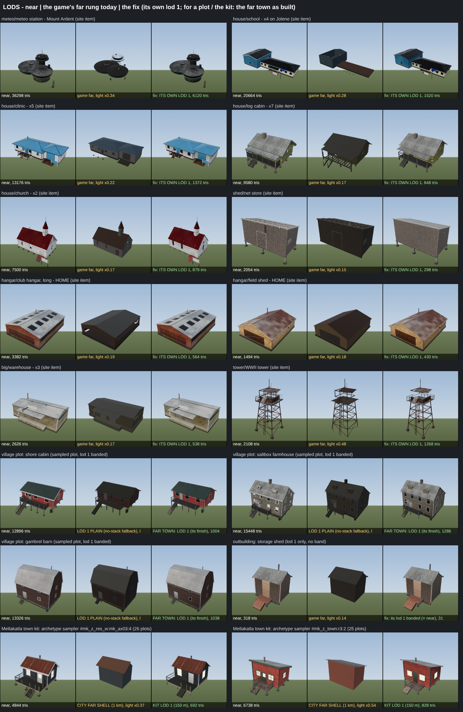

Made by `node tools/lods_sheet.js` (SwiftShader, headless; the numbers: `node tools/lods_audit.js`). Plan: [futureDesigns/LODS-2026-10.md](../../../futureDesigns/LODS-2026-10.md). The whole island's table: [audit.md](audit.md).

**light** = the rung's mean luminance over the near mesh's from camera C (1.00 = as bright); **black** = share of the rung's pixels darker than sRGB 38 from camera A; **leak** = share of the view looking INTO the building (25 views); **hole** = share of the near view where the rung shows something more than max(1.5 m, R/10) behind the near mesh's outside (see-through, a missing roof or storey); **roof** = the near mesh's roofed plan still roofed from straight above.

## meteo/meteo station - Mount Ardent (site item)

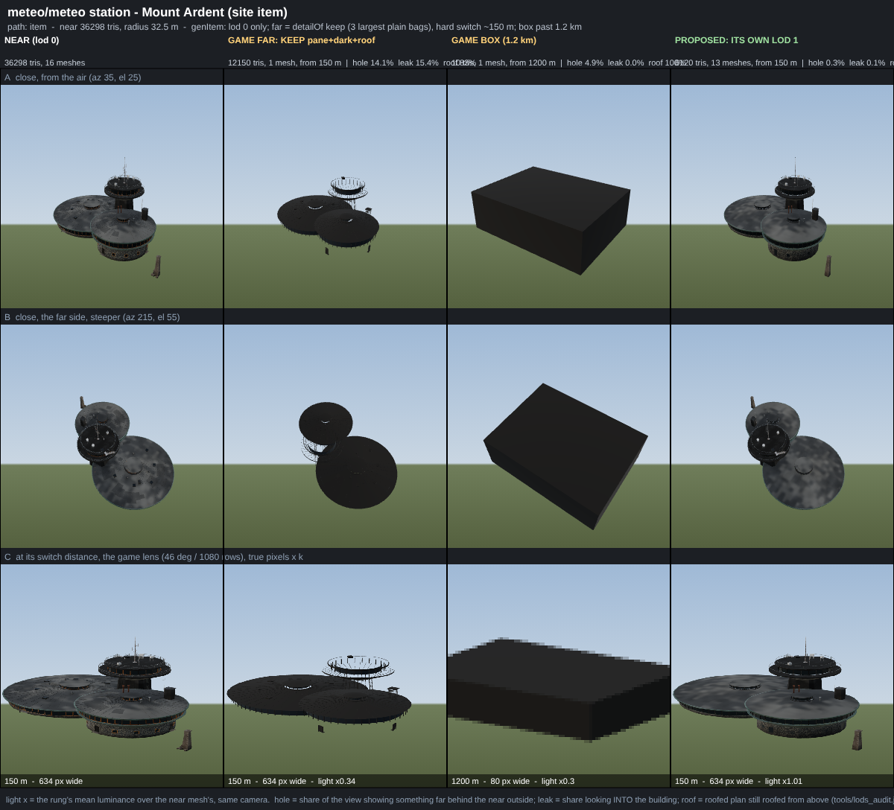

| rung | tris | meshes | from m | leak | hole | roof | light | black |
|---|---|---|---|---|---|---|---|---|
| NEAR (lod 0) | 36298 | 16 | - |  |  |  | 1.00 | 21% |
| GAME FAR: KEEP pane+dark+roof | 12150 | 1 | 150 | 15% | 14% | 83% | 0.34 | 71% |
| GAME BOX (1.2 km) | 10 | 1 | 1200 | 0.0% | 4.9% | 100% | 0.30 | 61% |
| PROPOSED: ITS OWN LOD 1 | 6120 | 13 | 150 | 0.1% | 0.3% | 100% | 1.01 | 26% |

## house/school - x4 on Jolene (site item)

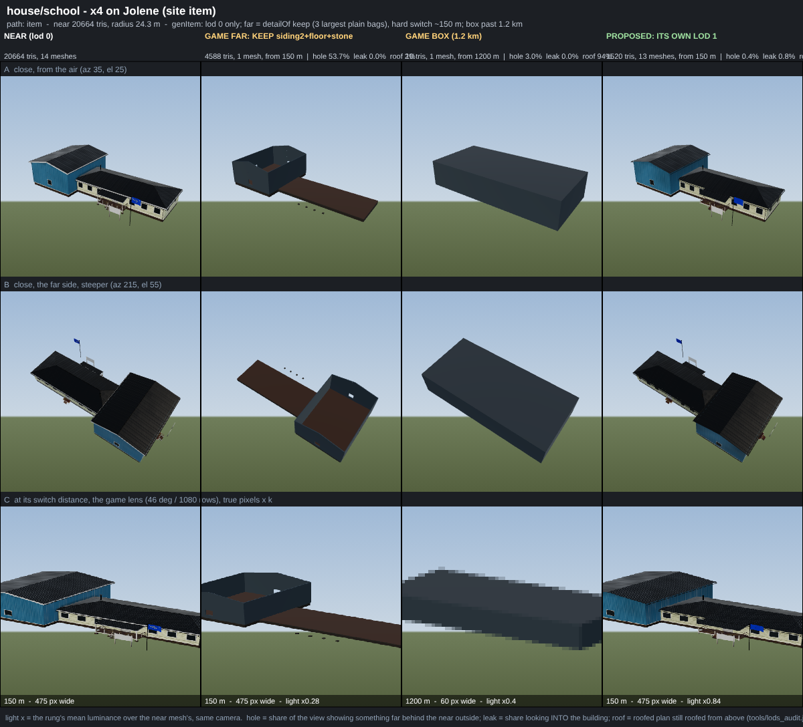

| rung | tris | meshes | from m | leak | hole | roof | light | black |
|---|---|---|---|---|---|---|---|---|
| NEAR (lod 0) | 20664 | 14 | - |  |  |  | 1.00 | 35% |
| GAME FAR: KEEP siding2+floor+stone | 4588 | 1 | 150 | 0.0% | 54% | 2.4% | 0.28 | 7.5% |
| GAME BOX (1.2 km) | 10 | 1 | 1200 | 0.0% | 3.0% | 95% | 0.40 | 0.0% |
| PROPOSED: ITS OWN LOD 1 | 1520 | 13 | 150 | 0.8% | 0.4% | 97% | 0.84 | 36% |

## house/clinic - x5 (site item)

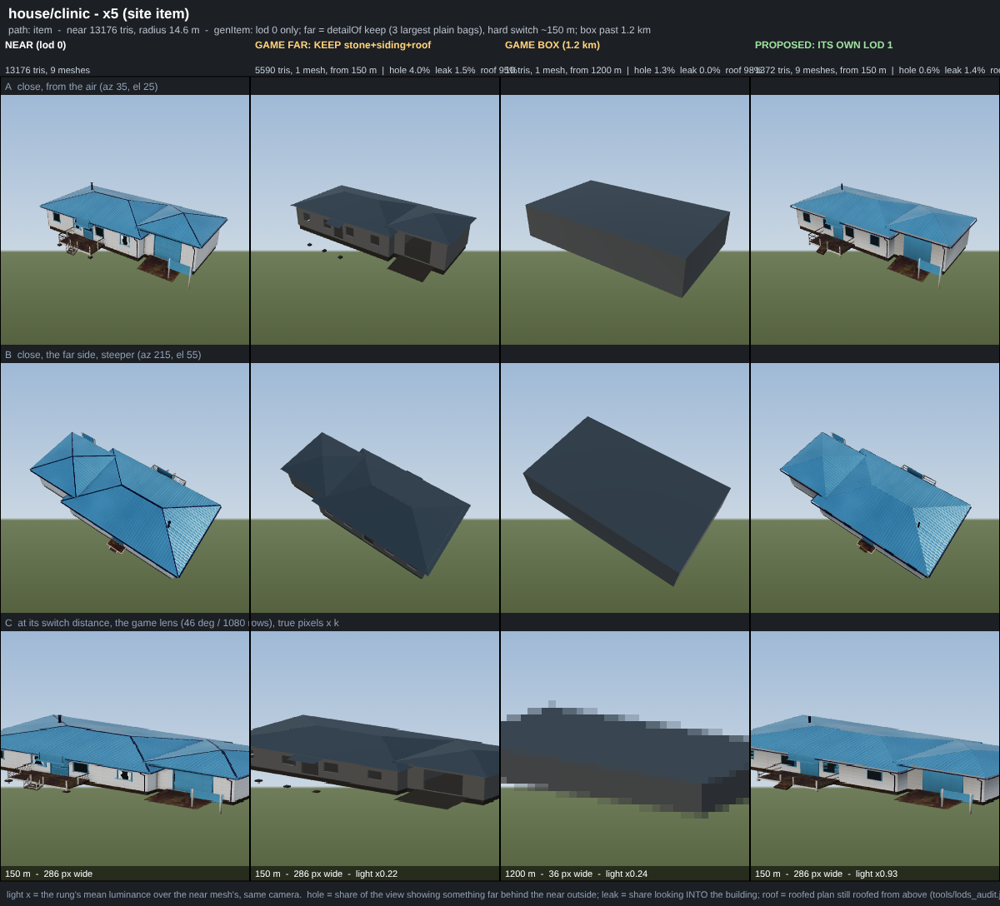

| rung | tris | meshes | from m | leak | hole | roof | light | black |
|---|---|---|---|---|---|---|---|---|
| NEAR (lod 0) | 13176 | 9 | - |  |  |  | 1.00 | 3.1% |
| GAME FAR: KEEP stone+siding+roof | 5590 | 1 | 150 | 1.5% | 4.0% | 95% | 0.22 | 4.9% |
| GAME BOX (1.2 km) | 10 | 1 | 1200 | 0.0% | 1.3% | 98% | 0.24 | 0.0% |
| PROPOSED: ITS OWN LOD 1 | 1372 | 9 | 150 | 1.4% | 0.6% | 100% | 0.93 | 4.2% |

## house/log cabin - x7 (site item)

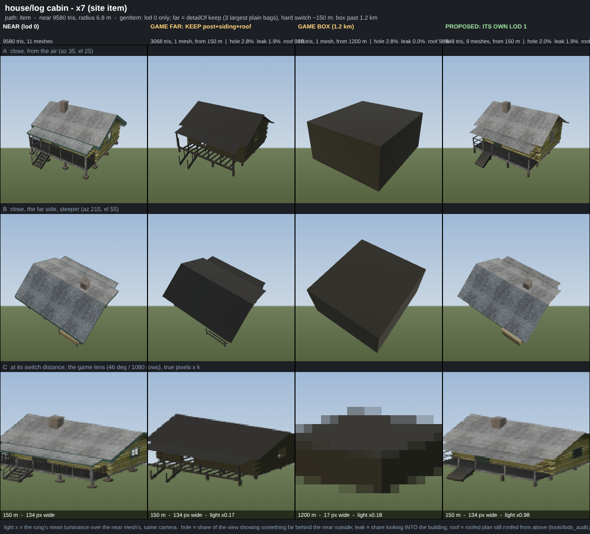

| rung | tris | meshes | from m | leak | hole | roof | light | black |
|---|---|---|---|---|---|---|---|---|
| NEAR (lod 0) | 9580 | 11 | - |  |  |  | 1.00 | 6.9% |
| GAME FAR: KEEP post+siding+roof | 3068 | 1 | 150 | 1.9% | 2.8% | 98% | 0.17 | 15% |
| GAME BOX (1.2 km) | 10 | 1 | 1200 | 0.0% | 2.8% | 98% | 0.18 | 21% |
| PROPOSED: ITS OWN LOD 1 | 848 | 9 | 150 | 1.9% | 2.0% | 98% | 0.98 | 2.7% |

## house/church - x2 (site item)

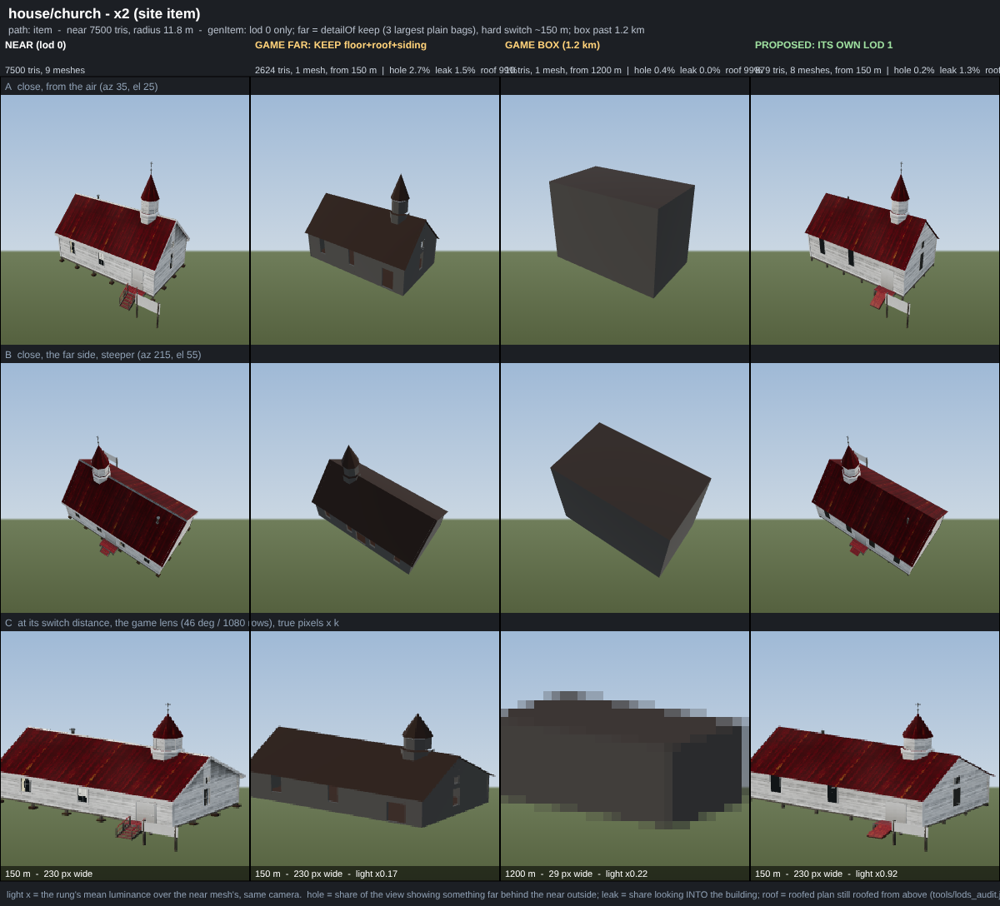

| rung | tris | meshes | from m | leak | hole | roof | light | black |
|---|---|---|---|---|---|---|---|---|
| NEAR (lod 0) | 7500 | 9 | - |  |  |  | 1.00 | 1.0% |
| GAME FAR: KEEP floor+roof+siding | 2624 | 1 | 150 | 1.5% | 2.7% | 99% | 0.17 | 2.3% |
| GAME BOX (1.2 km) | 10 | 1 | 1200 | 0.0% | 0.4% | 99% | 0.22 | 0.0% |
| PROPOSED: ITS OWN LOD 1 | 879 | 8 | 150 | 1.3% | 0.2% | 100% | 0.92 | 2.3% |

## shed/net store (site item)

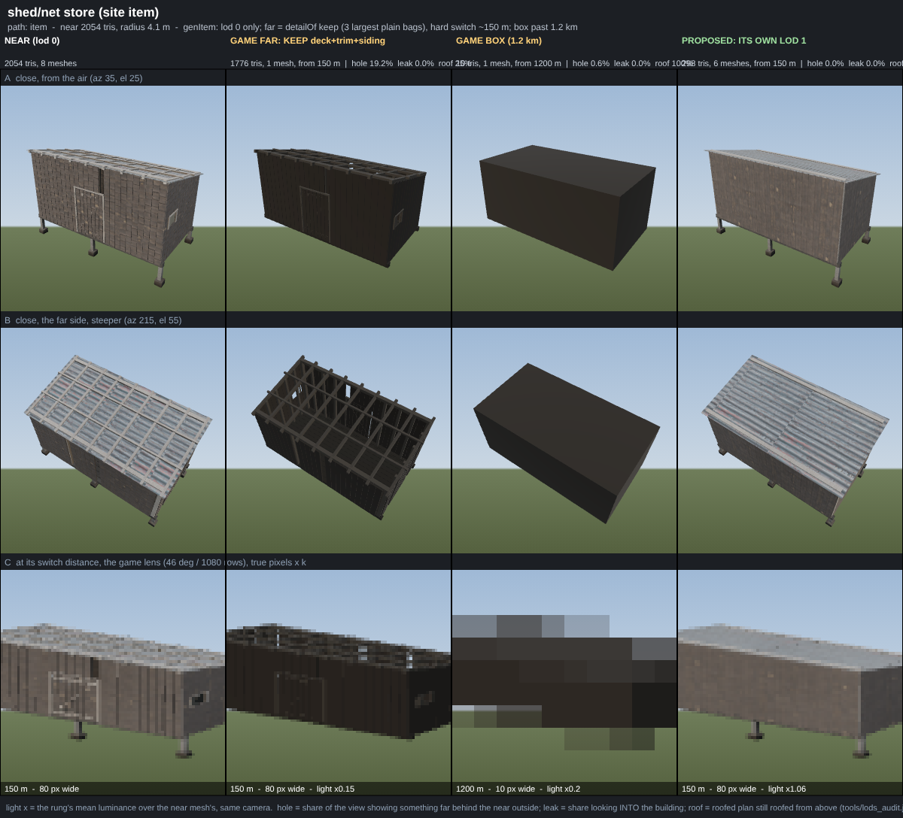

| rung | tris | meshes | from m | leak | hole | roof | light | black |
|---|---|---|---|---|---|---|---|---|
| NEAR (lod 0) | 2054 | 8 | - |  |  |  | 1.00 | 0.5% |
| GAME FAR: KEEP deck+trim+siding | 1776 | 1 | 150 | 0.0% | 19% | 26% | 0.15 | 25% |
| GAME BOX (1.2 km) | 10 | 1 | 1200 | 0.0% | 0.6% | 100% | 0.20 | 14% |
| PROPOSED: ITS OWN LOD 1 | 298 | 6 | 150 | 0.0% | 0.0% | 100% | 1.06 | 0.4% |

## hangar/club hangar, long - HOME (site item)

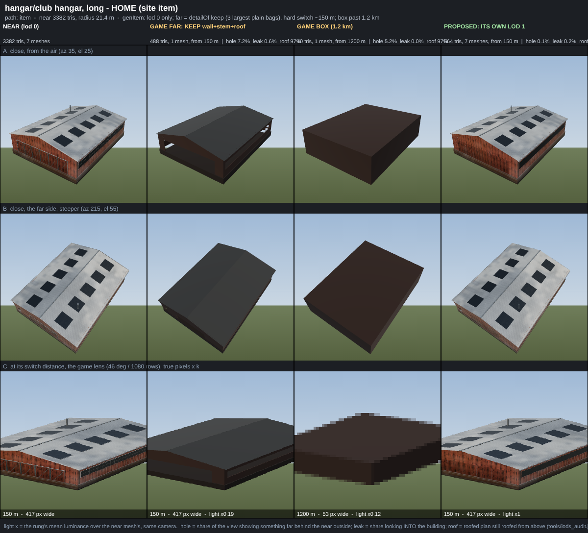

| rung | tris | meshes | from m | leak | hole | roof | light | black |
|---|---|---|---|---|---|---|---|---|
| NEAR (lod 0) | 3382 | 7 | - |  |  |  | 1.00 | 3.9% |
| GAME FAR: KEEP wall+stem+roof | 488 | 1 | 150 | 0.6% | 7.2% | 97% | 0.19 | 16% |
| GAME BOX (1.2 km) | 10 | 1 | 1200 | 0.0% | 5.2% | 97% | 0.12 | 18% |
| PROPOSED: ITS OWN LOD 1 | 564 | 7 | 150 | 0.2% | 0.1% | 100% | 1.00 | 4.8% |

## hangar/field shed - HOME (site item)

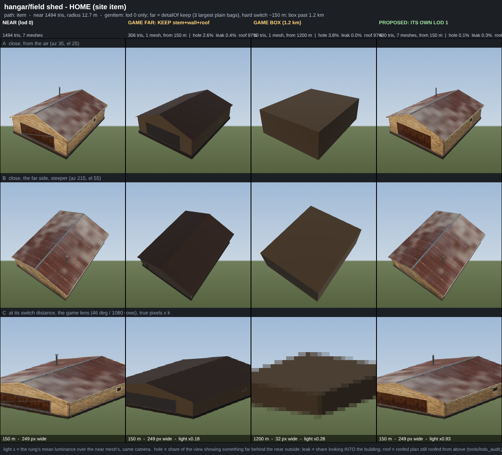

| rung | tris | meshes | from m | leak | hole | roof | light | black |
|---|---|---|---|---|---|---|---|---|
| NEAR (lod 0) | 1494 | 7 | - |  |  |  | 1.00 | 1.2% |
| GAME FAR: KEEP stem+wall+roof | 306 | 1 | 150 | 0.4% | 2.6% | 97% | 0.18 | 5.9% |
| GAME BOX (1.2 km) | 10 | 1 | 1200 | 0.0% | 3.8% | 97% | 0.28 | 0.0% |
| PROPOSED: ITS OWN LOD 1 | 430 | 7 | 150 | 0.3% | 0.1% | 100% | 0.93 | 1.2% |

## big/warehouse - x3 (site item)

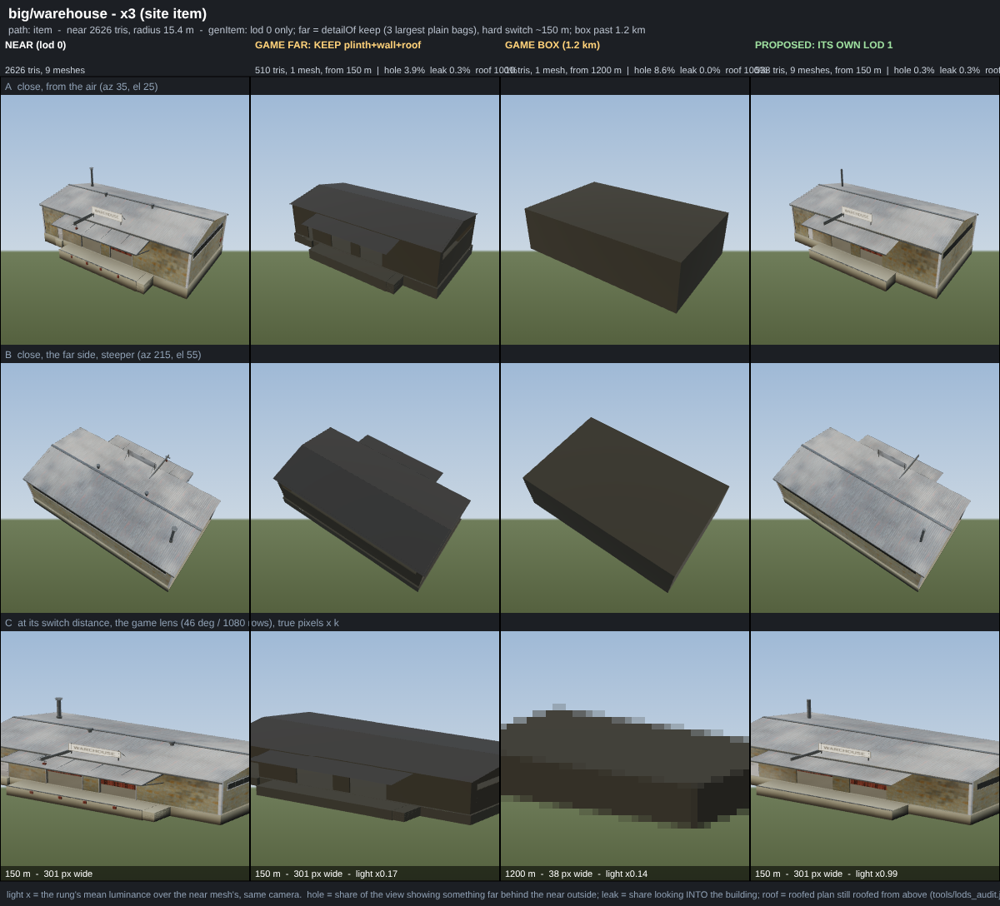

| rung | tris | meshes | from m | leak | hole | roof | light | black |
|---|---|---|---|---|---|---|---|---|
| NEAR (lod 0) | 2626 | 9 | - |  |  |  | 1.00 | 1.0% |
| GAME FAR: KEEP plinth+wall+roof | 510 | 1 | 150 | 0.3% | 4.0% | 100% | 0.17 | 0.1% |
| GAME BOX (1.2 km) | 10 | 1 | 1200 | 0.0% | 8.6% | 100% | 0.14 | 0.0% |
| PROPOSED: ITS OWN LOD 1 | 538 | 9 | 150 | 0.3% | 0.3% | 100% | 0.99 | 1.3% |

## tower/WWII tower (site item)

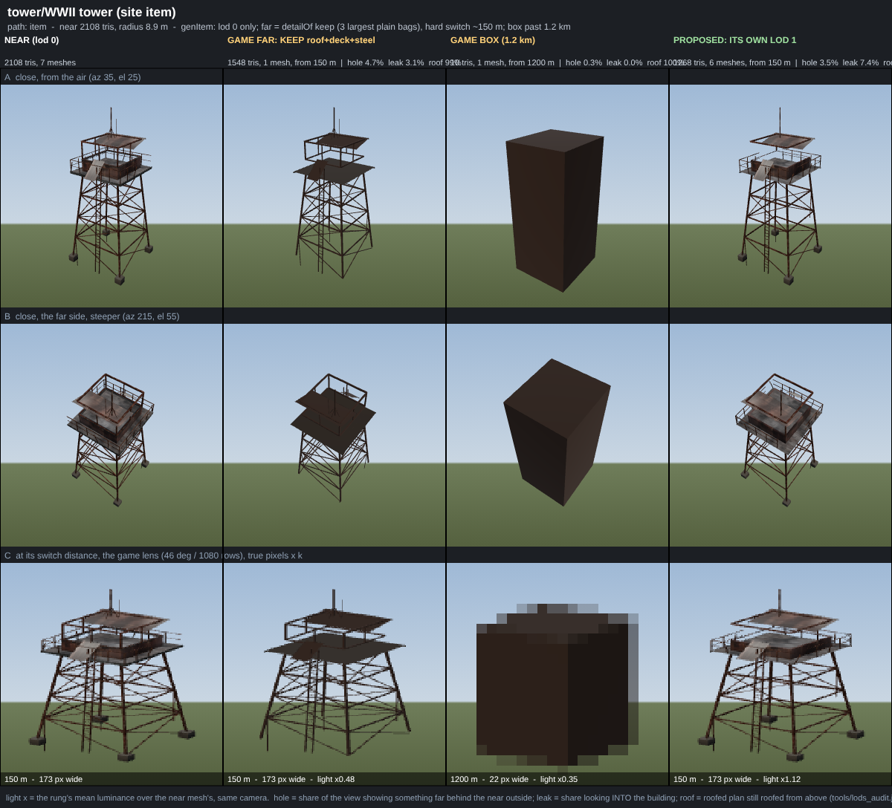

| rung | tris | meshes | from m | leak | hole | roof | light | black |
|---|---|---|---|---|---|---|---|---|
| NEAR (lod 0) | 2108 | 7 | - |  |  |  | 1.00 | 21% |
| GAME FAR: KEEP roof+deck+steel | 1548 | 1 | 150 | 3.1% | 4.7% | 99% | 0.48 | 18% |
| GAME BOX (1.2 km) | 10 | 1 | 1200 | 0.0% | 0.3% | 100% | 0.35 | 36% |
| PROPOSED: ITS OWN LOD 1 | 1268 | 6 | 150 | 7.4% | 3.5% | 99% | 1.12 | 21% |

## village plot: shore cabin (sampled plot, lod 1 banded)

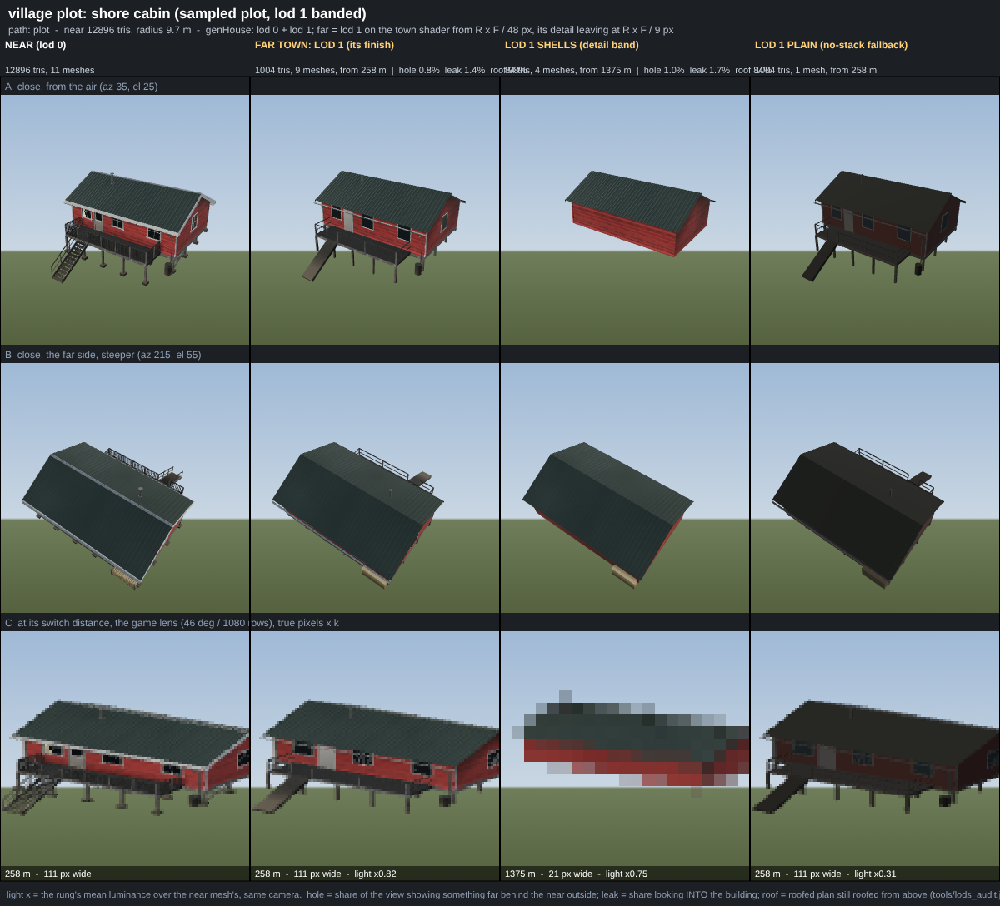

| rung | tris | meshes | from m | leak | hole | roof | light | black |
|---|---|---|---|---|---|---|---|---|
| NEAR (lod 0) | 12896 | 11 | - |  |  |  | 1.00 | 7.8% |
| FAR TOWN: LOD 1 (its finish) | 1004 | 9 | 258 | 1.4% | 0.8% | 98% | 0.82 | 5.2% |
| LOD 1 SHELLS (detail band) | 84 | 4 | 1375 | 1.7% | 1.0% | 84% | 0.75 | 0.1% |
| LOD 1 PLAIN (no-stack fallback) | 1004 | 1 | 258 |  |  |  | 0.31 | 21% |

## village plot: saltbox farmhouse (sampled plot, lod 1 banded)

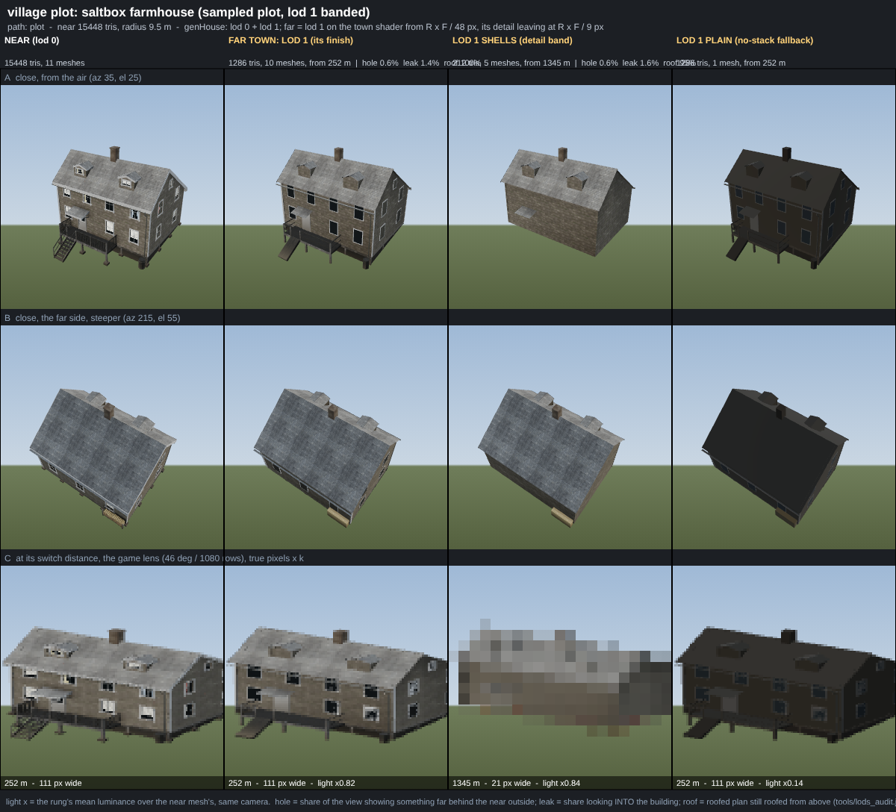

| rung | tris | meshes | from m | leak | hole | roof | light | black |
|---|---|---|---|---|---|---|---|---|
| NEAR (lod 0) | 15448 | 11 | - |  |  |  | 1.00 | 5.1% |
| FAR TOWN: LOD 1 (its finish) | 1286 | 10 | 252 | 1.4% | 0.6% | 100% | 0.82 | 6.4% |
| LOD 1 SHELLS (detail band) | 212 | 5 | 1345 | 1.6% | 0.6% | 95% | 0.84 | 0.1% |
| LOD 1 PLAIN (no-stack fallback) | 1286 | 1 | 252 |  |  |  | 0.14 | 27% |

## village plot: gambrel barn (sampled plot, lod 1 banded)

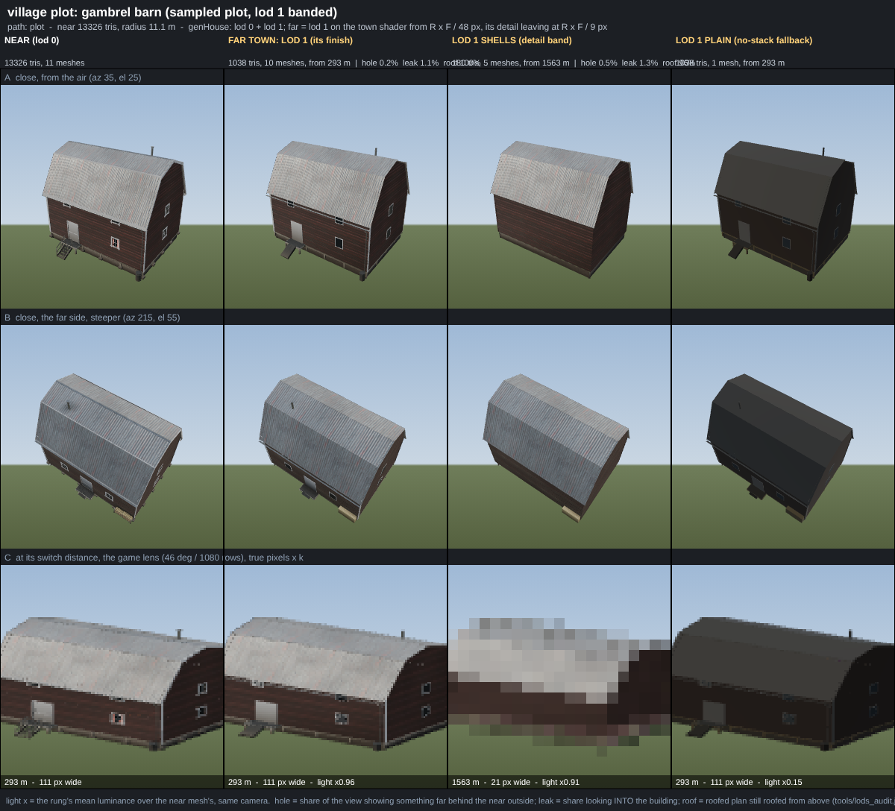

| rung | tris | meshes | from m | leak | hole | roof | light | black |
|---|---|---|---|---|---|---|---|---|
| NEAR (lod 0) | 13326 | 11 | - |  |  |  | 1.00 | 3.4% |
| FAR TOWN: LOD 1 (its finish) | 1038 | 10 | 293 | 1.1% | 0.2% | 100% | 0.96 | 6.0% |
| LOD 1 SHELLS (detail band) | 180 | 5 | 1563 | 1.3% | 0.5% | 96% | 0.91 | 5.4% |
| LOD 1 PLAIN (no-stack fallback) | 1038 | 1 | 293 |  |  |  | 0.15 | 42% |

## outbuilding: storage shed (lod 1 only, no band)

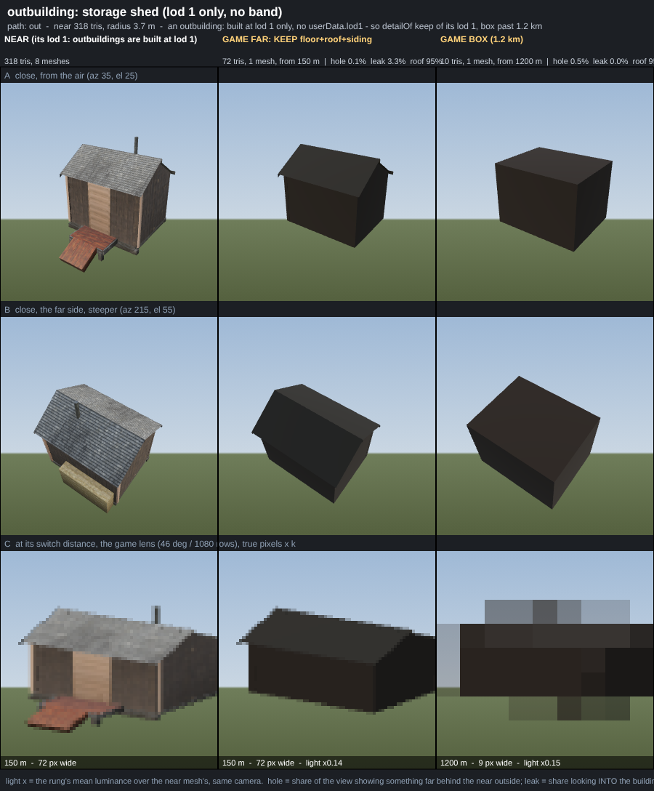

| rung | tris | meshes | from m | leak | hole | roof | light | black |
|---|---|---|---|---|---|---|---|---|
| NEAR (its lod 1: outbuildings are built at lod 1) | 318 | 8 | - |  |  |  | 1.00 | 0.3% |
| GAME FAR: KEEP floor+roof+siding | 72 | 1 | 150 | 3.3% | 0.1% | 95% | 0.14 | 20% |
| GAME BOX (1.2 km) | 10 | 1 | 1200 | 0.0% | 0.5% | 95% | 0.15 | 21% |

## Metlakatla town kit: archetype sampler #mk_z_res_w:mk_ax03:4 (26 plots)

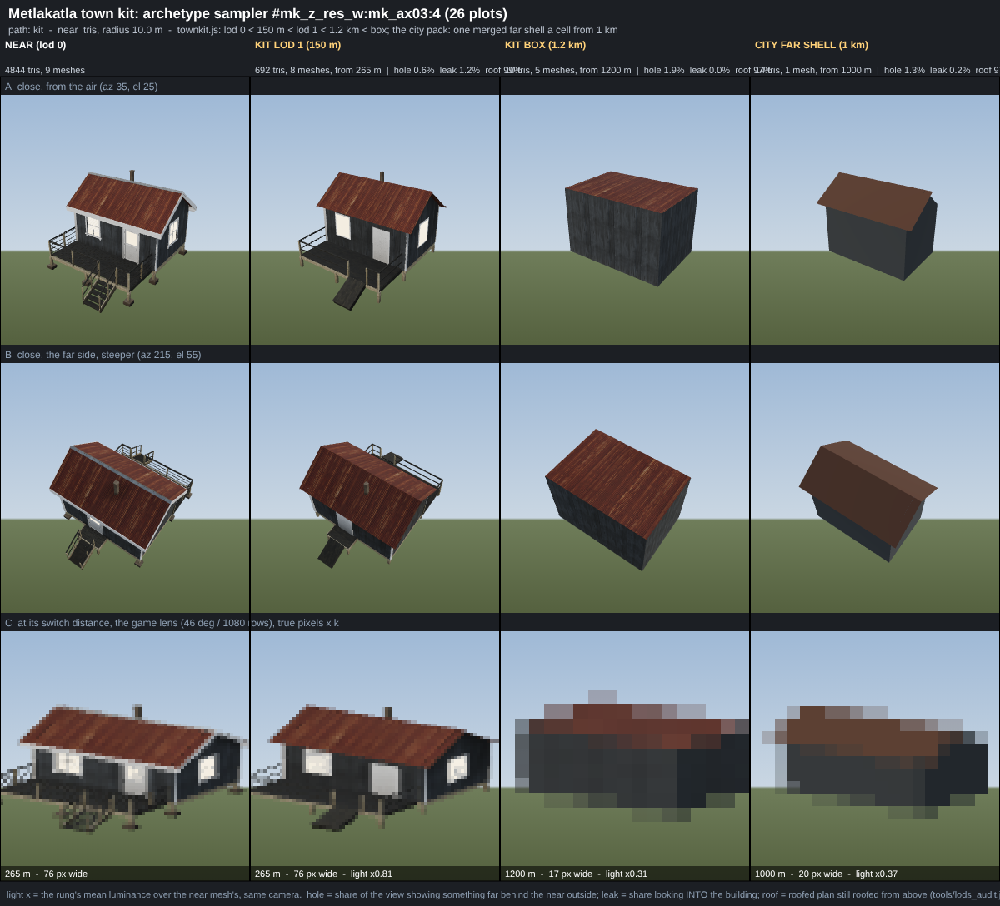

| rung | tris | meshes | from m | leak | hole | roof | light | black |
|---|---|---|---|---|---|---|---|---|
| NEAR (lod 0) | 4844 | 9 | - |  |  |  | 1.00 | 8.9% |
| KIT LOD 1 (150 m) | 692 | 8 | 265 | 1.2% | 0.6% | 99% | 0.81 | 13% |
| KIT BOX (1.2 km) | 10 | 5 | 1200 | 0.0% | 1.9% | 97% | 0.31 | 0.1% |
| CITY FAR SHELL (1 km) | 14 | 1 | 1000 | 0.2% | 1.4% | 97% | 0.37 | 0.0% |

## Metlakatla town kit: archetype sampler #mk_z_town:r3:2 (25 plots)

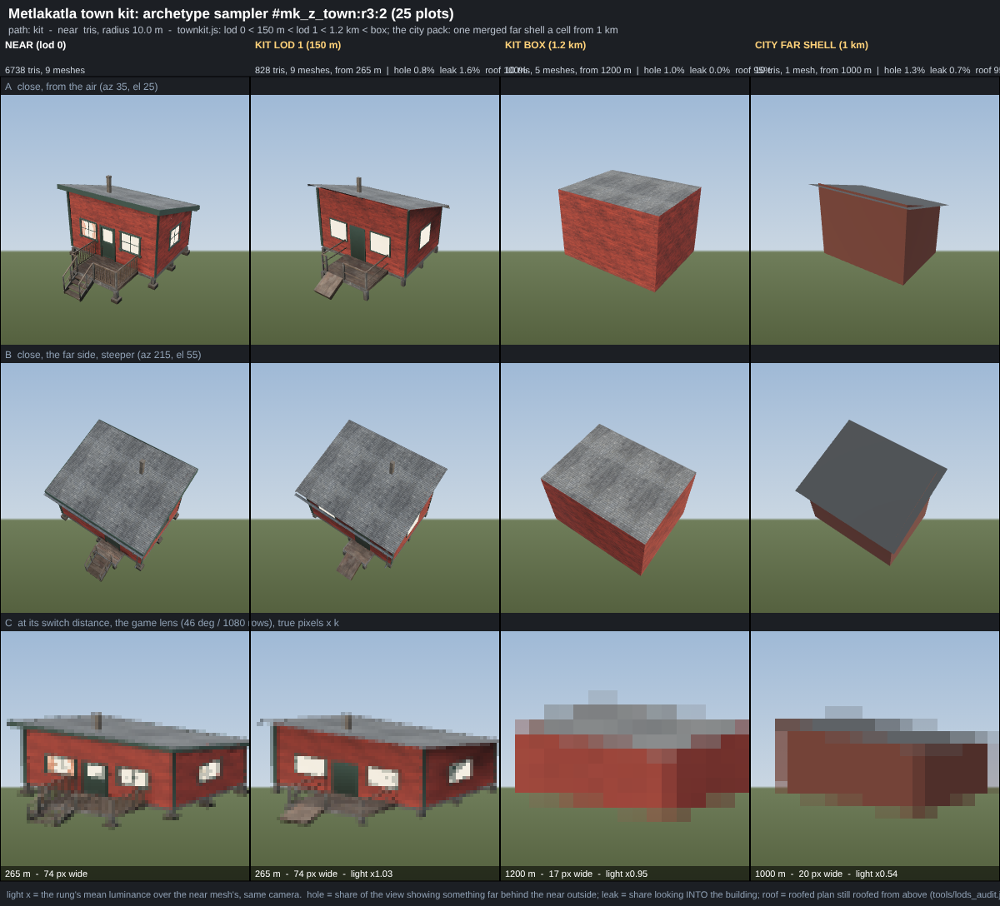

| rung | tris | meshes | from m | leak | hole | roof | light | black |
|---|---|---|---|---|---|---|---|---|
| NEAR (lod 0) | 6738 | 9 | - |  |  |  | 1.00 | 1.4% |
| KIT LOD 1 (150 m) | 828 | 9 | 265 | 1.6% | 0.8% | 100% | 1.03 | 0.2% |
| KIT BOX (1.2 km) | 10 | 5 | 1200 | 0.0% | 1.0% | 95% | 0.95 | 0.0% |
| CITY FAR SHELL (1 km) | 10 | 1 | 1000 | 0.7% | 1.3% | 95% | 0.54 | 0.0% |

